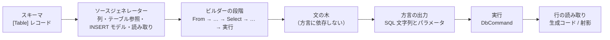
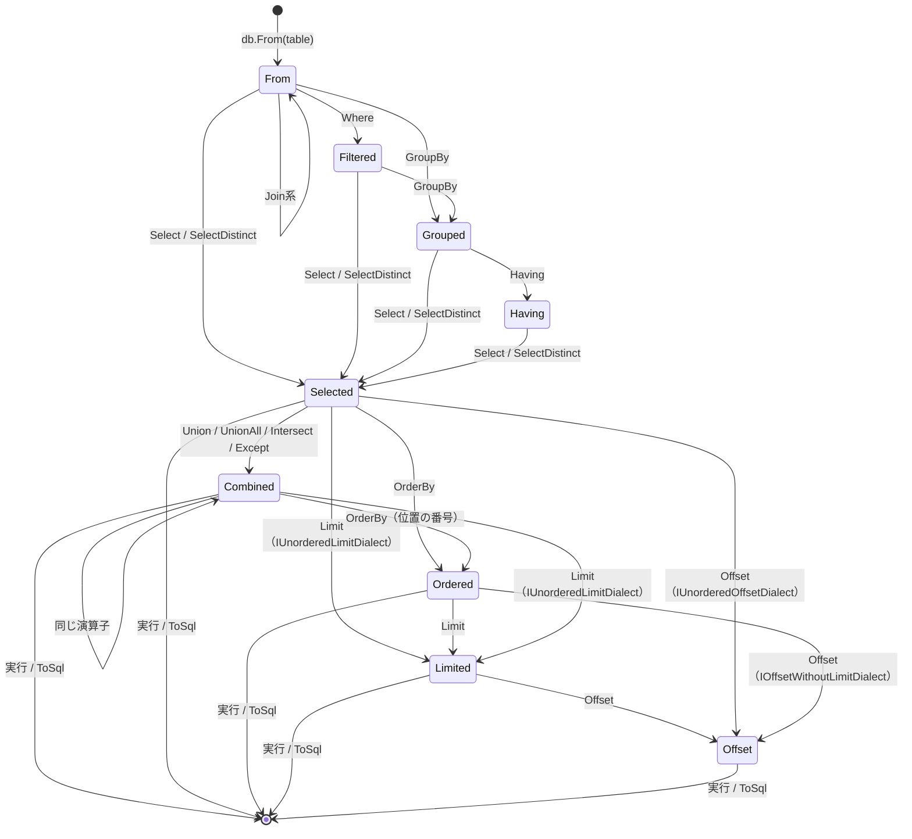

# AuraORM 設計書

本書は AuraORM の設計の正本である。契約・公開 API・生成される SQL・型安全性の保証・不変条件・フェーズはここで決める。変更は `design` Issue と設計 PR を通す（`.cursor/rules/design-docs.mdc`）。退けた案とその理由は [design-decisions.md](./design-decisions.md)、作業の順序は [roadmap.md](./roadmap.md) にある。

各データベースについての主張には、確認した一次資料を付ける。資料の一覧は §19 にある。

## 0. コンセプト

### 0.1 三つの約束

AuraORM は .NET 向けの型付き SQL クエリビルダーである。オブジェクトとテーブルを対応づけて変更を追跡する ORM ではない。C# で SQL を書くための道具であり、次の三つを約束する。

1. **SQL の柔軟性を損なわない。** API は SQL の句に一つずつ対応する。対象のデータベースで正しい SQL のうち API で表せるものは、すべてコンパイルが通る。API で表せない部分は生 SQL の断片（§11）で書ける。その場合も値はパラメータとして渡り、型は保たれる。
2. **生成される SQL を予測できる。** ビルダーの呼び出し一つが SQL の句一つになる。ライブラリは、呼び出し側が書いていないクエリ、結合、サブクエリ、`DISTINCT`、`ORDER BY`、`LIMIT`、往復を足さない。同じビルダーの連鎖は、値や実行環境によらず同じ SQL 文字列になる。例外は、呼び出し側が渡した一覧の要素の数（`In` の値の数、複数行の INSERT の行数）と INSERT で設定した列で、これらは文の形の一部として SQL を変える（§4.2、§6）。すべてのクエリは、接続なしで SQL とパラメータを返せる（`ToSql()`）。方言ごとの SQL は本書に書き、ゴールデンテストで固定する。
3. **不正なクエリだけを、徹底して型で防ぐ。** クエリにないテーブルの列、型の違う比較、順序の誤った句、`INSERT` の必須列の欠落、`WHERE` のない `UPDATE` / `DELETE`、集計と非集計の混在、そのデータベースにない機能は、コンパイルエラーになる。型で表せないものだけを実行前の検査に回し、その一覧を §14.3 に書く。

さらに、次の二つを前提とする。

- **NativeAOT とトリミングに対応する。** リフレクション、式ツリー、動的コード生成を使わない。行の読み取りなど型ごとのコードは、ソースジェネレーターがコンパイル時に作る。
- **軽量である。** ランタイムのライブラリは .NET の基本ライブラリと `System.Data.Common` だけに依存する。ADO.NET プロバイダーは利用者が選ぶ。

### 0.2 想定する書き手

書き手は人間と AI エージェントの両方である。エージェントは、それらしく見えるが誤ったクエリを書き、実行時まで気づかないことがある。AuraORM は、そうした誤りをコンパイルエラーとして示す。エラーには固定の ID があり、メッセージは直し方を示す（§15）。エラーにならないクエリは、`ToSql()` で人間が読んで確かめられる。

### 0.3 他のライブラリとの位置づけ

| ライブラリ | SQL の書き方 | AuraORM との違い |
| --- | --- | --- |
| EF Core | LINQ をプロバイダーが SQL に翻訳する。変更追跡、ナビゲーション、遅延読み込みがある | AuraORM は翻訳しない。呼び出しと SQL の句が一対一に対応する。変更追跡はない |
| Dapper | SQL を文字列で書き、結果を型に対応づける | AuraORM は列と型をコンパイル時に検査する。生 SQL を使う場合も、値は補間からパラメータになる |
| Drizzle ORM（TypeScript） | スキーマを TypeScript で定義し、SQL に近いビルダーで書く | 考え方の手本である。AuraORM は C# の型でこれを実現し、集計の正しさや方言の機能差まで型で扱う |
| jOOQ（Java）、Kysely（TypeScript） | 型付きの SQL ビルダー | 方向は同じ。AuraORM は列をラムダの引数からしか取れないようにし、FROM にないテーブルの参照を構造的に防ぐ |

## 1. 要件

### 1.1 機能要件

| ID | 要件 |
| --- | --- |
| R1 | C# のレコード（またはクラス）と属性でテーブルを定義できる。ソースジェネレーターが、型付きの列、テーブル参照、INSERT のモデル、行の読み取りを生成する |
| R2 | SELECT: FROM、全種類の JOIN、WHERE、GROUP BY、HAVING、集計、射影、DISTINCT、ORDER BY、LIMIT / OFFSET、UNION / INTERSECT / EXCEPT、サブクエリ（IN、EXISTS、スカラー）、派生テーブル、CTE |
| R3 | INSERT（複数行）、UPDATE、DELETE と、方言が持つ場合の RETURNING |
| R4 | UPSERT（SQLite / PostgreSQL の `ON CONFLICT`、MySQL / MariaDB の `ON DUPLICATE KEY UPDATE`） |
| R5 | 型付きの生 SQL 断片と、生 SQL のクエリ・コマンド。補間の値はパラメータになる |
| R6 | 実行: 結果の一覧、ストリーミング、単一行、影響行数。トランザクション。キャンセル |
| R7 | 値コンバーター（利用者の型と、データベースが扱う型の変換） |
| R8 | DDL: CREATE / DROP TABLE と CREATE / DROP INDEX |
| R9 | すべてのクエリが、接続なしで SQL とパラメータを返せる |
| R10 | 対象の五つの方言（§1.3）すべてで、上のすべてが同じ API で使える。方言にない機能はコンパイルエラーになる |

### 1.2 非機能要件

| ID | 要件 |
| --- | --- |
| N1 | `net8.0` 以降で動く。NativeAOT で発行したアプリで、トリミングと AOT の警告がゼロのまま使える |
| N2 | ランタイムのライブラリはパッケージに依存しない。ソースジェネレーターは同じパッケージに入る |
| N3 | ジェネレーターが利用者のプロジェクトに出力するコードは、C# 12（`net8.0` の既定）でコンパイルできる |
| N4 | 行の読み取りは、結果そのもの（行のオブジェクト、文字列、配列）のほかにメモリを確保しない。値をボックス化しない |
| N5 | 生成される SQL は、カルチャ、時刻、タイムゾーン、バインドする値に依存しない |
| N6 | 生 SQL 断片以外で、呼び出し側の値が SQL の文字列に入ることはない。識別子は常にクォートする |

### 1.3 対象のデータベース

v0.1 の公開時にサポート期間中のメジャーバージョンを対象とする。最小バージョンは、本書が使う構文をすべて持つものにした。サポート期間は 2026-10-23 に確かめた（§19）。

| 方言 | 最小バージョン | 主な理由 |
| --- | --- | --- |
| SQLite | 3.39 | RIGHT / FULL JOIN（3.39.0）、RETURNING（3.35.0） |
| PostgreSQL | 15 | 14 のサポートは 2026-11-12 に終わる |
| MySQL | 8.4 | 8.0 系のサポートは 2026 年 4 月に終わった。INTERSECT / EXCEPT（8.0.31）、行の別名を使う `ON DUPLICATE KEY UPDATE`（8.0.19） |
| MariaDB | 10.11 | 10.6 のコミュニティサポートは 2026-07-06 に終わった。10.11 は 2028-02-16 まで |
| SQL Server | 2019 | `IS [NOT] DISTINCT FROM` は 2022 からなので、2019 では §4.2 の展開を使う |

MariaDB は MySQL とは別の方言の型にする（§2.4）。RETURNING と UPSERT の構文が違うからである。

### 1.4 範囲外

- **変更追跡、ナビゲーションプロパティ、遅延読み込み、Unit of Work。** クエリが予測できなくなる。
- **リレーショナルクエリ**（Drizzle の `db.query.users.findMany({ with: ... })` に当たるもの）。一つの呼び出しが、入れ子の集約や複数の文に展開され、約束 2 に反する。
- **LINQ プロバイダー（`IQueryable<T>`）。** 式ツリーを翻訳する方式であり、約束 2 と NativeAOT の前提に反する。
- **同期 API。** 実行はすべて非同期で行う（`docs/design-decisions.md`）。
- **利用者が方言を追加すること。** 方言は閉じた集合とする（§2.4）。

ほかに後のフェーズに回すものは §18 にある。

## 2. 全体の構成

### 2.1 パッケージとプロジェクト

パッケージは `AuraORM` の一つだけにする。

| プロジェクト | 中身 | 対象 |
| --- | --- | --- |
| `src/AuraORM` | ランタイム。式、ビルダー、方言ごとの SQL の出力、実行、行の読み取り | `net8.0`、`IsAotCompatible` |
| `src/AuraORM.Generators` | ソースジェネレーターとアナライザー。パッケージの `analyzers/dotnet/cs` に入る | `netstandard2.0` |

ジェネレーターが参照する `Microsoft.CodeAnalysis.CSharp` は 4.8 とする。これは .NET 8 SDK の最初のリリースに入っているコンパイラーの版であり、.NET 8 SDK のどの版でもジェネレーターを読み込める。

### 2.2 層



- ビルダーは、方言に依存しない文の木を作る。木を SQL にするのは方言の出力だけである。
- 方言の違いはすべて出力の層にあり、その規則は本書の各節に方言ごとに書く。
- ラムダは文を組み立てるときに一度だけ呼ばれ、式のオブジェクトを返す。ラムダを式ツリーとして解析することはしない。

### 2.3 名前空間と公開面

- 公開する型は名前空間 `AuraORM` に置く。利用者は `using AuraORM;` と `using static AuraORM.Sql;` で全機能を使える。
- 公開面は次に限る: `Database<TDialect>` と `Transaction<TDialect>`、接続を持たない `SqlBuilder<TDialect>`、その共通の基底の `DatabaseSession<TDialect>`、`DatabaseOptions`、生 SQL の断片 `SqlFragment`、結果の型が実装する `IQueryResult<TSelf>`、方言の型と機能のインターフェース、ビルダーの段階の型、式の型（`IExpr<T, TLevel>`、`Column<T>`、`Condition<TLevel>`、`IProjection<T, TLevel>`）、関数（`Sql`）、属性、`SqlStatement`、例外。
- 生成コードが呼ぶ型（`TableAlias` と、その `Column<T>` などのメソッド、`TableColumns<TRow>`、`NullableTableColumns<TRow>`、`InsertModel`、`ResultProjection<TResult, TLevel>`、`RowReader` とその `Read*` / `ReadNamed*`）も公開する。利用者のコードからは作れない（コンストラクターが `internal`）ので、列を得る道はラムダの引数だけのままである（§3.4）。
- 文の木、SQL の出力、パラメータの設定は `internal` にする。

### 2.4 方言

方言は型で表す。`Database<TDialect>` から作ったクエリは、すべて型引数に方言を持つ。

| 型 | データベース |
| --- | --- |
| `SqliteDialect` | SQLite |
| `PostgreSqlDialect` | PostgreSQL |
| `MySqlDialect` | MySQL |
| `MariaDbDialect` | MariaDB |
| `SqlServerDialect` | SQL Server |

方言の型は、持つ機能をインターフェースで宣言する。方言に依存する API は、型引数がそのインターフェースを満たすときだけ呼べる拡張メソッドにする。満たさない方言で呼ぶとコンパイルエラー（CS0311、または CS1061）になる。

| インターフェース | 意味 | SQLite | PostgreSQL | MySQL | MariaDB | SQL Server |
| --- | --- | --- | --- | --- | --- | --- |
| `IFullJoinDialect` | FULL OUTER JOIN | ✓ | ✓ | | | ✓ |
| `IInsertReturningDialect` | INSERT の結果を返す | ✓ | ✓ | | ✓ | ✓ |
| `IUpdateReturningDialect` | UPDATE の結果を返す | ✓ | ✓ | | | ✓ |
| `IDeleteReturningDialect` | DELETE の結果を返す | ✓ | ✓ | | ✓ | ✓ |
| `IUnorderedLimitDialect` | ORDER BY のない LIMIT | ✓ | ✓ | ✓ | ✓ | |
| `IOffsetWithoutLimitDialect` | `ORDER BY` の後の、LIMIT のない OFFSET | | ✓ | | | ✓ |
| `IUnorderedOffsetDialect` | `ORDER BY` も LIMIT もない OFFSET | | ✓ | | | |
| `ILimitInSubqueryDialect` | `IN` / `NOT IN` のサブクエリの LIMIT（§5.11） | ✓ | ✓ | | | ✓ |
| `IOnConflictDialect` | `ON CONFLICT` による UPSERT | ✓ | ✓ | | | |
| `IOnDuplicateKeyDialect` | `ON DUPLICATE KEY UPDATE` による UPSERT | | | ✓ | ✓ | |
| `ICreateTableIfNotExistsDialect` | `CREATE TABLE IF NOT EXISTS` | ✓ | ✓ | ✓ | ✓ | |
| `ICreateIndexIfNotExistsDialect` | `CREATE INDEX IF NOT EXISTS` | ✓ | ✓ | | ✓ | |
| `IDropIndexIfExistsDialect` | `DROP INDEX IF EXISTS` | ✓ | ✓ | | ✓ | ✓ |
| `ITransactionalDdlDialect` | トランザクションの中の DDL（§13.1） | ✓ | ✓ | | | ✓ |

方言は閉じた集合であり、利用者は追加できない。方言の出力は `internal` であり、型から出力への対応は `typeof` の比較で決まる（リフレクションを使わない）。

## 3. スキーマの定義

### 3.1 テーブルの宣言

テーブルは、`[Table]` を付けた `partial` なレコードかクラスで宣言する。この型が行の型になる。

```csharp
[Table("users")]
public sealed partial record User(
    [PrimaryKey, AutoIncrement] long Id,
    [MaxLength(100)] string Name,
    int? Age,
    [Default(SqlDefault.CurrentTimestamp)] DateTime CreatedAt);
```

- 位置指定のレコードでは、主コンストラクターの引数が列になる。それに加えて、`get` と `init`（または `set`）を持つ公開のインスタンスプロパティが列になる。テーブルはクラス（レコードクラス）であり、構造体はテーブルにできない（AURA0101）。
- 列の順序は宣言の順序である。この順序が `SELECT` の列の順序と DDL の列の順序になる。
- 列にしないプロパティには `[NotColumn]` を付ける。
- 列の NULL 可否は C# の型で決まる。`int?` と `string?` は NULL を許し、`int` と `string` は許さない。参照型の NULL 可否を読むため、テーブルの型は null 許容参照型が有効な文脈で宣言する（無効ならエラー AURA0102）。

属性:

| 属性 | 対象 | 意味 |
| --- | --- | --- |
| `[Table(name)]` | 型 | テーブル名。`Schema` でスキーマ名を、`Naming` で列名の規則を指定できる |
| `[Column(name)]` | 列 | 列名を指定する |
| `[PrimaryKey]` | 列 | 主キー。複数の列に付けると複合主キーになり、順序は宣言順 |
| `[AutoIncrement]` | 列 | データベースが値を振る整数の列。テーブルに一つだけで、単独の主キーでなければならない（複合主キーの一部にはできない。SQLite の `AUTOINCREMENT` は単独の `INTEGER PRIMARY KEY` にしか付かないため） |
| `[MaxLength(n)]` | 列 | 文字列とバイト列の最大長（DDL の型に使う）。1 以上（AURA0119）。方言の上限は §13.7 |
| `[Precision(p, s)]` | 列 | `decimal` の精度と位取り（DDL の型に使う）。`decimal` の列には必須（AURA0112）。精度は 1 以上、位取りは 0 以上で精度以下（AURA0119）。方言の上限は §13.7 |
| `[Default(...)]` | 列 | データベースの既定値。`SqlDefault` の値か、定数。定数は、C# の代入と同じく列の型に暗黙に変換できなければならない（`long` の列の `[Default(0)]`、範囲内の定数として `byte` の列の `[Default(1)]` は書ける。`byte` の列の `[Default(300)]` は AURA0113）。`SqlDefault.CurrentTimestamp` は `DateTime` と `DateTimeOffset` の列だけで、UTC の現在時刻になる（AURA0117、§13.3）。`null` は NULL を許す列だけで、配列と有限でない数は書けない（AURA0113）。INSERT で省略できるようになる。コンストラクターは `object?` を取る一つだけである（`SqlDefault` を取る多重定義があると、リテラルの `0` が列挙型に変換され `CurrentTimestamp` になるため） |
| `[DefaultSql(sql)]` | 列 | 既定値を生 SQL で書く。DDL にそのまま出る。INSERT で省略できるようになる |
| `[Unique]` | 列 | 単一列の一意制約。CREATE TABLE の表の制約になる（§13.4） |
| `[Index(name, members)]` | 型（複数可） | インデックス。列はメンバー名を `nameof` で並べ（`Members`）、`Unique` で一意にできる。`CreateIndexes` が作る（§13.4）。名前は同じスキーマのテーブルの間で一意（AURA0118） |
| `[References(typeof(T), nameof(T.Member))]` | 列 | 外部キー。参照先が `[Table]` の型の、単独の主キーか `[Unique]` の列で、その列の型が一致することをジェネレーターが検査する（§13.5） |
| `[ValueConverter(typeof(C))]` | 型、アセンブリ（複数可） | 値コンバーター（§3.6）。型に付けるとその型の、アセンブリに付けると `C` の `TModel` のコンバーターになる |
| `[NotColumn]` | プロパティ | 列にしない |

### 3.2 名前

- テーブル名は `[Table]` の引数がそのまま使われる。
- 列名の既定は、プロパティ（または引数）の名前そのままである。`CreatedAt` の列名は `CreatedAt` になる。
- `[Column("created_at")]` があればそれを使う。
- `[Table("users", Naming = ColumnNaming.SnakeCase)]` のとき、`[Column]` のない列の名前をスネークケースに変える。変換の規則は次のとおりで、ジェネレーターがコンパイル時に適用する。結果は生成コードの中に文字列として残る。
  1. 小文字または数字の直後の大文字の前に `_` を入れる（`CreatedAt` → `Created_At`）。
  2. 大文字が続き、その後に小文字が来るとき、最後の大文字の前に `_` を入れる（`HTTPCode` → `HTTP_Code`）。
  3. すべてを小文字にする（`created_at`、`http_code`）。
- 名前は SQL の中で常にクォートする（§5.12）。大文字と小文字は保たれる。

### 3.3 CLR の型と SQL の型

列に使える CLR の型と、DDL（§13）で使う方言ごとの SQL の型は次のとおり。nullable な値型（`int?` など）は、もとの型と同じ SQL の型で NULL を許す。

| CLR の型 | SQLite | PostgreSQL | MySQL / MariaDB | SQL Server |
| --- | --- | --- | --- | --- |
| `bool` | `INTEGER` | `boolean` | `BOOLEAN` | `bit` |
| `byte` | `INTEGER` | `smallint` | `TINYINT UNSIGNED` | `tinyint` |
| `short` | `INTEGER` | `smallint` | `SMALLINT` | `smallint` |
| `int` | `INTEGER` | `integer` | `INT` | `int` |
| `long` | `INTEGER` | `bigint` | `BIGINT` | `bigint` |
| `float` | `REAL` | `real` | `FLOAT` | `real` |
| `double` | `REAL` | `double precision` | `DOUBLE` | `float` |
| `decimal` | `TEXT` | `numeric(p,s)` | `DECIMAL(p,s)` | `decimal(p,s)` |
| `string` | `TEXT` | `text` / `varchar(n)` | `LONGTEXT` / `VARCHAR(n)` | `nvarchar(max)` / `nvarchar(n)` |
| `byte[]` | `BLOB` | `bytea` | `LONGBLOB` / `VARBINARY(n)` | `varbinary(max)` / `varbinary(n)` |
| `Guid` | `TEXT` | `uuid` | `CHAR(36)` | `uniqueidentifier` |
| `DateTime` | `TEXT` | `timestamp` | `DATETIME(6)` | `datetime2` |
| `DateTimeOffset` | `TEXT` | `timestamp with time zone` | `DATETIME(6)` | `datetimeoffset` |
| `DateOnly` | `TEXT` | `date` | `DATE` | `date` |
| `TimeOnly` | `TEXT` | `time` | `TIME(6)` | `time` |
| 列挙型 | 基になる整数型と同じ | 同左 | 同左 | 同左 |

- `string` と `byte[]` は `[MaxLength(n)]` があれば長さ付きの型、なければ長さのない型になる。
- `decimal` の列には `[Precision(p, s)]` が必須である（エラー AURA0112）。既定の精度を置くと、PostgreSQL、MySQL、SQL Server は位取りを超える桁を黙って丸め、SQLite は丸めないので、同じ値の読み書きが方言で変わるためである。SQLite の `TEXT` は値を正確に保つが、SQL の中での大小比較と算術は数値として行われない。
- SQLite では `decimal` の大小の比較（`Gt` / `Ge` / `Lt` / `Le` / `Between`）、`ORDER BY` のキー、`Min` / `Max` / `Sum` / `Avg` は、文を組み立てるときに `InvalidOperationException` になる（§14.3）。値が `TEXT` なので、大小の比較と並べ替えは文字列の順になる（SQLite 3.40 で `'9.5' > '10.25'` が真、`MAX` が `9.5` だった）。等しいかの比較（`Eq` / `Ne` / `In`）は正しいので許す。式の型は方言を持たないので、この誤りは型で止められない。EF Core の SQLite プロバイダーも、`decimal` の比較と並べ替えをデータベースでは行わない（クライアント側の評価にする）。
- `Guid` は Microsoft.Data.Sqlite の既定に合わせて SQLite では `TEXT`（`00000000-0000-0000-0000-000000000000` の形）で保存する。
- `DateTimeOffset` を MySQL / MariaDB の `DATETIME(6)` に保存すると、オフセットは保存されない（`DATETIME` はタイムゾーンを持たない）。
- 主キー、一意制約、インデックス、外部キーに使う `string` と `byte[]` の列は `[MaxLength]` が必須である（エラー AURA0110）。MySQL と SQL Server では、長さのない型にインデックスを張れないためである。
- 長さ、精度、キーの大きさの方言ごとの上限は §13.7 にある。超えると DDL の組み立てで `InvalidOperationException` になる。
- 値をパラメータにするときと、結果から読むときの変換は、ADO.NET プロバイダーに任せる。AuraORM は CLR の値をそのままパラメータの `Value` に入れ、型付きの取得メソッド（`GetInt64` など）か `GetFieldValue<T>` で読む。方言とプロバイダーの組み合わせごとの既知の差は §12.6 に書く。
- 表にない型はコンバーター（§3.6）で表にある型に変換する。どちらもなければエラー AURA0103 になる。

### 3.4 生成されるコード

`User` に対して、ジェネレーターは同じ `partial` 型の中に次を生成する。

| メンバー | 型 | 役割 |
| --- | --- | --- |
| `User.Table` | `Table<User, User.Columns, User.NullableColumns, User.Insert>` | テーブル参照。`db.From(User.Table)` のように使う |
| `User.Columns` | クラス | 列の集合。ラムダの引数になる。`IProjection<User, PerRow>` でもあり、`Select(u => u)` で行全体を表す |
| `User.NullableColumns` | クラス | 外部結合で NULL になりうる側の列の集合。各列は NULL を許す型になる。`IProjection<User?, PerRow>` |
| `User.Insert` | クラス | INSERT のモデル（§6） |
| `IQueryResult<User>` の実装 | 静的メンバー | 生のクエリ（§11.3）で、列名から行を読む。列名の一覧は `__AuraColumnNames` という private の静的フィールドに持つ |

- `User.Columns` の各プロパティは `Column<T>` 型で、`T` は列の CLR の型（`long`、`string`、`int?`）である。`[AutoIncrement]` の列は `ReadOnlyColumn<T>` で、UPDATE の代入先にできない（§7）。
- `User.NullableColumns` の各プロパティは `IExpr<T?, PerRow>` 型である。`long` の列は `long?`、`string` の列は `string?` になる。列ではないので、代入先にはできない。
- `User.Columns` と `User.NullableColumns` は、ライブラリだけが作れる。生成されるファクトリは、ライブラリの `internal` なコンストラクターを持つ `TableAlias` を受け取るので、利用者のコードからは作れない。列を得る方法は、ビルダーが渡すラムダの引数だけである。
- 生成コードは C# 12 でコンパイルでき、型名はすべて `global::` で修飾する。
- 利用者の型に、生成するメンバー（生成するクラスが基底の型から受け継ぐメンバーを含む）と同じ名前のメンバーがあればエラー AURA0104 になる。`__aura` で始まる名前も、生成コードのローカル変数などに使うので AURA0104 になる。メンバー名は生成コードの中で常に `@名前` と書くので、キーワードと同じ名前（`@class`）のメンバーも列にできる。

### 3.5 結果の型

テーブルではない型を、射影と生 SQL のクエリの結果にするときは `[QueryResult]` を付ける。

```csharp
[QueryResult]
public sealed partial record UserOrderTotal(string Name, decimal? Total);
```

ジェネレーターは次を生成する。

- `UserOrderTotal.RowProjection` と `UserOrderTotal.GroupProjection`: `required` な `init` プロパティを持つクラス。各プロパティの型は、前者が `IProjection<T, PerRow>`、後者が `IProjection<T, PerGroup>` で、`T` は対応するメンバーの型である（§4.5）。`GroupBy` のキーが一つの式なら、`Select` で `new UserOrderTotal.GroupProjection { Name = k, Total = Sum(o.Amount) }` のように使う。メンバーを書き忘れると CS9035、型や評価の段階が違うと CS0029 になる。
- `UserOrderTotal.Columns` と `UserOrderTotal.NullableColumns`: この型を派生テーブルと CTE（§5.11）の行として使うときの列の集合（外部結合の NULL 化した側では後者、§5.3）。各列は結果の型のメンバーに対応し、名前はメンバー名（`[Column]` があればその名前）である。行全体の射影（`Select(t => t)`）は `UserOrderTotal` として読む。
- 結果の型の行を返すクエリの `As("名前")`（拡張メソッド、§5.11）。`[Table]` の型にも、行全体を返すクエリの `As` を生成する。C# は制約から型引数を推論しないので、列の集合の型を結果の型から決めるには、型ごとに生成する必要がある。生成するのは名前空間の直下の静的クラス `UserOrderTotalNamedQueries`（入れ子の型では、外側の型の名前を前につなげる。`Outer.Item` なら `OuterItemNamedQueries`）で、型かそれを囲む型が公開でなければ `internal` にする。拡張メソッドは入れ子のクラスに置けないためである。射影の後、`Limit` の後、`Offset` の後の段階に `As` を置く。生成するクラスの名前が、同じ名前空間の別の型（利用者の型、または別の型から生成するクラス。`Outer.Item` と `OuterItem` はどちらも `OuterItemNamedQueries` になる）と同じなら、ジェネレーターが AURA0114 を報告する（そのままでは CS0101 になり、利用者のコードにない行の二重定義に見える）。
- `IQueryResult<UserOrderTotal>` の実装: 生のクエリ（§11.3）で、列名から値を読むコード。列名はメンバー名（`[Column]` があればその名前）である。

### 3.6 値コンバーター

利用者の型（強く型付けされた ID など）を列にするには、コンバーターを書き、モデルの型に `[ValueConverter]` で指定する。コンバーターは型ごとに一つで、その型の値は、どこに現れても同じコンバーターで変換される。

```csharp
[ValueConverter(typeof(UserIdConverter))]
public readonly record struct UserId(long Value);

public sealed class UserIdConverter : IValueConverter<UserId, long>
{
    public static long ToProvider(UserId value) => value.Value;
    public static UserId FromProvider(long value) => new(value);
}
```

- `IValueConverter<TModel, TProvider>` は静的抽象メンバーを持つインターフェースである。`TProvider` は §3.3 の表の、NULL を許さない型（列挙型を除く）でなければならない。`string` と `byte[]` は許す（`Email(string)` のような型）。`int?` のような NULL を許す値型と、`string?` の注釈は許さない。モデルの型（`TModel`）は §3.3 の表にない型でなければならない。表の型の変換を変えると、その型のすべての値の扱いが変わるからである。どちらかに反するとエラー AURA0105 になる。一つのコンバーターが `IValueConverter<,>` を二つ以上実装していても AURA0105 になる（どちらの変換を使うかが宣言の順で決まってしまうため。#83 のレビューで見つかった）。コンバーターを重ねる（`TProvider` がまたコンバーターを持つ）ことはできない。
- 自分で定義していない型（ほかのライブラリの型）には、アセンブリに `[assembly: ValueConverter(typeof(C))]` を書く。
- 一つの型に、見えるコンバーターが二つ以上あるとエラー AURA0115 になる。同じコンパイルの中の宣言と、参照するアセンブリの型に付いた宣言が対象である。
- 変換はどこでも型で決まる。列と比べる値（`Eq(u.Id, userId)`）、`In` の値の一覧、`Case` の値、`Values` の行、`Set` の値、生 SQL の穴（§11.1）、結果を読むとき（列、射影、`[QueryResult]` のメンバー、生のクエリ）のすべてで、同じコンバーターが呼ばれる。SQL の文字列は変わらない。列ごとに別の変換にはできない（同じ型を、ある列では `long`、別の列では `string` で保存することはできない）。
- NULL はコンバーターを通さない。`UserId?` の列の NULL はそのまま NULL のパラメータになり、読んだ NULL はそのまま `null` になる。NULL でない値には、同じコンバーターが使われる。
- データベースの中の比較と並べ替えは、変換後の値で行う。`Eq`、`Lt`、`In`、`OrderBy` は書け、並べ替えは変換後の値の順になる（C# の型の順ではない）。型の制約を持つ関数（数の `Add`、文字列の `Like` など）は、モデルの型には使えない（コンパイルエラー）。`Min` / `Max` も、§3.3 の型ごとと列挙型の多重定義しかないので、変換した型には使えない（コンパイルエラー）。総称の制約を広げると、`MAX` できない型（SQL Server の `bit` になる `bool`）まで通るからである。変換した型の集計は §18 の VC2 にする。変換後の型が `decimal` のとき、SQLite の `decimal` の検査（§3.3）を当てる。
- コンバーターが投げた例外は、包まずに呼び出し元に届く（`DbException` と同じく、§12）。
- 変換の登録: ジェネレーターは、コンバーターを宣言したアセンブリと、その型をテーブルの列か `[QueryResult]` のメンバーに使うアセンブリに、型とコンバーターを登録するモジュールの初期化子を出す。初期化子は、アセンブリごとに一つの internal のクラス `AuraORM.Generated.__AuraValueConverters` に置き、そのアセンブリで宣言したものと使うものをまとめて登録する。登録のコードはコンバーターとモデルの型の名前を書くので、宣言したアセンブリでは両方が public か internal でなければならない（private の入れ子の型などはエラー AURA0105）。使うアセンブリから見えない（参照するアセンブリの internal の）コンバーターは、使うアセンブリでは登録せず、宣言したアセンブリの登録に任せる。利用者のコードに同じ完全名の型があるとエラー AURA0116 になる（`.cursor/rules/engineering.mdc` の、生成する名前の衝突の検査）。生成物には `// <auto-generated/>` を付ける。ライブラリでの `[ModuleInitializer]` の警告 CA2255 は、その印のある生成物の中では出ず、利用者の手書きのコードの中では出る（#79 のレビューで、警告をエラーにし `AnalysisMode=All` にしたライブラリで確かめた）。登録は同じものを何度してもよい。.NET は、モジュールの初期化子を、そのモジュールの静的フィールドへの最初のアクセスか、メソッドの最初の呼び出しの時点か、それより前に実行する（ECMA-335 の補遺、§19）。そのため、モデルの型のコンストラクターを呼んだとき（`new UserId(1)`）か、テーブルや結果の型を使ったときには登録が済んでいる。
- 登録のない型の値をパラメータにするとき、または結果を読むときは、`InvalidOperationException` になる（§14.3）。宣言したアセンブリのコードがまだ一度も動いていない（`default(UserId)` だけを使った）ときに起こりうる。
- 別のアセンブリが同じ型に別のコンバーターを登録しようとしても、初期化子は例外を投げない。最初の登録を残して衝突を記録し、その型の値をパラメータにするとき、または結果を読むときに `InvalidOperationException` にする（§14.3）。初期化子が投げると、そのアセンブリの最初の使用が `TypeInitializationException` になり、使わない型の衝突でもアプリの起動で落ちるからである（ECMA-335 の補遺の保証で、初期化子が終わるまでモジュールのほかのコードは動かない）。
- 変換は式の木もリフレクションも使わない（§16.3）。登録は総称の静的クラスの欄で、パラメータを作るときと読むときに、その欄を引く。
- DDL（§13.2）の列の型は、変換後の型（`TProvider`）の §3.3 の型である。変換した列の `[Default]` の定数は書けない（AURA0113。§13.3）。

ほかのライブラリでは、Dapper の `AddTypeHandler` と、その NativeAOT 版の Dapper.AOT の `[module: TypeHandler(typeof(T), typeof(H))]` が型ごとである。EF Core、linq2db、jOOQ、Drizzle ORM は、列と比べる値の変換を相手の列から決める（EF Core と linq2db は型ごとの宣言も持つ）。列から決める方式では、生 SQL の値は変換されない（EF Core の資料に「生 SQL の API では使えない」とある）。EF Core と linq2db のコンバーターは式の木で、AuraORM の方針（§16.3）とは合わない（§19）。

### 3.7 ジェネレーターの検査

テーブルと結果の型の誤りは、ジェネレーターがコンパイル時に報告する。ID の一覧は §15 にある。主なものは次のとおり。

- 型が `partial` でない、または入れ子の型の外側が `partial` でない。
- 列の型が使えない。
- 列名が重複している。
- `[AutoIncrement]` が二つ以上ある、整数でない、または主キーでない。
- `[References]` の参照先が `[Table]` の型でない、メンバーが列でない、単独の主キーでも `[Unique]` の列でもない、型が一致しない。
- `[Index]` の列名が列でない。
- 行の型に、行を作るためのコンストラクター（位置指定のレコードのコンストラクター、またはアクセスできる引数なしのコンストラクター）がない。
- `decimal` の列に `[Precision]` がない。
- `[Default]` の定数が列の型に暗黙に変換できない。`SqlDefault.CurrentTimestamp` を `DateTime` / `DateTimeOffset` でない列に付けた。
- 同じスキーマのテーブルの間で、`[Index]` の名前が重複している。
- `[MaxLength]` が 1 未満、`[Precision]` の精度が 1 未満か、位取りが 0 未満か精度より大きい。

## 4. 式

### 4.1 型

| 型 | 意味 |
| --- | --- |
| `IProjection<out T, TLevel>` | `SELECT` の列の並びと、その結果を `T` として読むコード。式、行全体、タプル、結果の型の射影がこれになる |
| `IExpr<out T, TLevel>` | 値を持つ SQL の式。`T` は結果として読むときの CLR の型。`IProjection<T, TLevel>` を継承する |
| `Column<T>` | テーブルの列。`IExpr<T, PerRow>` を実装し、UPDATE の代入先になれる |
| `ReadOnlyColumn<T>` | 代入先になれない列（`[AutoIncrement]`）。`IExpr<T, PerRow>` を実装する |
| `Condition<TLevel>` | 真偽を返す述語。`WHERE`、`ON`、`HAVING`、`CASE WHEN` に使う。値ではないので射影にはならない |

- `T` は NULL 可否を含む。NULL を許す `int` の列は `IExpr<int?, PerRow>`、NULL を許す `string` の列は `IExpr<string?, PerRow>` である。
- `IExpr` と `IProjection` は `T` について共変のインターフェースである。クラスにすると、`string?` の列と `string` の列を比べたときに、利用者のコードで null 許容の警告（CS8620）が出る。共変のインターフェースなら、`IExpr<string, …>` を `IExpr<string?, …>` として渡しても警告は出ない（試作で、クラスでは 8 件、インターフェースでは 0 件だった）。
- この二つのインターフェースは `internal` のメンバーを持つので、ライブラリの外では実装できない。式を作れるのは `Sql` の関数と、ジェネレーターが作る列だけである。
- `TLevel` は評価の段階で、`PerRow`（行ごと）か `PerGroup`（グループごと）である（§4.5）。
- 述語と値を分けるのは、SQL Server が述語を値として扱えず、`bit` の列をそのまま述語にもできないからである。真偽値の列を条件にするときは `Eq(u.IsActive, true)` と書く。この形はすべての方言で同じ SQL（`"IsActive" = @p0`）になる。

### 4.2 関数

関数はすべて静的クラス `Sql` のメソッドである。`using static AuraORM.Sql;` で、Drizzle と同じように `Eq(u.Age, 20)` と書ける。ここに載せる関数は、五つの方言すべてで使える。方言固有の関数は v0.1 には入れず、生 SQL 断片（§11）で書く（§18 の DF1）。

値の引数（`T` 型）はパラメータになる。式の引数（`IExpr<T, TLevel>`）は SQL として展開される。二つの引数を取る関数は、両方の `TLevel` が同じでなければならない。

**比較**

| 関数 | SQL | 型の規則 |
| --- | --- | --- |
| `Eq(a, b)` | `a = b` | `a` と `b` の `T` が同じ。片方だけが nullable な値型でもよい（`IExpr<long?>` と `IExpr<long>`）。`b` は値でもよい |
| `Ne(a, b)` | `a <> b` | 同上 |
| `Gt` / `Ge` / `Lt` / `Le` | `>` / `>=` / `<` / `<=` | 同上 |
| `Between(a, lo, hi)` | `a BETWEEN lo AND hi` | 同上 |
| `In(a, values)` | `a IN (@p0, @p1, …)` | `values` は `IReadOnlyList<T>`。空なら `1 = 0` |
| `NotIn(a, values)` | `a NOT IN (@p0, …)` | 空なら `1 = 1` |
| `In(a, subquery)` / `NotIn(a, subquery)` | `a IN (SELECT …)` | サブクエリの射影が一つの式で、その `T` が `a` と同じ（片方だけ nullable でもよい） |
| `Like(a, pattern)` / `NotLike` | `a LIKE @p0` | `a` は `string` か `string?` |
| `Like(a, pattern, escape)` / `NotLike` | `a LIKE @p0 ESCAPE @p1` | `escape` は `char`。利用者の入力の `%` と `_` を文字として探すときに使う |

`In` の要素の数は文の形の一部であり、要素の数が違えば SQL の文字列も違う。これは N5 の例外である。`LIKE` が大文字と小文字を区別するかは、データベースの照合順序で決まる。AuraORM は `LIKE` をそのまま出す。

**NULL**

| 関数 | SQLite | PostgreSQL | MySQL / MariaDB | SQL Server |
| --- | --- | --- | --- | --- |
| `IsNull(a)` | `a IS NULL` | 同左 | 同左 | 同左 |
| `IsNotNull(a)` | `a IS NOT NULL` | 同左 | 同左 | 同左 |
| `IsNotDistinctFrom(a, b)` | `a IS b` | `a IS NOT DISTINCT FROM b` | `a <=> b` | `((a IS NULL AND b IS NULL) OR (a IS NOT NULL AND b IS NOT NULL AND a = b))` |
| `IsDistinctFrom(a, b)` | `a IS NOT b` | `a IS DISTINCT FROM b` | `NOT (a <=> b)` | `NOT ((a IS NULL AND b IS NULL) OR (a IS NOT NULL AND b IS NOT NULL AND a = b))` |
| `Coalesce(a, b)` | `COALESCE(a, b)` | 同左 | 同左 | 同左 |
| `NullIf(a, b)` | `NULLIF(a, b)` | 同左 | 同左 | 同左 |

SQL Server 2019 には `IS [NOT] DISTINCT FROM` がないので展開する。展開は、片方だけが NULL のときも UNKNOWN にならず TRUE か FALSE になる（`a = b OR (a IS NULL AND b IS NULL)` の形は、片方だけ NULL のとき UNKNOWN になり、`IsDistinctFrom` が行を返さない）。展開では `a` と `b` が三度ずつ現れる。同じ式を三度書くので、値の引数は三か所で同じパラメータになる（§5.12）。`Coalesce` は二つの引数を取り、三つ以上は入れ子にする。`b` が NULL を許さない値型なら、結果は NULL を許さない型になる。`NullIf` の結果は NULL を許す型で、`a` は値型か `string` に限る（C# の制約で、ほかの参照型を NULL を許す型として表せないため）。

**論理**

| 関数 | SQL |
| --- | --- |
| `And(c1, c2, …)` | `(c1 AND c2 AND …)`。引数は二つ以上 |
| `Or(c1, c2, …)` | `(c1 OR c2 OR …)`。引数は二つ以上 |
| `Not(c)` | `NOT (c)` |
| `Exists(subquery)` | `EXISTS (SELECT …)` |
| `And(conditions)` / `Or(conditions)` | 条件の一覧（`IEnumerable<Condition<TLevel>?>`）を結ぶ。`null` の要素は飛ばす。残りが二つ以上なら `(c1 AND c2 …)`、一つならその条件、一つもなければ「条件なし」。結果は `OptionalCondition<TLevel>` |

条件の数が実行時に決まる絞り込み（検索フォームなど）は、一覧の `And` / `Or` で書く。

```csharp
var filters = new List<Condition<PerRow>?>
{
    name is null ? null : Like(u.Name, name + "%"),
    minAge is null ? null : Ge(u.Age, minAge.Value),
};
db.From(User.Table).Where(u => And(filters)).Select(u => u);
// 両方あれば WHERE ("users"."Name" LIKE @p0 AND "users"."Age" >= @p1)、一つならその条件だけ、なければ WHERE を出さない
```

- 一覧が空のとき、`And` も `Or` も「条件なし」になり、`Where` は全行を返す。空の `Or` は論理としては偽だが、検索の絞り込みで「選んだ条件がない」ことを表すので、Drizzle ORM の `or()` と同じく「条件なし」にする。一方、空の値の一覧を受け取る `In(a, [])` は `1 = 0`（行なし）である。`In` は「この値のどれか」を表すので、値が一つもなければどの行も当たらない。
- `OptionalCondition<TLevel>` は、SELECT の `Where`（と行 Q3 の `Having`）だけが受け取る。「条件なし」の `Where` は `WHERE` を出さない。条件の数が値で決まることは、`In` の要素の数と同じく文の形の一部である（§0.1）。
- UPDATE と DELETE の `Where` は `Condition<PerRow>` だけを受け取り、`OptionalCondition` は CS0619 になる（§7、§8）。条件が一つもないときに全行を更新・削除する文にならないためである。たとえば `Delete(…).Where(u => Or(選んだ ID の条件の一覧))` で何も選ばれていなければ、全行の削除になってしまう。全行は `AllRows()` で明示する。
- Drizzle ORM の `and()` も `undefined` を飛ばし、一つもなければ `undefined` を返して、`where(undefined)` は `WHERE` を出さない。Drizzle では UPDATE / DELETE でも同じなので全行が対象になる。AuraORM はそこを型で止める（§19）。

**算術**（数値型。`System.Numerics.INumber<T>` を満たす `T` と、その nullable。名前は .NET の命名の指針に合わせて略さない）

| 関数 | SQL |
| --- | --- |
| `Add` / `Subtract` / `Multiply` | `(a + b)` / `(a - b)` / `(a * b)` |
| `Divide(a, b)` | `(a / b)`。整数の型では、MySQL / MariaDB だけ `(a DIV b)`（MySQL の `/` は整数どうしでも小数を返すため） |
| `Modulo(a, b)` | `(a % b)` |
| `Negate(a)` | `(-a)` |

整数の除算の結果の型は整数である。オーバーフローとゼロ除算の扱いはデータベースに従う。

**文字列**

| 関数 | SQLite | PostgreSQL | MySQL / MariaDB | SQL Server |
| --- | --- | --- | --- | --- |
| `Concat(a, b, …)` | `(a \|\| b \|\| …)` | `(a \|\| b \|\| …)` | `CONCAT(a, b, …)` | `(a + b + …)` |
| `Lower(a)` / `Upper(a)` | `LOWER(a)` / `UPPER(a)` | 同左 | 同左 | 同左 |
| `Length(a)` | `LENGTH(a)` | `CHAR_LENGTH(a)` | `CHAR_LENGTH(a)` | `CAST(LEN(a) AS int)` |
| `Trim(a)` | `TRIM(a)` | 同左 | 同左 | `TRIM(a)` |
| `Substring(a, start, length)` | `SUBSTRING(a, start, length)` | 同左 | 同左 | 同左 |

`Length` の結果は `int?` である。SQL Server の `LEN` は `nvarchar(max)` など長さのない型（長さのない `string` の列の型、§3.3）で `bigint` を返すので、`int` に `CAST` して方言の結果の型をそろえる。引数が NULL を許さない `string` でも結果を `int?` にするのは、C# の型引数で、参照型の NULL 可否（`string` / `string?`）から値型の NULL 可否（`int` / `int?`）を選べないためである（`string` と `string?` は同じ型で、二つの多重定義にできない）。どの方言でも、`Concat` は引数のどれかが NULL なら NULL を返す。SQL Server の `LEN` は末尾の空白を数えない。ほかの方言の結果と違うことがある点を XML ドキュメントにも書く。

**型と条件分岐**

| 関数 | SQL |
| --- | --- |
| `Cast(a, SqlType.Int64)` | `CAST(a AS 型)`。第二引数は §4.3 の型の印 |
| `Case(c, v).When(c, v).Else(v)` | `CASE WHEN c THEN v … ELSE v END`。`Else` は必須。NULL を既定にするときは `T` を NULL を許す型にして `Else(null)` と書く |
| `CurrentTimestamp()` | `CURRENT_TIMESTAMP`。結果は `DateTime`。値の意味は方言で違う: SQLite は UTC、PostgreSQL はトランザクションの開始時刻（`timestamp with time zone`）、MySQL / MariaDB はセッションのタイムゾーンの現在時刻、SQL Server はサーバーの OS のローカル時刻。AuraORM は変換しない |
| `Value<T>(v)` | `@p0`。値を式として使う（射影の中の定数など） |

**集計**（結果は `PerGroup`。引数は `PerRow`）

| 関数 | SQLite | PostgreSQL | MySQL / MariaDB | SQL Server | 結果の型 |
| --- | --- | --- | --- | --- | --- |
| `Count()` | `COUNT(*)` | `COUNT(*)` | `COUNT(*)` | `COUNT_BIG(*)` | `long` |
| `Count(a)` | `COUNT(a)` | `COUNT(a)` | `COUNT(a)` | `COUNT_BIG(a)` | `long` |
| `CountDistinct(a)` | `COUNT(DISTINCT a)` | 同左 | 同左 | `COUNT_BIG(DISTINCT a)` | `long` |
| `Sum(a)`（整数） | `SUM(a)` | `CAST(SUM(a) AS bigint)` | `CAST(SUM(a) AS SIGNED)` | `SUM(CAST(a AS bigint))` | `long?` |
| `Sum(a)`（`decimal`、`double`） | `SUM(a)` | 同左 | 同左 | 同左 | 引数の型の nullable |
| `Sum(a)`（`float`） | `SUM(a)` | 同左 | 同左 | `CAST(SUM(a) AS real)` | `float?` |
| `Avg(a)`（整数、浮動小数点） | `AVG(a)` | `AVG(CAST(a AS double precision))` | `CAST(AVG(a) AS DOUBLE)` | `AVG(CAST(a AS float))` | `double?` |
| `Avg(a)`（`decimal`） | `AVG(a)` | 同左 | 同左 | 同左 | `decimal?` |
| `Min(a)` / `Max(a)`（数値、日付と時刻、`string`、列挙型） | `MIN(a)` / `MAX(a)` | 同左 | 同左 | 同左 | 引数の型の nullable |

`Min` / `Max` は `bool` と `Guid` を受け取らない（CS0315）。PostgreSQL の `min` / `max` が受け取る型の一覧に `boolean` と `uuid` がなく、SQL Server の `MIN` / `MAX` は `bit` を受け取らないためである（SQL Server は `uniqueidentifier` を受け取る）。列挙型は基になる整数の順で比べる。整数の `Sum` と `Avg` に `CAST` を入れるのは、方言ごとに結果の SQL の型が違い（PostgreSQL の `SUM(bigint)` は `numeric`、MySQL の `SUM` は `DECIMAL`、SQL Server の `SUM(int)` は `int`）、そのままでは同じ CLR の型で読めず、SQL Server では `int` の範囲で桁あふれするからである。SQL Server の `SUM` は `real` の引数にも `float`（`double`）を返すので、`real` に戻す（EF Core も同じ `CAST` を入れる）。MySQL の `SUM` も `FLOAT` の引数に `DOUBLE` を返すが、MySqlConnector の `GetFloat` がそれを読むことを結合テストで確かめた。この `CAST` は関数の出力の一部として固定であり、値によって変わらない。SQLite の `decimal`（`TEXT`）の集計は浮動小数点で計算される。

### 4.3 `Cast` の型

| 型の印 | SQLite | PostgreSQL | MySQL / MariaDB | SQL Server |
| --- | --- | --- | --- | --- |
| `SqlType.Int64`（`long`） | `INTEGER` | `bigint` | `SIGNED` | `bigint` |
| `SqlType.Double`（`double`） | `REAL` | `double precision` | `DOUBLE` | `float` |
| `SqlType.Decimal`（`decimal`） | `TEXT` | `numeric` | `DECIMAL(65,30)` | `decimal(38,18)` |
| `SqlType.String`（`string`） | `TEXT` | `text` | `CHAR` | `nvarchar(max)` |
| `SqlType.DateTime`（`DateTime`） | `TEXT` | `timestamp` | `DATETIME(6)` | `datetime2` |
| `SqlType.DateOnly`（`DateOnly`） | `TEXT` | `date` | `DATE` | `date` |

これ以外の型への `Cast` は書けない（MySQL の `CAST` が受け付ける型が限られるため）。結果は常に NULL を許す型である。変換に失敗したときの結果（NULL かエラーか）が方言によって違い、引数の NULL 可否からは決まらないためである。

### 4.4 NULL の扱い

SQL の三値論理はそのまま残す。そのうえで、次の二つはアナライザーのエラーにする。

- **AURA0201**: 比較関数（§4.2 の「比較」の表の関数）の値の引数に、型の付いた `null` の定数（`(int?)null`、`default(int?)`、`(string?)null`）を書いた。SQL の `= NULL` は常に真にならない。直し方として `IsNull` / `IsNotNull` を示す。型のない `null` は、値の多重定義と式の多重定義のどちらにも変換できるので、すでに CS0121（あいまいな呼び出し）になる。
- **AURA0202**: 比較関数の値の引数が NULL になりうる。値型では型が nullable（`int?`）のとき、参照型ではコンパイラーの流れ解析がその位置で NULL になりうると判断するとき（`string?` の変数を確かめずに渡した、`string?` を返すメソッドの結果）である。実行時に NULL なら行が一件も一致しない。直し方として、`IsNotDistinctFrom` を使うか、NULL でないことを確かめてから `.Value` や `!` で渡すことを示す。参照型を宣言の型ではなく流れ解析で判断するのは、確かめた後の値を通すためで、C# の null 許容の警告と同じ基準である。
- 値型と参照型で基準が違う点に注意する。`int? x` は `if (x is not null)` で確かめた後も型が `int?` なので AURA0202 になり、`x.Value` で渡す。`string? s` は確かめた後なら `s` のまま通る。NULL を許す型への明示的なキャスト（`(string?)name`、`(int?)count`）は、中の値で判断する。NULL を許さない値型へのキャスト（`(int)x`）は、`x.Value` と同じく NULL なら例外になるので、キャストの結果の型で判断し、通す。

`IN` の値の一覧に `null` が入っていても NULL の行には一致しないので、`In` の値の型が nullable なら同じく AURA0202 にする。

- **AURA0203**: `NotIn(a, sub)` のサブクエリの結果の型が NULL を許す（`int?`、`string?`）。サブクエリが一行でも NULL を返すと `NOT IN` はどの行にも一致しない（全方言で確かめた。§5.11）。直し方として、`Not(Exists(…))` で書くか、NULL を除いた式（`Coalesce`）を選ぶことを示す。値型も参照型もアナライザーで判断する（制約だけが違う多重定義は C# で書けないので、値型も型では止めない）。

### 4.5 評価の段階: 行とグループ

集計を含むクエリでは、`SELECT`、`HAVING`、`ORDER BY` に、`GROUP BY` のキーか集計の結果しか書けない。SQLite はこの誤りを報告せず、グループの中の任意の行の値を返す。AuraORM はこれを型で防ぐ。

- テーブルの列と、列から作った式は `PerRow` である。
- 集計関数は `PerRow` の式を受け取り、`PerGroup` の式を返す。集計の中に集計は書けない。
- `GroupBy` のキーは、後の段階のラムダに `PerGroup` の式として渡る（§5.5）。
- 二つの引数を取る関数は、両方の段階が同じでなければならない。値の引数はどちらの段階にも合う。
- `Where` と `On` は `Condition<PerRow>`、`Having` は `Condition<PerGroup>` だけを受け取る。
- `Select` の射影は、すべての要素が同じ段階でなければならない。`GroupBy` のないクエリで `PerGroup` の射影を選ぶと、表全体を一つのグループとする集計（`SELECT COUNT(*) FROM …`）になる。

```csharp
// コンパイルできない: 集計と行の値の混在（CS0029）
db.From(Order.Table).Select(o => (o.Customer, Count()));

// コンパイルできない: GROUP BY のキーではない列（CS0029）
db.From(Order.Table).GroupBy(o => o.Customer).Select((k, o) => (o.Price, Count()));

// コンパイルできる
db.From(Order.Table).GroupBy(o => o.Customer).Select((k, o) => (k, Count(), Sum(o.Price)));
```

PostgreSQL は、主キーで GROUP BY したとき、同じテーブルのほかの列を選ぶことを許す（関数従属）。AuraORM ではその列もキーに加える。これは SQL より厳しい制限であり、理由は上に書いた誤りを型で防ぐためである。

## 5. SELECT

### 5.1 段階

ビルダーは段階ごとに別の型を持ち、各段階はその後に書ける句のメソッドだけを持つ。生成される SQL の句の順序は、ビルダーの呼び出しの順序によらず標準の順序である。



- `Where`、`GroupBy`、`Having`、`OrderBy`、`Limit`、`Offset` は、それぞれ一度だけ書ける。条件を足すときは `And(…)` にまとめる。
- `Join` は `Where` より前にだけ書ける。
- 一つのクエリのテーブル（`From` と `Join` の合計）は 8 つまで。これを超える結合は、派生テーブルか CTE で分ける。
- 段階の型は、方言と、各テーブルの列の集合の型（通常と NULL 化の二つ）を型引数に持つ。これらの型はライブラリの中でテーブルの数ごとに生成される（`tools/` のツールが出力し、CI が出力の古さを検査する。行 Q1 で作る）。

### 5.2 FROM とテーブル参照

```csharp
db.From(User.Table)                       // FROM "users"
db.From(User.Table.As("u"))               // FROM "users" AS "u"
```

- 列は `"テーブル名"."列名"` と修飾して出す。`As` で別名を付けたテーブルの列は `"別名"."列名"` になる。
- 同じテーブルを二度使うとき（自己結合）は、二度目以降に `As` が必要である。別名のない重複は、文を作るときに `InvalidOperationException` になる（§14.3）。
- `[Table]` に `Schema` があれば、テーブル名を `"スキーマ"."テーブル"` と出す。

### 5.3 JOIN と NULL 化

| メソッド | SQL | 結合後のラムダの引数 |
| --- | --- | --- |
| `InnerJoin(t, on)` | `INNER JOIN t ON …` | 変わらない |
| `LeftJoin(t, on)` | `LEFT JOIN t ON …` | `t` の側が `NullableColumns` になる |
| `RightJoin(t, on)` | `RIGHT JOIN t ON …` | それまでのすべてのテーブルが `NullableColumns` になる |
| `FullJoin(t, on)` | `FULL JOIN t ON …` | すべてのテーブルが `NullableColumns` になる。`IFullJoinDialect` が必要 |
| `CrossJoin(t)` | `CROSS JOIN t` | 変わらない |

```csharp
var rows = await db.From(User.Table)
    .LeftJoin(Order.Table, (u, o) => Eq(o.UserId, u.Id))
    .Select((u, o) => (u.Name, o.Amount))
    .ToListAsync();   // List<(string, decimal?)>
```

- `on` のラムダには、結合するテーブルの通常の列が渡る（`ON` の中では、結合する行は存在するため）。それまでのテーブルの列の集合は、その時点のもの（`LeftJoin` の後なら NULL 化したもの）が渡る。
- 結合は `From` の直後の段階にだけあり（`Where` の後は CS1061）、テーブルは 8 つまで（9 つ目の結合は CS1061）。`FullJoin` は `IFullJoinDialect` を持たない MySQL / MariaDB では CS0311 になる。
- 別名のない同じテーブル（または同じ別名）の二度目は、結合を呼んだときに `InvalidOperationException` になる（§14.3）。列の修飾が区別できないためである。
- `NullableColumns` を行全体として選ぶと（`Select((u, o) => (u, o))`）、結果は `Order?` になる。すべての主キー列が NULL なら `null` を返す。主キーのないテーブルでは、すべての列が NULL のとき `null` を返す。

### 5.4 WHERE

```csharp
.Where(u => And(Gt(u.Age, 20), Like(u.Name, "A%")))
// WHERE ("users"."Age" > @p0 AND "users"."Name" LIKE @p1)
```

`Where` は `Condition<PerRow>` か `OptionalCondition<PerRow>`（§4.2 の一覧の `And` / `Or`）を受け取る。「条件なし」なら `WHERE` を出さない。

### 5.5 GROUP BY と HAVING

```csharp
db.From(Order.Table)
  .GroupBy(o => (o.Customer, o.Status))
  .Having((k, o) => Gt(Count(), 2L))
  .Select((k, o) => (k.Item1, k.Item2, Sum(o.Amount)))
// SELECT "orders"."Customer", "orders"."Status", SUM("orders"."Amount") FROM "orders"
// GROUP BY "orders"."Customer", "orders"."Status" HAVING COUNT(*) > @p0
```

- `GroupBy` のラムダは、一つの式か、式のタプル（8 つまで）を返す。
- 後の段階のラムダは、最初の引数にキー（`k`）を、続いて各テーブルの列の集合を受け取る。キーが一つの式なら `k` はその式（`PerGroup`）で、タプルなら `k.Item1` から順に `PerGroup` の式である（`GroupBy(o => o.Customer).Select((k, o) => (k, Count()))`）。
- キーにパラメータを含む式（`Add(o.Price, 1)`）を書いてもよい。キーの式を SELECT や HAVING で使うと、同じパラメータが使われる（§5.12）。
- MySQL と MariaDB では、列ではないキー（`Add(o.Price, 1)` など）を `HAVING` に書くと `MIN(キー)` と出力する（``HAVING MIN((`orders`.`Price` + @p0)) > @p1``）。この二つは `HAVING` の中の式を `GROUP BY` の式と照らし合わせず、`Unknown column` で失敗するためである（MySQL のバグ 24083 と 78395、MariaDB 12 でも同じことを確かめた）。キーはグループの中で一つの値（NULL を含む）なので、`MIN` を付けても結果は変わらない。列のキー、SELECT、ORDER BY ではそのまま出す。
- キーの式には列が一つ以上なければならない。列を含まないキー（`Value(2)`、`Add(Value(1), Value(2))`、`CurrentTimestamp()`）は、文を組み立てるときに `InvalidOperationException` になる（§14.3）。SQL Server は GROUP BY の式ごとに列を求め、メッセージ 164 で失敗する。MySQL と MariaDB では値が SQL に埋め込まれるので、値一つのキーが `GROUP BY 2` と列の位置として読まれ、`Can't group on 'COUNT(*)'` で失敗する（どちらも SQL Server 2025、MySQL 9、MariaDB 12、MySqlConnector 2.6.2 で確かめた）。SQLite と PostgreSQL では通るが、表全体を一つのグループにするだけの文である。生 SQL の断片（`Raw<T>`）は中を見ないので、列を含むものとして通す。サブクエリ（`Scalar`）を含むキーも、同じく組み立てるときに `InvalidOperationException` になる（SQL Server はメッセージ 144、MySQL は相関していればメッセージ 1055 で失敗する）。
- 列の集合は集計関数の引数にだけ使える（§4.5）。

### 5.6 射影

| 書き方 | 結果の型 |
| --- | --- |
| `Select(u => u)` | 行の型（`User`）。テーブルのすべての列を宣言順に選ぶ |
| `Select(u => u.Name)` | 式の `T`（`string`） |
| `Select((u, o) => (u.Name, o.Amount, …))` | タプル（8 要素まで）。要素は式か行全体 |
| `Select(u => new UserSummary.RowProjection { … })` | 結果の型（§3.5） |

- `SELECT *` は出さない。列は常に並べて出す。
- 射影の列には別名を付けない。結果は列の位置で読む。派生テーブルと CTE の射影（結果の型の射影）だけ、メンバー名を別名（`AS "Name"`）として出す。

### 5.7 DISTINCT

`SelectDistinct(...)` は `SELECT DISTINCT …` を出す。射影の書き方は `Select` と同じ。

`SELECT DISTINCT` の `ORDER BY` には、選択リストにある式しか書けない（PostgreSQL は `for SELECT DISTINCT, ORDER BY expressions must appear in select list` で失敗する。PostgreSQL 18 で確かめた。SQL Server の文書も同じ制約を書いている。SQLite と MySQL は受け付ける）。AuraORM はこれを型で止める。

- `SelectDistinct` の後の `OrderBy` のラムダは、テーブルの列ではなく、選んだ項目を受け取る。一つの式ならその項目、式のタプルなら各項目のタプルである。項目の型は `DistinctItem<T, TLevel>` で、式ではないので関数の引数にはできず、`Asc` / `Desc` にだけ渡せる。選んだ項目から作った式（`Lower(s.Item1)` など）は選択リストにないためである。

```csharp
db.From(User.Table).SelectDistinct(u => (u.Status, u.Age)).OrderBy(s => [Asc(s.Item1), Desc(s.Item2)])
// SELECT DISTINCT "users"."Status", "users"."Age" FROM "users" ORDER BY 1 ASC, 2 DESC
```

- `ORDER BY` のキーは、選択リストでの項目の位置（1 から）で出す。式を出し直すと、パラメータを含む項目（`Add(u.Age, 1)`）が別のパラメータ（`$1` と `$2`）になり、PostgreSQL では選択リストの式と一致しなくなるためである。位置の数は文の形から決まり、値ではないので、パラメータにせず書く。位置による `ORDER BY` はすべての方言で書ける。

- 行全体、結果の型の射影（`RowProjection`）、行全体を含むタプルの `SelectDistinct` には `OrderBy` がない（CS1061）。並べ替えのキーを選んだ項目に限れないためである。並べるときは、並べる列を式のタプルで選ぶ。これは SQL より厳しい制限であり、理由は PostgreSQL と SQL Server で失敗する文を型で防ぐためである。

### 5.8 ORDER BY

```csharp
.OrderBy(u => [Asc(u.Name), Desc(u.Id)])
// ORDER BY "users"."Name" ASC, "users"."Id" DESC
```

- `Asc` と `Desc` は常に明示し、出力にも常に `ASC` / `DESC` を書く。
- `NULLS FIRST` / `NULLS LAST` は方言によって構文がないので v0.1 には入れない（§18 の DF1）。
- `GroupBy` のあとでは、ラムダはキーと列の集合を受け取り、`PerGroup` の式だけを並べられる。
- 値だけのキー（`Desc(Value(1))`、パラメータ一つ）は、文を組み立てるときに `InvalidOperationException` になる（§14.3）。MySQL と MariaDB では値が SQL に埋め込まれて `ORDER BY 1` になり、エラーにならずに 1 列目で並ぶ。SQL Server はメッセージ 1008 で失敗する（MySQL 9、MariaDB 12、SQL Server 2025 で確かめた）。値の式（`Add(Value(1), Value(0))`）と関数（`CurrentTimestamp()`）は全方言で式として扱われるので許す。生 SQL の断片は中を見ない。

### 5.9 LIMIT と OFFSET

`Limit(n)` と `Offset(m)` の値はパラメータになる。

| 方言 | `Limit(n)` | `Limit(n).Offset(m)` | `Offset(m)` だけ |
| --- | --- | --- | --- |
| SQLite | `LIMIT @p0` | `LIMIT @p0 OFFSET @p1` | 書けない |
| PostgreSQL | `LIMIT $1` | `LIMIT $1 OFFSET $2` | `OFFSET $1` |
| MySQL / MariaDB | `LIMIT @p0` | `LIMIT @p0 OFFSET @p1` | 書けない |
| SQL Server | `OFFSET 0 ROWS FETCH NEXT @p0 ROWS ONLY`（`OrderBy` の後だけ） | `OFFSET @p0 ROWS FETCH NEXT @p1 ROWS ONLY`（同。`@p0` が `m`、`@p1` が `n`） | `OFFSET @p0 ROWS`（`OrderBy` の後だけ） |

- SQL Server の `OFFSET … FETCH` は `ORDER BY` が必要なので、`OrderBy` のない `Limit` は SQL Server では書けない（`IUnorderedLimitDialect` を持たない）。ライブラリが `ORDER BY` を補うことはしない。
- SQLite と MySQL の `OFFSET` は `LIMIT` が必要なので、`Limit` のない `Offset` は書けない（`IOffsetWithoutLimitDialect` を持たない）。
- `OrderBy` のない、`Limit` のない `Offset` は PostgreSQL だけが書ける（`IUnorderedOffsetDialect`）。SQL Server の `OFFSET` は `ORDER BY` の一部だからである。
- SQL Server の `FETCH` の行数は 1 以上でなければならないので、SQL Server の `Limit(0)` は呼んだときに `ArgumentOutOfRangeException` になる（§14.3）。値で決まるので型では止められない。ほかの方言は `LIMIT 0` を出し、行を返さない。
- SQL Server の `Limit(n).Offset(m)` では `OFFSET` が先に現れるので、`m` が `@p0`、`n` が `@p1` になる。パラメータの番号は SQL の文字列に現れる順である（§5.12）。

### 5.10 集合演算

```csharp
var q = db.From(User.Table).Select(u => u.Name)
    .Union(db.From(Admin.Table).Select(a => a.Name));
// SELECT "users"."Name" FROM "users" UNION SELECT "admins"."Name" FROM "admins"
```

- `Union`、`UnionAll`、`Intersect`、`Except` は、`Selected` の段階（`OrderBy` の前）どうしで、結果の型と方言が同じものだけを結べる。値型で NULL 可否だけが違う結果（`int` と `int?`）も結べない（CS1503。SQL では結べて結果は NULL を許すが、合わせる側で `Coalesce` などを書く）。参照型の NULL 可否（`string` と `string?`）は実行時に同じ型なので型では止められず、null 許容の警告 CS8620 になるだけで、結果の型は最初の被演算子の型になる（`string` を先に書くと、NULL が入りうる結果が `string` として返る）。外部結合の NULL 化（§5.3、§14.2）と同じである。Drizzle ORM も形が同じものだけを許す（`ValidateShape`、§19）。
- SQLite は一つの複合 SELECT に被演算子を 500 までしか結べない（既定の上限 `SQLITE_MAX_COMPOUND_SELECT`。501 で `too many terms in compound SELECT`）。超えると、文を組み立てるときに `ArgumentException` になる（パラメータの数の上限（§12.4）と同じ扱い、§14.3）。MySQL 9 と MariaDB 12 は 10000、SQL Server 2025 は 30000 の被演算子の文を実行して正しい行数を返し、PostgreSQL 18 は 2000 で通って 10000 で `stack depth limit exceeded` になった（`max_stack_depth` の設定で決まるので、§14.2 にする）。
- 集合演算の段階（と、その後の `Limit` / `Offset`）はサブクエリにできる（§5.11）。`OrderBy` だけで `Limit` のない段階は置けず（CS0619）、MySQL / MariaDB の `In` / `NotIn` に `Limit` の後の段階は渡せない（CS0311）のも、ほかの段階と同じである。
- 被演算子をかっこで囲まない（SQLite が受け付けないため）。そのため、被演算子に `ORDER BY` と `LIMIT` は書けない（型でそうなっている）。
- 一つの連鎖には同じ演算子しか書けない（`a.Union(b).Union(c)` は書けるが、`a.Union(b).Intersect(c)` は CS0619 と「先の集合演算を派生テーブルにしてから結ぶ」というメッセージ）。`OrderBy` / `Limit` / `Offset` の後に `Union` などを書いても、CS0619 と「並べ替えと件数の制限は集合演算の結果にかける」というメッセージになる。どちらも、その形を受け取る `[Obsolete(error: true)]` のメソッドを置いて、CS1061（その名前のメソッドがない）の代わりに直し方を示す（D1-25）。標準 SQL（PostgreSQL、MySQL、MariaDB、SQL Server）は `INTERSECT` を `UNION` / `EXCEPT` より強く結ぶが、SQLite は複合 SELECT を左から順に評価するので、かっこのない混在は同じ SQL で方言によって違う行を返す（SQLite 3.40 で `SELECT 1 UNION SELECT 2 INTERSECT SELECT 2` は `2` だけを返した）。演算子を混ぜるときは、先の集合演算を派生テーブル（§5.11）にして、その外側で次の演算子を書く。
- 集合演算の後に `OrderBy`、`Limit`、`Offset` を書ける（行 Q5）。これらは複合 SELECT 全体にかかる（`… UNION … ORDER BY 1 ASC LIMIT @p0`）。`OrderBy` のラムダは結果の項目を受け取り、キーは項目の位置の番号になる。項目がどのテーブルの列かは被演算子ごとに違うので、`SelectDistinct` の `OrderBy`（§5.7、D1-16）と同じ形にする。ラムダには結果の型の要素ごとの項目（一つの式なら `SetItem<T, TLevel>`、タプルなら `(SetItem<T1, TLevel>, SetItem<T2, TLevel>, …)`。`TLevel` は最初の被演算子の射影の段階）が渡る（`.OrderBy(s => [Asc(s.Item1)])`）。今の `Select` は式のタプルと行全体を含むタプルで同じ段階の型を返すので、射影に行全体か結果の型があるかは型では分からない。そのときの `OrderBy` は、文を組み立てるときに `InvalidOperationException` になる（行は複数の列に展開されるので、項目の位置が決まらない。§14.3）。派生テーブル（§5.11）にして外側で並べ替える。`Limit` と `Offset` を書ける段階は §5.9 の方言の規則と同じである。全方言で `… UNION … ORDER BY 1 … LIMIT` が通ることを確かめた（SQLite 3.40、PostgreSQL 18、MySQL 9、MariaDB 12、SQL Server 2025）。Drizzle ORM、Kysely、jOOQ も、集合演算の後の `orderBy` / `limit` を許す（§19）。

### 5.11 サブクエリ、派生テーブル、CTE

この節の振る舞いは、SQLite 3.40、PostgreSQL 18、MySQL 9、MariaDB 12、SQL Server 2025 で確かめた。

**サブクエリ**（行 Q4）

```csharp
db.From(User.Table).Where(u => In(u.Id, db.From(Order.Table).Select(o => o.UserId)))
// WHERE "users"."Id" IN (SELECT "orders"."UserId" FROM "orders")

db.From(User.Table).Where(u => Exists(db.From(Order.Table).Where(o => Eq(o.UserId, u.Id)).Select(o => o.Id)))
// WHERE EXISTS (SELECT "orders"."Id" FROM "orders" WHERE "orders"."UserId" = "users"."Id")

db.From(User.Table).Select(u => (u.Name, Scalar(db.From(Order.Table).Where(o => Eq(o.UserId, u.Id)).Select(o => Max(o.Amount)))))
// SELECT "users"."Name", (SELECT MAX("orders"."Amount") FROM "orders" WHERE "orders"."UserId" = "users"."Id") FROM "users"

db.From(Order.Table).GroupBy(o => o.UserId)
  .Having((k, o) => Gt(Sum(o.Amount), GroupScalar(db.From(Quota.Table).Where(q => Eq(q.UserId, Outer(k))).Select(q => q.Amount))))
// HAVING SUM("orders"."Amount") > (SELECT "quotas"."Amount" FROM "quotas" WHERE "quotas"."UserId" = "orders"."UserId")
```

- `In(a, sub)` / `NotIn(a, sub)` は、サブクエリの結果の型 `T` が `a` の型と合うものだけを受け取る（`a` が `IExpr<T?, …>` なら、値の一覧の `In` と同じく `T` のサブクエリも受け取る。値型では逆に、`a` が `T` でサブクエリが `T?`（NULL を許す外部キーなど）の形も受け取る）。タプルの射影の結果の型はタプル、行全体と結果の型の射影は行の型なので、型が合えばサブクエリの項目は一つに決まる。新しい段階の型は作らない。jOOQ の `in(Select<? extends Record1<T>>)` と EF Core の `Contains<T>` も、結果の型で一つの列を求める（§19）。条件の段階は `a` の段階である。
- `Exists(sub)` は、射影のあるどのサブクエリも受け取る。`PerRow` の条件である。
- `Scalar(sub)` は、一つの式の射影のサブクエリから、その `T` を NULL を許す型にした `PerRow` の式を作る（行がなければ NULL）。Kysely も、選択の中のサブクエリを NULL を許す型にする（§19）。結果の型だけでは行全体の射影（`Select(a => a)`）も受け取ってしまうので、一つの式でない射影は `ArgumentException` にする（§14.3）。
- `GroupScalar(sub)` / `GroupExists(sub)` は、`PerGroup` の式と条件を作る。`Having`、`GroupBy` の後の `Select` と `OrderBy` で使う。その中では、外側の文の列を GROUP BY のキーを通してだけ使える。ほかの外側の列を使うと、文を組み立てるときに `InvalidOperationException` になる（§14.3）。HAVING には GROUP BY のキーと集計しか書けず、SQLite はこの誤りを報告しないためである（§4.5。外側のキーでない列を参照するサブクエリを、SQLite は黙って通し、ほかの方言はエラーにした）。C# の型は戻り値で多重定義できず、二つの段階を実装する型は推論に失敗する（CS0411）ので、名前を分けた。
- サブクエリのラムダは行の値（`PerRow`）を受け取るので、外側のキー `k`（`PerGroup`）はそのままでは書けない。`Outer(k)` で、キーをサブクエリの中の行の値にする（`Where(q => Eq(q.UserId, Outer(k)))`。SQL はキーの列のままである）。`Outer` が受け取るのは列のキー（`k`、`k.Item1` …）だけで、集計や列でないキー（`Add(o.Price, 1)`）は `ArgumentException` になる。列のキーの参照は全方言で通るが、列でないキーは PostgreSQL、MySQL、MariaDB がそのままでは拒み、`MIN` で包むと SQLite が拒む。外側の集計の参照も SQLite が拒む。`GroupScalar` / `GroupExists` の外で `Outer` を使うと、文を組み立てるときに `InvalidOperationException` になる（§14.3）。
- 外側のクエリのラムダの引数を内側のラムダで使えば、相関サブクエリになる。内側の列を外側の文で使うと、文の外の列として例外になる（§14.3）。
- 外側の文と同じ名前（別名があれば別名）のテーブルを内側の文の `FROM` に置き、外側の列を内側で使うと、文を組み立てるときに `InvalidOperationException` になる（§14.3）。どちらの列も同じ修飾（`"accounts"."email"`）で出て、SQL は内側のテーブルの列と解釈するので、例外もエラーもなく誤った結果になる（自己相関の `Exists(… Gt(x.Id, a.Id) …)` が常に偽になる）。どちらかに `As("…")` を付ける。§5.2 の、同じテーブルを別名なしで二度使う検査を、文をまたいで広げたものである。外側の列を使わない（相関しない）サブクエリは、同じ名前でも誤らないので通す。
- サブクエリにできるのは射影のある段階である: `Select` / `SelectDistinct` の後、`GroupBy` の後の射影、`Limit` / `Offset` の後、集合演算（行 Q5）。`OrderBy` の後で `Limit` も `Offset` もない段階は置けない。その段階を受け取る多重定義を `[Obsolete(…, error: true)]` で置くので、CS0619 と「`OrderBy` を外すか、`Limit` を足す」というメッセージになる（その多重定義がないと、`In` は値の一覧への変換の誤り CS1503、`Exists` / `Scalar` は型の推論の失敗 CS0411 になり、直し方が分からない。§0.2）。その並び順は外側では保証されず、SQL Server はメッセージ 1033 で失敗する。EF Core はこの `ORDER BY` を黙って消し、jOOQ は `TOP` を足すが、どちらも書いたものと違う SQL になる（§19）。
- MySQL と MariaDB では、`Limit` の後のサブクエリを `In` / `NotIn` に渡すとコンパイルエラーになる（CS0311、`ILimitInSubqueryDialect`）。この二つはメッセージ 1235（`LIMIT & IN/ALL/ANY/SOME subquery`）で失敗する。jOOQ と linq2db はサブクエリを派生テーブルで包むが、見えないサブクエリが増えるのでそうしない（§19）。`Exists` と `Scalar` は `Limit` 付きでも全方言で通る。
- `NotIn(a, sub)` のサブクエリが NULL を返しうるときは AURA0203 になる（§4.4）。EF Core は `NOT EXISTS` などに書き換えるが、AuraORM は書いた SQL を変えない（§19）。
- 外側の文と方言の違うサブクエリ（`SqlBuilder<SqliteDialect>` で作ったものを SQL Server の文に入れる）は、文を組み立てるときに `InvalidOperationException` になる（§14.3）。式の型は方言を持たないので型では止められず、サブクエリの方言ごとの規則（§5.9）を素通りさせないためである。
- 2 行以上を返す `Scalar` は、SQLite だけ黙って 1 行目を返し、ほかはエラーになる（§14.2）。

**派生テーブルと CTE**（行 Q6）

```csharp
var totals = db.From(Order.Table)
    .GroupBy(o => o.Customer)
    .Select((k, o) => new UserOrderTotal.GroupProjection { Name = k, Total = Sum(o.Amount) })
    .As("t");

db.From(totals).Where(t => Gt(t.Total, 100m)).Select(t => t.Name);
// SELECT "t"."Name" FROM (SELECT "orders"."Customer" AS "Name", SUM("orders"."Amount") AS "Total" FROM "orders" GROUP BY "orders"."Customer") AS "t" WHERE "t"."Total" > @p0

db.With(totals).From(totals).Where(t => Gt(t.Total, 100m)).Select(t => t.Name);
// WITH "t" AS (SELECT "orders"."Customer" AS "Name", SUM("orders"."Amount") AS "Total" FROM "orders" GROUP BY "orders"."Customer") SELECT "t"."Name" FROM "t" WHERE "t"."Total" > @p0
```

- 結果の型の射影か、一つのテーブルの行全体を射影にしたクエリに `As("名前")` を付けると、名前付きのクエリになる。結果の型（`[QueryResult]`）と `[Table]` の型ごとに、ジェネレーターが `As` を生成する（§3.5）。集合演算（§5.10）にも付けられる。
- 名前付きのクエリは、`From` と結合の相手に書ける。ラムダには `UserOrderTotal.Columns`（行全体なら `Account.Columns`、外部結合の NULL 化した側では `NullableColumns`）が渡り、その列は `"t"."列名"` を指す。
- 名前付きのクエリは、一番外側の文の `db.With(…)` に並べたときは CTE として書き（`WITH "t" AS (…) … FROM "t"`）、並べないときは派生テーブルとして書く（`FROM (SELECT …) AS "t"`）。どちらになるかは `With` を書いたかどうかで決まる。設計の前の版の `db.Cte("t", sub)` は、CTE の側も列の集合の型を結果の型から決める必要があり、`As` と同じ生成が要るので、`As` 一つにまとめた（D1-37）。
- 名前付きのクエリの中の SELECT の項目には `AS "列名"` を付ける（結果の型ではメンバー名、行全体では列名）。集合演算では列の名前は最初の被演算子で決まるが、どの被演算子にも付ける。文が名前付きのクエリの中にあるかどうかだけで書き方が決まり、被演算子の位置で変わらない（D1-38）。一番外側の SELECT には今までどおり付けない（§5.12）。すべての被演算子に別名を付けた集合演算の CTE が全方言で通ることを確かめた。
- `t.As("t2")` で、同じ名前付きのクエリの別名の参照を作る。CTE なら `FROM "t" INNER JOIN "t" AS "t2"`、派生テーブルならサブクエリをもう一度書いて `(SELECT …) AS "t2"` になる。別名のない二度目は、§5.2 と同じく組み立て時の `InvalidOperationException` になる。
- 一つの式や式のタプルの射影は、列に名前がないので名前付きのクエリにできない。Drizzle ORM と Kysely も、名前のない式には別名を求める（§19）。それらに `As` を書くと、ライブラリの総称の `[Obsolete(error: true)]` の `As` に当たり、CS0619 と「結果の型（`[QueryResult]`）の射影か行全体にする」というメッセージになる（その多重定義がないと、関係のない結果の型の `As` を挙げる CS1929 になる）。
- 名前付きのクエリにできる段階は、サブクエリと同じである（`OrderBy` だけの段階は CS0619）。
- `db.With(a, b)` で複数を順に書ける。後の CTE は前の CTE を参照できる（`WITH "a" AS (…), "b" AS (… FROM "a" …)`）。前の CTE の本体が、`With` に後から並べた CTE を読むと（`With(b, a)` で `b` が `a` を読む）、文を組み立てるときに `InvalidOperationException` になり、「`a` を `b` より前に並べる」と示す。CTE は前に定義したものしか読めず、派生テーブルとして書き直すと、本体が二度出て書き手の意図と違う SQL になるためである（D1-41）。`With` に並べていない名前付きのクエリを読むときは、派生テーブルとして書く（D1-37）。
- `With` に並べた CTE は、一番外側の文の中のどこから読んでも CTE の参照になる（`FROM "a"`）。外側の文のサブクエリ、集合演算の被演算子、ほかの CTE の本体を含む。
- `With` には名前付きのクエリそのものを並べる。別名の参照（`a.As("a2")`）を並べると `ArgumentException` になる。同じ名前の二つの名前付きのクエリを並べても `ArgumentException` になる（SQL の CTE は名前で区別される）。
- 名前付きのクエリの本体は、独立した文である。外側の文の列を本体の中で使うと（外側のラムダの列を持ち込む）、文の外の列として、文を組み立てるときに `InvalidOperationException` になる（§14.3）。外側の行ごとに中を評価する派生テーブル（`LATERAL`）は書けず、相関はサブクエリ（`In` / `Exists` / `Scalar`）で書く（D1-40）。
- WITH は一番外側の文にだけ書ける。`With` を持つ文をサブクエリ、派生テーブル、CTE の本体にすると、文を組み立てるときに `InvalidOperationException` になる（§14.3）。SQL Server は入れ子の WITH をメッセージ 156 で拒む。先頭で宣言した CTE は、内側のサブクエリと派生テーブルから参照できる（全方言で確かめた）。Drizzle ORM と Kysely は入れ子の WITH をそのまま出し（SQL Server で失敗する）、linq2db は外側に移す（書いた位置と出る位置が違い、パラメータの番号も入れ替わる。jOOQ の issue 3175 が同じ問題を挙げる）（§19）。
- `With` に並べた CTE と同じ名前の本物のテーブルを、その文の中で使うと、文を組み立てるときに `InvalidOperationException` になる（§14.3）。SQL はその名前を CTE と解釈するので、例外もエラーもなく誤った結果になる（`WITH "accounts" AS (SELECT 9 AS "id") SELECT "accounts"."id" FROM "accounts"` は全方言で 9 を返した）。D1-34 と同じ種類の黙った誤りである（D1-39）。スキーマ付きのテーブル（`"app"."memberships"`）は CTE を指さないので、同じ名前でも例外にしない。
- 再帰 CTE は §18 の C2 にする。

### 5.12 SQL の書式

すべての文に共通する規則。

- キーワードは大文字。要素の区切りは `, `。句の間は半角空白一つ。改行と末尾の `;` は出さない。
- 識別子は常にクォートする。SQLite と PostgreSQL は `"x"`（中の `"` は `""`）、MySQL と MariaDB は `` `x` ``（中の `` ` `` は ``` `` ```）、SQL Server は `[x]`（中の `]` は `]]`）。
- パラメータの名前は、PostgreSQL が `$1`、`$2`、…（名前のないパラメータ）、ほかの方言は `@p0`、`@p1`、… である。番号は、SQL の文字列に現れる順に振る（`SqlStatement.Parameters` の順でもある）。一つの式のオブジェクトを、一つの文の中の複数の場所で使うときは、同じパラメータをもう一度使う（`GroupBy` のキー `k` を SELECT で使うと `GROUP BY ("orders"."Price" + $1)` と `SELECT ("orders"."Price" + $1)`、§4.2 の SQL Server の `IsNotDistinctFrom` の展開）。同じ形の式でも、別々に書けば別のパラメータになる（`Add(o.Price, 1)` を `GroupBy` と `Select` に一度ずつ書くと `$1` と `$2`）。キーは後のラムダに `k` として渡るので、別々に書く必要はない（§5.5）。一つのサブクエリのオブジェクトを二か所で使うとき（`var sub = …; Or(In(a.Id, sub), NotIn(a.Id, sub))`）も、その中の値は同じパラメータになる。PostgreSQL は、GROUP BY のキーと SELECT の式を、パラメータの番号まで含めて比べるためである（PostgreSQL 18 で、`$1` と `$2` に分かれると `must appear in the GROUP BY clause` で失敗し、同じ `$1` なら通ることを確かめた）。`SqlStatement.Parameters` には、そのパラメータが一度だけ入る。
- 複合の式（`And`、`Or`、算術、`Concat`）は常にかっこで囲む。比較とそれ以外の関数呼び出しは囲まない。
- 本書の例では、読みやすさのために SQL を改行して示すことがある。実際の出力は一行である。

## 6. INSERT

### 6.1 モデル

`User.Insert` は、`[AutoIncrement]` を除く列をプロパティに持つ。

- NULL を許さず、既定値（`[Default]` / `[DefaultSql]`）もない列は `required` になる。書き忘れると CS9035 になる。
- それ以外の列は省略できる。プロパティは値を設定したかどうかを覚えていて、設定しなかった列は `INSERT` の列の並びに出さない（データベースの既定値が使われる）。
- `[AutoIncrement]` の列はモデルにないので、値を指定できない。

### 6.2 文

```csharp
await db.Insert(User.Table)
    .Values(new User.Insert { Name = "Alice", Age = 30 })
    .ExecuteAsync();
// INSERT INTO "users" ("Name", "Age") VALUES (@p0, @p1)
```

- `Values` は一行（`User.Insert`）か、複数行（`IReadOnlyList<User.Insert>`）を受け取る。複数行は `VALUES (…), (…)` になる。空の一覧は `ArgumentException` になる（§14.3）。Drizzle ORM も空の一覧を例外にする（`pg-core/query-builders/insert.ts`、§19）。
- 列の並びは、設定された列を宣言の順に並べたものである。複数行では、すべての行で設定された列が同じでなければならない（違えば `ArgumentException`、§14.3）。
- 設定された列が一つもないとき、SQLite、PostgreSQL、SQL Server は `INSERT INTO "t" DEFAULT VALUES`、MySQL と MariaDB は ``INSERT INTO `t` () VALUES ()`` を出す。
- 設定された列が一つもない行が二つ以上あるとき、MySQL と MariaDB は ``INSERT INTO `t` () VALUES (), ()`` を出す。SQLite、PostgreSQL、SQL Server は `ArgumentException` になる（§14.3）。この三つの `DEFAULT VALUES` は一行しか書けず（`DEFAULT VALUES, DEFAULT VALUES` は構文エラー）、SQLite は `VALUES` の中に `DEFAULT` を書けないためである（SQLite 3.40、PostgreSQL 15 と 18、SQL Server 2019 と 2025、MySQL 8.4 と 9.7、MariaDB 10.11 と 12.3 で確かめた）。一行ずつ挿入する。
- 対象に別名付きのテーブル（`User.Table.As("u")`）を渡すと `ArgumentException` になる（§14.3）。UPDATE と DELETE も同じである（§7、§8）。SQL Server では UPDATE / DELETE の対象の別名を `FROM` 句でしか付けられず（§18 の U1）、三つの文で規則を揃える。対象のテーブルを読むサブクエリは、内側の側で別名を付けて書く。
- パラメータの数が方言の上限（§12.4）を超えると、実行前に `ArgumentException` になる。SQL Server では、行の数が 1000 を超えたときも同じである（`INSERT … VALUES` の行の上限。超えるとエラー 10738）。ライブラリが文を分けることはしない。
- `ExecuteAsync` は影響を受けた行の数を返す（INSERT、UPDATE、DELETE で同じ）。この数はプロバイダーが返す値そのままで、接続の設定で意味が変わる。MySqlConnector は既定（`UseAffectedRows=false`）で条件に合った行の数を返し、ほかの方言と揃う。`UseAffectedRows=true` では値が実際に変わった行の数になる。SQL Server で `SET NOCOUNT ON` にすると -1 になる。AuraORM はこの設定を検査せず、`ExecuteAsync` の XML ドキュメントに書く。

## 7. UPDATE

```csharp
await db.Update(User.Table)
    .Set(u => [Set(u.Name, "Bob"), Set(u.Age, Add(u.Age, 1))])
    .Where(u => Eq(u.Id, 1L))
    .ExecuteAsync();
// UPDATE "users" SET "Name" = @p0, "Age" = ("users"."Age" + @p1) WHERE "users"."Id" = @p2
```

- `Set(column, value)` の `column` は `Column<T>` に限る。`ReadOnlyColumn<T>`（`[AutoIncrement]` の列）には、それを受け取る `[Obsolete(…, error: true)]` の多重定義を置くので、CS0619 と「データベースが値を決める列」というメッセージになる。NULL 化した列と式は CS1503 になる。値は `T` か `IExpr<T, PerRow>` で、列と型が違えば CS1503 か CS0311 になる。
- `Set(u.Nickname, null)` は、NULL を許す列に NULL を代入する。式を受け取る多重定義は、式の型を型引数（`TExpr : IExpr<T, PerRow>`）に取る。`null` からはその型引数を推論できないので、`null` は値の多重定義を選ぶ（式の型を `IExpr<T, PerRow>` の引数にすると、`null` が両方に当てはまり CS0121 になる）。NULL を許さない参照型の列に `null` や NULL を許す式を代入すると、null 許容の警告（CS8620 / CS8631）になる（§14.2）。
- `SET` の代入先の列名は修飾しない（PostgreSQL が受け付けないため）。それ以外の列の参照は §5.2 のとおり修飾する。
- 代入の一覧が空のとき、または同じ列に二度代入したときは、文を作るときに `ArgumentException` になる（§14.3）。
- `Set` の後は `Where(…)` か `AllRows()` のどちらかを書く。どちらもなければ `ExecuteAsync` も `ToSql` も存在しない（CS1061）。`AllRows()` は SQL に何も足さない。
- `Where` は `Condition<PerRow>` だけを受け取る。一覧の `And` / `Or` の結果（`OptionalCondition`、条件なしになりうる）は、それを受け取る `[Obsolete(…, error: true)]` の多重定義を置くので、CS0619 と「`AllRows()` を書く」というメッセージになる（§4.2）。その多重定義がないと、ラムダの戻り値の変換の誤り CS0029 になる。
- 対象に別名付きのテーブルを渡すと `ArgumentException` になる（§6.2）。
- 代入は、SQL の規格のとおり、すべての値を更新の前の行で評価する。MySQL と MariaDB は単一テーブルの UPDATE の代入を左から順に評価し、前の代入の結果を後の値が読む（`SET n = n + 1, m = n` で、`m` に新しい `n` が入る。SQLite、PostgreSQL、SQL Server では古い `n`）。MySQL の資料は "differs from standard SQL" と書き、MariaDB は sql_mode の `SIMULTANEOUS_ASSIGNMENT`（10.3.5 から）で同時に評価するが、既定では有効でない。そこで MySQL と MariaDB では、ある代入の値が、それより前の代入の列を読むと、文を組み立てるときに `InvalidOperationException` になる（§14.3）。値が読むとは、値の式（その中のサブクエリを含む）に対象の列があることをいう。後で代入する列を読むのは古い値なので通す。二つの列の値を入れ替える代入は一つの文で書けないので、文を分ける。
- MySQL では、文の中のサブクエリが対象のテーブルを読むと（`WHERE`、`SET` の値のどちらでも、派生テーブルを通しても）、文を組み立てるときに `InvalidOperationException` になる（§14.3）。MySQL はこの文をエラー 1093 で拒む。資料によれば、派生テーブルを通して通るのは、その派生テーブルが外側に併合されず実体化されたときだけで、併合が既定である。どちらになるかは最適化の判断で、資料は保証しない（手元の 8.4 と 9.7 では派生テーブルを通した形が通ったが、これに頼らない）。UPDATE / DELETE には `With` がなく、`With` を持つ文はサブクエリにできない（§5.11）ので、CTE を通す形は書けない。サブクエリが読むとは、その `FROM` か `JOIN`（入れ子の内側も）に対象と同じテーブル（名前とスキーマが同じ）があることをいう。サブクエリが相関で対象の列を使うだけなら読まない。MariaDB（UPDATE は 10.3.2、DELETE は 10.3.1 から）と、ほかの方言はこの文を受け付ける。MySQL で書くときは、先に SELECT で値を読み、`In(列, 値の一覧)` で書く。
- 対象のテーブルを外側の文として、§5.11 のサブクエリの検査（外側と同じ名前のテーブル、文の外の列）はそのまま当てはまる。

## 8. DELETE

```csharp
await db.Delete(User.Table).Where(u => Eq(u.Id, 1L)).ExecuteAsync();
// DELETE FROM "users" WHERE "users"."Id" = @p0
```

`Where(…)` か `AllRows()` がなければ `ExecuteAsync` も `ToSql` も存在しないのは UPDATE と同じである。`Where` が `OptionalCondition` を受け取らないのも UPDATE と同じである（§4.2）。対象の別名の例外（§6.2）、MySQL でサブクエリが対象のテーブルを読むときの例外（エラー 1093）、§5.11 のサブクエリの検査も UPDATE と同じである（§7）。

## 9. RETURNING

INSERT、UPDATE、DELETE の後に `Returning(射影)` を書くと、影響を受けた行の値を返す。方言が対応しなければコンパイルエラーになる（§2.4）。

```csharp
List<long> ids = await db.Insert(User.Table)
    .Values(rows)
    .Returning(u => u.Id)
    .ToListAsync();
```

| 方言 | INSERT | UPDATE | DELETE |
| --- | --- | --- | --- |
| SQLite / PostgreSQL | 末尾に `RETURNING "Id"` | 末尾に `RETURNING "Id"` | 末尾に `RETURNING "Id"` |
| MariaDB | 末尾に `` RETURNING `Id` `` | 書けない | 末尾に `` RETURNING `Id` `` |
| MySQL | 書けない | 書けない | 書けない |
| SQL Server | 列の並びの後、`VALUES` の前に `OUTPUT INSERTED.[Id]` | `SET` の後、`WHERE` の前に `OUTPUT INSERTED.[Id]` | テーブル名の後、`WHERE` の前に `OUTPUT DELETED.[Id]` |

- `RETURNING` の列は修飾しない（SQL Server は `INSERTED.` / `DELETED.` を付ける）。`Returning` の中のサブクエリでは、内側の文として §5.2 のとおり修飾し、相関する対象の列も `"users"."Id"` と書く（SQLite と PostgreSQL と MariaDB で確かめた）。UPDATE の列は更新の後の値、DELETE の列は削除の前の値である。
- `Returning` の結果（`ReturningQuery`）は SELECT ではないので、サブクエリにも集合演算の被演算子にもできない（CS1503）。実行のメソッドは SELECT と同じものを持つ（§12.2）。方言が対応しない `Returning`（MySQL のすべて、MariaDB の UPDATE）は、方言の制約を満たさず CS0311 になる。
- MariaDB の `UPDATE … RETURNING` は 13.0 からで、最小バージョンの 10.11 にはないので書けない。
- SQL Server の `OUTPUT`（`INTO` なし）は、その操作のトリガーが有効なテーブルでは失敗する。AuraORM は `OUTPUT … INTO` に書き換えない。この制約は XML ドキュメントに書く。
- SQLite の `RETURNING` が返す行の順序は決まっていない。SQL Server も `OUTPUT` の行の順序を保証しない。PostgreSQL の `RETURNING` の順序も、AuraORM は保証しない。
- `RETURNING` の射影に集計は書けない（型で `PerRow` に限る）。射影の形（一つの式、タプル、結果の型）と読み取りは SELECT と同じである（§5.6、§12.2）。
- SQL Server で `Returning` の射影にサブクエリがあると、文を組み立てるときに `InvalidOperationException` になる（§14.3）。SQL Server は `OUTPUT` のサブクエリを拒む（資料は「データを読むサブクエリを含められない」と書く。2019 と 2025 でメッセージ 10705 を確かめた）。サブクエリは型の上では `IExpr<T, PerRow>` で、ほかの式と区別できないので、組み立て時に調べる。
- どの方言でも、`Returning` のサブクエリが対象のテーブルを読むと（読むの意味は §7）、文を組み立てるときに `InvalidOperationException` になる（§14.3）。サブクエリがどの時点の表を見るかが方言で違う。3 行の表から 2 行を削除する `DELETE … RETURNING (SELECT COUNT(*) FROM t)` は、PostgreSQL（15 と 18）と MariaDB（10.11 と 12.3）が削除の前の 3 を返した。SQLite 3.40 は削除の前の 3 でも後の 1 でもない 2 を返し、6 行から 4 行を削除すると 5 を返した（後は 2 行）。最初の 1 行を消した途中の表を見ている。SQLite の UPDATE は更新の前の表を見た（`a` が 5、1、2 の 3 行に `UPDATE t SET a = a + 1 RETURNING (SELECT COUNT(*) FROM t WHERE a > 1)` を実行すると、前の表の 2 が返った。後の表なら 3）。SQLite の資料はこの結果を決まっていないもの（"Self-Referential Subqueries Are Indeterminate"）とし、PostgreSQL の資料も RETURNING のサブクエリについては書いていない。対象を読まないサブクエリは、SQL Server を除いて書ける。
- MySQL で挿入した行の ID が必要なときは、同じ接続で `LAST_INSERT_ID()` を生 SQL で問い合わせる。ライブラリが自動でこの問い合わせを足すことはしない。
- `Returning` の文を最後まで読まずに閉じるとき（`First…`、途中でやめた `AsAsyncEnumerable()`）、SELECT と違って `DbCommand.Cancel()` を呼ばない（§12.2）。`Cancel` は文そのものを止め、変更が黙って取り消されるためである。20 万行の表で、`RETURNING`（SQL Server は `OUTPUT`）付きの INSERT、UPDATE、DELETE の最初の行を読んで `Cancel` で閉じると、MariaDB 12.3 と SQL Server 2025 では、例外なしに最初の行が返り、変更は一行も残らなかった（MariaDB の UPDATE は `RETURNING` を書けないので除く）。SQLite（Microsoft.Data.Sqlite 10.0.13 が組み込む版）と PostgreSQL 18 では変更がすべて残った。1000 行ではどの方言でも残った（文が終わってから `Cancel` が届いたと考えられる）。`Cancel` を呼ばずに閉じると、20 万行でもどの方言でも変更がすべて残った。そのため `First…` でも、残りの行を受け取り終えるまで戻らない。行を減らしたいときは、文の条件で絞る。

## 10. UPSERT

方言ごとの構文をそのまま API にする。共通の API で包むと、方言によって意味が変わる（MySQL はどの一意キーの衝突にも反応する）からである。SQL Server の `MERGE` は §18 の U2 で、SQL Server には UPSERT のメソッドがない（方言の制約を満たさず CS0311）。

### 10.1 SQLite と PostgreSQL（`IOnConflictDialect`）

```csharp
await db.Insert(User.Table)
    .Values(row)
    .OnConflict(u => [u.Email])
    .DoUpdate((u, excluded) => [Set(u.Name, excluded.Name)])
    .Where((u, excluded) => Lt(u.Version, excluded.Version))
    .ExecuteAsync();
// INSERT INTO "users" ("Email", "Name", "Version") VALUES (@p0, @p1, @p2)
// ON CONFLICT ("Email") DO UPDATE SET "Name" = "excluded"."Name" WHERE "users"."Version" < "excluded"."Version"
```

- `OnConflict` は衝突の対象の列の配列を受け取る（`u => [u.Email]`、`u => [u.TenantId, u.Email]`）。空の配列、同じ列を二度並べた配列は `ArgumentException`、テーブルの列でないものは `InvalidOperationException` になる（§14.3）。式の対象、部分インデックスの対象（`ON CONFLICT (…) WHERE …`）、制約の名前（`ON CONFLICT ON CONSTRAINT …`）は §18 の U3 にする。
- `OnConflict(…)` の後は `DoNothing()`（`DO NOTHING`）か `DoUpdate(…)`（`DO UPDATE SET …`）を書く。どちらもなければ `ExecuteAsync` も `ToSql` もない（CS1061）。
- 対象のない `OnConflictDoNothing()` は `ON CONFLICT DO NOTHING` を出し、どの一意の制約の衝突でも行を飛ばす。PostgreSQL の資料によれば、対象を省けるのは `DO NOTHING` だけで、`DO UPDATE` には対象が要る。そこで対象のない `DoUpdate` は置かない。Drizzle ORM の `onConflictDoNothing()` と jOOQ の `onConflictDoNothing()` も対象なしの形を持つ（§19）。
- `DoUpdate` のラムダは、既存の行の列（`u`）と、挿入しようとした行の列（`excluded`）を受け取る。代入の規則は UPDATE と同じである（§7）。代入先は修飾しない（PostgreSQL は修飾した代入先を拒み、SQLite は構文エラーにする）。代入の一覧が空のとき、同じ列に二度代入したときは `ArgumentException` になる。代入先が `u` の列でないとき（`Set(excluded.Name, …)`）は `InvalidOperationException` になる（§14.3）。`excluded` の列も型は `Column<T>` なので、型では止められない。止めるには `Table<…>` に代入できない列の型の型引数を足すことになり、その代わりに組み立て時に調べる。
- `excluded` の列は `"excluded"."列"` と書く。INSERT に含めていない列の `excluded` は、その列の既定値になる（SQLite 3.40、PostgreSQL 15 と 18 で確かめた）。
- `DoUpdate` の後の `Where` は `DO UPDATE SET … WHERE …` を出す。条件が偽の行は更新されず、行の数にも入らない。`Where` は UPDATE と同じく `Condition<PerRow>` だけを受け取る（`OptionalCondition` は CS0619）。
- 設定した列が一つもない行（§6.2 の `DEFAULT VALUES`）に `OnConflict` / `OnConflictDoNothing` を付けると、SQLite では `ArgumentException` になる（§14.3）。SQLite の資料に「`DEFAULT VALUES` の後には UPSERT の句を書けない」とある。PostgreSQL は `INSERT INTO "t" DEFAULT VALUES ON CONFLICT …` を出す（15 と 18 で確かめた）。
- テーブルの名前が `excluded`（大文字と小文字を区別しない）のとき、`OnConflict` の文は `InvalidOperationException` になる（§14.3）。SQLite 3.40 は `excluded.n` をテーブルの既存の行の列と読み、挿入しようとした値ではなく既存の値で更新した。エラーにならず、誤った値が入る。PostgreSQL（15 と 18）は「`excluded` があいまい」というエラーで拒む。
- `DoUpdate` の値や条件のサブクエリが対象のテーブルを読んでも、SQLite と PostgreSQL は受け付ける。別名のないテーブル、別名を付けたテーブル、派生テーブルを通した形の三つとも、SQLite 3.40、PostgreSQL 15 と 18 で通った。

### 10.2 MySQL と MariaDB（`IOnDuplicateKeyDialect`）

```csharp
await db.Insert(User.Table)
    .Values(row)
    .OnDuplicateKeyUpdate((u, excluded) => [Set(u.Name, excluded.Name)])
    .ExecuteAsync();
// MySQL:   INSERT INTO `users` (`Email`, `Name`) VALUES (@p0, @p1) AS `excluded` ON DUPLICATE KEY UPDATE `Name` = `excluded`.`Name`
// MariaDB: INSERT INTO `users` (`Email`, `Name`) VALUES (@p0, @p1) ON DUPLICATE KEY UPDATE `Name` = VALUE(`users`.`Name`)
```

- ラムダの引数と代入の規則は `DoUpdate` と同じである（§10.1）。代入先が `u` の列でないときの `InvalidOperationException` も同じである。
- 挿入しようとした行は、MySQL では行の別名 `AS excluded` で読む（8.0.19 から。§10.1 と名前を揃える）。MySQL の `VALUES(列)` は 8.0.20 から非推奨で、資料に「将来の版で削除されうる」とある。MariaDB は行の別名を受け付けない（10.11 と 12.3 でエラー 1064。資料にも載っていない）ので、テーブル名で修飾した `VALUE(テーブル.列)` を出す。MariaDB の資料によれば、この関数は `VALUES()` から `VALUE()` に改名され、旧名の `VALUES()` は `ON DUPLICATE KEY UPDATE` の中でしか通らない。旧名は値のサブクエリの中では表の値の構文と読まれ、`(SELECT … WHERE m.role = VALUES(email))` がエラー 1064 になる。修飾しない `VALUE(name)` は、サブクエリの表に同じ名前の列があるとその列と読まれ、エラーにならずに NULL になった。修飾した `VALUE(a.name)` は、句の直下でもサブクエリの中でも挿入しようとした値を読み、含めていない列は既定値になる（10.11.19 と 12.3.3 で確かめた。#75 のレビューと、その後の結合テストで見つかった）。jOOQ は MySQL には行の別名、MariaDB には `VALUES(列)` を出す（§19）。
- MySQL で、INSERT に含めていない列を `excluded` で読むと `InvalidOperationException` になる（§14.3）。MySQL は行の別名の、列の並びにない列をエラー 1054 で拒む（8.4 と 9.7 で確かめた）。ほかの方言では、その列の既定値になる（MariaDB の `VALUE(列)` と、SQLite と PostgreSQL の `excluded`）。読みたい列は行に設定する。
- MySQL と MariaDB は `ON DUPLICATE KEY UPDATE` の代入も左から順に評価する（`n = n + 10, name = n` で、`name` に新しい `n` が入った。8.4 と 9.7、10.11 と 12.3 で確かめた。MySQL の資料が左から順と書くのは単一テーブルの UPDATE で、この句の頁には書いていない）。そこで §7 と同じく、代入の値がそれより前の代入の列を読むと `InvalidOperationException` になる。`excluded` の列は既存の行の列ではないので数えない。
- `excluded` の列を値のサブクエリの中で読むとき、そのサブクエリの `FROM` に、`excluded` の列を修飾する名前（SQLite、PostgreSQL、MySQL では `excluded`、MariaDB では対象のテーブルの名前）のテーブルがあると、`InvalidOperationException` になる（§14.3）。SQL がその名前を内側のテーブルと読むからで、§5.11 の外側と同じ名前のテーブルの検査と同じ考えである。内側のテーブルに別名を付ければ書ける。§10.1 の `DoUpdate` も同じである。
- テーブルの名前が `excluded`（大文字と小文字を区別しない）のとき、MySQL の `OnDuplicateKeyUpdate` は `InvalidOperationException` になる（§14.3）。MySQL は行の別名とテーブル名が同じだとエラー 1066 で拒む（8.4 と 9.7）。MariaDB は行の別名を使わないので受け付ける。
- 設定した列が一つもない行は ``INSERT INTO `t` () VALUES () … ON DUPLICATE KEY UPDATE …`` を出す（MySQL は `() VALUES () AS excluded`）。
- MySQL では、値のサブクエリが対象のテーブルを読むと（派生テーブルを通しても）、§7 の UPDATE / DELETE と同じく組み立て時に `InvalidOperationException` になる（§14.3）。MySQL 8.4 と 9.7 は、別名のないテーブル `(SELECT MAX(n) FROM t)` と、派生テーブルを通した形をエラー 1093 で拒んだ。別名を付けたテーブル `(SELECT MAX(x.n) FROM t AS x)` は通ったが、その理由は資料に見つからず、保証がないので、別名の有無で規則を分けない。MariaDB（10.11 と 12.3）は三つの形とも受け付ける。
- 「何もしない」形は置かない。MySQL の `INSERT IGNORE` は、一意キーの衝突だけでなく、型の変換の誤りなども警告にして続けるからである。衝突した行を変えないときは、代入できる列を自分自身に代入して `OnDuplicateKeyUpdate((u, excluded) => [Set(u.Name, u.Name)])` と書ける（Drizzle ORM の資料も、列を自分自身に代入する書き方を示す）。`[AutoIncrement]` の列は代入できない（§7）ので、主キーが `[AutoIncrement]` ならほかの列を使う。この書き方は XML ドキュメントに書く。

### 10.3 共通の規則

- `Returning` は UPSERT の後にも書ける（§9。SQLite、PostgreSQL、MariaDB）。返るのは挿入した行と更新した行で、`DO NOTHING` で飛ばした行と、`Where` が偽で更新しなかった行は返らない（PostgreSQL の資料に「挿入か更新に成功した行だけを返す」とある）。挿入した行と更新した行が返ることを SQLite 3.40、PostgreSQL 15 と 18、MariaDB 10.11 と 12.3 で、`DO NOTHING` で飛ばした行が返らないことを SQLite 3.40 と PostgreSQL 15 と 18 で確かめた。
- `ExecuteAsync` の行の数は方言で違う。SQLite と PostgreSQL は、挿入した行と更新した行を一つずつ数え、`DO NOTHING` で飛ばした行は数えない。MySQL と MariaDB は、挿入した行を 1、更新した行を 2 と数える（MySQL の資料にある）。値が変わらなかった行は、MySqlConnector の既定（`UseAffectedRows=false`）では 1 になる（MySQL 8.4 と 9.7、MariaDB 10.11 と 12.3 で、MySqlConnector 2.6.2 を通して確かめた）。AuraORM は数え直さず、この違いを XML ドキュメントに書く（D1-48）。
- 衝突の対象を、スキーマに宣言した主キーや一意のインデックスと照らさない。データベースには C# に宣言していないインデックスがありうる（§14.2）。対象に合う一意の制約がなければ、SQLite と PostgreSQL がエラーにする。
- 一つの文の複数の行が、同じ一意の値で衝突するときの結果は方言で違う（§14.2）。PostgreSQL はエラーにする（資料: 同じ行に二度影響することはできず、cardinality violation のエラーになる）。SQLite、MySQL、MariaDB は行ごとに順に適用し、後の行が、前の行の挿入した行を更新する（SQLite 3.40、MySQL 8.4 と 9.7、MariaDB 10.11 と 12.3 で確かめた。SQLite の資料は「複数行の INSERT では、UPSERT の判断を行ごとにする」と書く）。どの値が重なるかはデータで決まるので、AuraORM は調べない。この違いは XML ドキュメントに書く。
- `OnConflict` で対象に指定しなかった一意の制約で衝突すると、SQLite と PostgreSQL はエラーにする。MySQL と MariaDB の `ON DUPLICATE KEY UPDATE` は、どの一意キーの衝突にも反応する。資料は、一意のインデックスが複数あるテーブルで使わないよう勧めている。

## 11. 生 SQL

### 11.1 断片

API で書けない式は、補間文字列で書く。

```csharp
.Where(u => Raw($"{u.Name} COLLATE NOCASE = {name}"))
// WHERE "users"."Name" COLLATE NOCASE = @p0

.Select(u => Raw<int>($"instr({u.Name}, {"a"})"))
```

| 関数 | 結果 |
| --- | --- |
| `Raw(sql)` | `Condition<PerRow>` |
| `Raw<T>(sql)` | `IExpr<T, PerRow>` |
| `RawAggregate<T>(sql)` / `RawHaving(sql)` | `IExpr<T, PerGroup>` / `Condition<PerGroup>` |

引数は `SqlInterpolatedStringHandler`（補間文字列ハンドラー）で受け取る。

- 文字列の部分（リテラル）は、そのまま SQL になる。
- 補間の穴に式（`IExpr`、`Condition`、列）を書くと、その SQL が展開される。テーブル参照（`User.Table`）を書くと、クォートしたテーブル名（スキーマがあれば `"スキーマ"."テーブル"`）になる。
- それ以外の値は、パラメータになる。値の型は §3.3 の表の型か、コンバーター（§3.6）を持つ型でなければならない（違えばアナライザーのエラー AURA0301）。コンバーターを持つ型の値は、変換後の値のパラメータになる。総称の型引数（`T value` を `{value}` に書く）も、型が §3.3 の型だと分からないので AURA0301 になる。具体的な型にしてから穴に書く。
- 書式指定（`{x:N2}`）と幅の指定（`{x,5}`）は書けない。ハンドラーにそれを受け取る `AppendFormatted` がないので、コンパイラーが CS1739 を出す。
- 補間でない `string` は受け取らない。実行時に組み立てた文字列を SQL に入れるには、`Unsafe(string)` を穴に書く。名前のとおり、その文字列は検査されずに SQL に入る。
- 実行時に決まる識別子は `Identifier(string)` を穴に書く。方言のクォートで囲み、中の引用符を二重にする。

### 11.2 結果の型と評価の段階

`Raw<T>` の `T` は宣言どおりに読まれる。SQL の中身を AuraORM は解析しないので、型と段階の正しさは書いた人が保証する。生 SQL 断片は、型安全性の保証（§14）の外にある。

### 11.3 生のクエリとコマンド

```csharp
List<UserOrderTotal> rows = await db.QueryAsync<UserOrderTotal>(
    $"SELECT u.Name, SUM(o.Amount) AS Total FROM users u JOIN orders o ON o.UserId = u.Id GROUP BY u.Name");

long count = await db.QueryScalarAsync<long>($"SELECT {Count()} FROM users WHERE Age > {minAge}");
int affected = await db.ExecuteAsync($"UPDATE users SET Name = {name} WHERE Id = {id}");
```

- `QueryAsync<T>` の `T` は `[Table]` か `[QueryResult]` の型で、ジェネレーターが列名から読むコードを作る。結果の列と対応づける名前は、`[Table]` の型では列名（`[Column]` と `Naming` を適用したもの）、`[QueryResult]` の型ではメンバー名（`[Column]` があればその名前）である。大文字と小文字は区別しない。対応は結果の読み取りを始めるときに一度だけ決め、メンバーに対応する列がなければ `InvalidOperationException` になる。メンバーが使う名前の列が結果に二つ以上あるときも、どちらを読むか決まらないので `InvalidOperationException` になる。メンバーが使わない名前の重複は問題にしない（§14.3）。
- 結果の型を用意しないときは、タプルを受け取る `QueryAsync<T1, T2, …>` を使う。列は位置で読む。
- `QueryScalarAsync<T>` は最初の行の最初の列を読む。行がなければ `InvalidOperationException` になる。`QueryScalarOrDefaultAsync<T>` は行がなければ `default` を返す。値型では、行がないことと値が `default` の行とを区別するには、NULL を許す型（`int?`）で読む。
- 文は実行メソッドを呼んだときに組み立てる。そのときに見つかった誤り（§14.3 の検査）は、返す `Task` ではなく、呼び出しそのものが投げる。
- 値の埋め込みの規則は §11.1 と同じである。
- 生 SQL の結果の列は、読む型と同じ SQL の型でなければならない。AuraORM は型付きの取得メソッドで読み、整数を広げて読むこともしない（予測できる読み取りのため）。たとえば SQL Server の `COUNT(*)` は `int` なので `long` では読めず、`COUNT_BIG(*)` を書くか、上の例のように `Count()` を穴に書く（§4.2 の方言ごとの出力になる）。

## 12. 実行

### 12.1 データベース

```csharp
await using var dataSource = NpgsqlDataSource.Create(connectionString);
var db = new Database<PostgreSqlDialect>(dataSource);

var connection = new SqliteConnection("Data Source=app.db");
var db2 = new Database<SqliteDialect>(connection);
```

- `Database<TDialect>` は `DbDataSource` か `DbConnection` を受け取る。どちらも利用者のものであり、`Database` は破棄しない。
- `DbDataSource` を受け取ったときは、コマンドごとに接続を借りて返す。この場合の `Database` はスレッドセーフである。
- `DbConnection` を受け取ったときは、その接続を使う。接続が閉じていれば、コマンドの間だけ開いて閉じる。開いていれば開いたままにする。ADO.NET の接続はスレッドセーフではないので、この場合の `Database` も同時に使えない。
- メモリ上の SQLite（`Data Source=:memory:`）は、接続を閉じるとデータベースごと消える。閉じた接続を渡すとコマンドごとに開き直すので、コマンドのたびに空のデータベースになる。メモリ上の SQLite は、開いた接続を渡す。
- `DatabaseOptions` で、コマンドのタイムアウトの既定値を指定できる。

### 12.2 結果を返す実行

`Selected` 以降の段階と、`Returning` の後で使える。

| メソッド | 結果 | 行の数が合わないとき |
| --- | --- | --- |
| `ToListAsync()` | `List<T>` | |
| `AsAsyncEnumerable()` | `IAsyncEnumerable<T>`。一行ずつ読む | |
| `FirstAsync()` | 最初の行 | 0 行なら `InvalidOperationException` |
| `FirstOrDefaultAsync()` | 最初の行か `default` | |
| `SingleAsync()` | ただ一つの行 | 0 行か 2 行以上なら `InvalidOperationException` |
| `SingleOrDefaultAsync()` | ただ一つの行か `default` | 2 行以上なら `InvalidOperationException` |

- `First…` と `Single…` は SQL に `LIMIT` を足さない。`First…` は最初の行を読んだらリーダーを閉じ、`Single…` は二行目があるかを確かめる。行を減らしたいときは `Limit` を書く。
- SELECT の読み残しのある結果でリーダーを閉じるときは（`First…`、途中でやめた `AsAsyncEnumerable()`）、閉じる前に `DbCommand.Cancel()` を呼ぶ。`Returning` の後の文では呼ばず、残りの行はプロバイダーが読み捨てる（§9）。SqlClient の `Close` は、残りの結果を読み切ってから戻るためである（`Cancel` を先に呼ぶと短くなると SqlClient の文書にある）。Dapper も、読み終えていないリーダーを閉じるときに `Cancel` を呼ぶ（`SqlMapper.QueryImpl` の `finally`）。この振る舞いは `FirstAsync` などの XML ドキュメントに書く。
- `FirstOrDefaultAsync` と `SingleOrDefaultAsync` は、行がなければ `default` を返す。値型の結果（`long`、タプル）では、行がないことと値が `default` の行とを区別できない。区別するときは `FirstAsync` を使うか、NULL を許す型で読む。
- `AsAsyncEnumerable()` は、列挙している間だけ接続とリーダーを持つ。列挙を途中でやめれば閉じる。
- すべての実行メソッドは、最後の引数に `CancellationToken` を取る。

### 12.3 `ToSql`

すべての文は `ToSql()` で `SqlStatement` を返す。接続は使わない。`Where` も `AllRows()` もない UPDATE / DELETE は文として完成していないので、`ToSql()` もない（§7）。

```csharp
SqlStatement s = db.From(User.Table).Where(u => Gt(u.Age, 20)).Select(u => u.Name).ToSql();
// s.Text: SELECT "users"."Name" FROM "users" WHERE "users"."Age" > @p0
// s.Parameters: [ (@p0, 20) ]
```

`SqlStatement` は SQL の文字列と、パラメータの名前と値の一覧を持つ。実行するときに使う SQL と同じものである。

接続のないところで SQL だけを作るときは `SqlBuilder<TDialect>` を使う（R9）。`Database<TDialect>` と同じ文の入口（`From`、行 M1 の `Insert` / `Update` / `Delete` など）を持ち、接続もプロバイダーも要らない。

```csharp
var sql = new SqlBuilder<PostgreSqlDialect>();
SqlStatement s = sql.From(User.Table).Where(u => Gt(u.Age, 20)).Select(u => u.Name).ToSql();
// sql.From(User.Table).Select(u => u.Name).ToListAsync();   // CS1929: 実行のメソッドは Executable の文にしかない
```

- 段階の型は、方言のほかに「実行できるか」を型引数（`TMode`）に持つ。`Database` と `Transaction` から作った文は `Executable`、`SqlBuilder` から作った文は `SqlOnly` で、実行のメソッド（`ToListAsync` など）は `Executable` の文にだけある拡張メソッドである。実行できない文を実行するとコンパイルエラー（CS1929）になる。
- Drizzle ORM の `new QueryBuilder()`（`drizzle-orm/pg-core`）も、型引数 `TBuilderMode`（`'db'` / `'qb'`）で、`QueryBuilder` から作った文を実行のメソッドのない型にしている（§19）。

### 12.4 パラメータ

- パラメータは `DbCommand.CreateParameter()` で作り、名前（PostgreSQL では名前なし）と `Value` だけを設定する。`DbType` は設定しない。型の推定はプロバイダーに任せる。
- NULL は `DBNull.Value` として渡す。NULL の `byte[]` だけは `DbType.Binary` を設定する。SqlClient は型のない `DBNull` を `nvarchar` と推定し、`nvarchar` から `varbinary` へは暗黙に変換できないので、`varbinary` の列への代入が失敗するためである。SQL Server では `DateTime` に `DbType.DateTime2` を設定する。SqlClient は型を指定しない `DateTime` を旧来の `datetime`（1/300 秒の精度）と推定し、`datetime2` の列（§3.3）に入れても値が丸められるためである（0.1234560 秒が 0.1233333 秒になることを結合テストで確かめた）。ほかの型とその NULL は、各方言の結合テスト（型ごとの値と NULL の往復）で確かめる。
- 一つの文のパラメータの数の上限は、SQLite 32766（3.32.0 以降の既定）、PostgreSQL 65535、MySQL と MariaDB 65535、SQL Server 2100 である。超えると実行の前に `ArgumentException` になる。SQLite の上限は接続ごとに下げられるが、AuraORM は既定値で検査する。SQL Server の複数行の INSERT は、行の数も 1000 までに検査する（§6.2）。SQLite の集合演算は、被演算子の数も 500 までに検査する（§5.10）。

### 12.5 トランザクション

```csharp
await using (var tx = await db.BeginTransactionAsync())
{
    await tx.Insert(User.Table).Values(row).ExecuteAsync();
    await tx.Update(User.Table).Set(…).Where(…).ExecuteAsync();
    await tx.CommitAsync();
}

await db.InTransactionAsync(async tx => { … });   // 例外がなければコミット、あればロールバック
```

- `Transaction<TDialect>` は `Database<TDialect>` と同じクエリのメソッドを持つ。トランザクションの中の文は、すべてそのトランザクションで実行される。
- `CommitAsync` を呼ばずに破棄すると、ロールバックする。
- `Transaction` に `BeginTransactionAsync` はない（入れ子のトランザクションはセーブポイントの別行 §18 で扱う）。
- 分離レベルは `BeginTransactionAsync(IsolationLevel)` で指定できる。
- `Transaction` の DDL（§13）は、DDL をトランザクションで戻せる方言（`ITransactionalDdlDialect`: SQLite、PostgreSQL、SQL Server）だけで書ける。MySQL と MariaDB の DDL は暗黙にコミットするので、CS0311 になる（§13.1）。
- 本体の例外の後のロールバックも失敗したときは、本体の例外を先にした `AggregateException` を投げる。

### 12.6 プロバイダーとの組み合わせ

テストと CI で確かめる組み合わせは次のとおり（版は `Directory.Packages.props`、データベースの版は `tools/databases.json`）。AuraORM はこれらのパッケージに依存しない。

| 方言 | プロバイダー | 補足 |
| --- | --- | --- |
| SQLite | Microsoft.Data.Sqlite | `DateOnly` / `TimeOnly` は `TEXT` で保存される |
| PostgreSQL | Npgsql | パラメータは `$1` 形式で、Npgsql の SQL の書き換えを使わない。`DateTime` の `Kind` と `timestamp` / `timestamptz` の対応は Npgsql の規則に従う |
| MySQL / MariaDB | MySqlConnector | `DateOnly` / `TimeOnly` は 2.0.0 から |
| SQL Server | Microsoft.Data.SqlClient | `DateOnly` / `TimeOnly` は 5.1 から。NativeAOT の対応はプロバイダーが公式には保証していない |

## 13. DDL

```csharp
await db.CreateTable(User.Table).ExecuteAsync();
await db.CreateTable(User.Table).IfNotExists().ExecuteAsync();     // ICreateTableIfNotExistsDialect
await db.CreateIndexes(User.Table).ExecuteAsync();                // [Index] の索引
await db.CreateIndexes(User.Table).IfNotExists().ExecuteAsync();  // ICreateIndexIfNotExistsDialect
await db.DropIndexes(User.Table).IfExists().ExecuteAsync();       // IDropIndexIfExistsDialect
await db.DropTable(User.Table).IfExists().ExecuteAsync();
```

この節の例は次のテーブルを使う。`User` は §3.1 の型である。

```csharp
[Table("orders")]
[Index("ix_orders_user", nameof(UserId), nameof(CreatedAt))]
[Index("ux_orders_coupon", nameof(Coupon), Unique = true)]
public sealed partial record Order(
    [PrimaryKey, AutoIncrement] long Id,
    [References(typeof(User), nameof(User.Id))] long UserId,
    [Unique, MaxLength(20)] string Code,
    [MaxLength(20)] string? Coupon,
    [Precision(18, 2), Default(0)] decimal Total,
    [Default(SqlDefault.CurrentTimestamp)] DateTime CreatedAt);
```

### 13.1 文と実行

- 文は `CreateTable`、`CreateIndexes`、`DropIndexes`、`DropTable` の四つで、`Database<TDialect>`、`Transaction<TDialect>`、`SqlBuilder<TDialect>` から作る。DDL はテーブルそのものを取り、別名付きのテーブル（`User.Table.As("u")`）は `ArgumentException` になる（§14.3）。`SqlBuilder` の文は `ToSql()` だけを持つ（§12.3）。
- `CreateTable` と `DropTable` は、一つのテーブルの一つの文である。`ToSql()` は `SqlStatement` を返す。
- `CreateIndexes` と `DropIndexes` は、テーブルの `[Index]` を宣言の順に並べ、索引ごとに一つの文にする。`ToSql()` は `IReadOnlyList<SqlStatement>` を返す。`[Index]` がなければ一覧は空で、`ExecuteAsync` は何もしない。`ExecuteAsync` は文を順に一つずつ実行し、例外が起きたらそこで止める。先に実行した文は戻らない。戻したいときは、トランザクションの中で実行する。
- `ExecuteAsync` は `Task` を返す。DDL の影響行数には意味がないので返さない。
- DDL の文はパラメータを持たない。既定値の定数は SQL のリテラルとして書く（§13.3）。
- 一つの呼び出しは一つのテーブルである。外部キーの参照先を先に作り、参照する側を先に消す順序は、利用者が決める。
- `Transaction<TDialect>` の DDL は、`TDialect` が `ITransactionalDdlDialect`（SQLite、PostgreSQL、SQL Server）のときだけ書ける。MySQL と MariaDB では CS0311 になる。この二つの DDL は暗黙のコミットを起こす（MySQL の「Statements That Cause an Implicit Commit」、MariaDB の「SQL Statements That Cause an Implicit Commit」）。トランザクションの中で 1 行を INSERT し、CREATE TABLE を実行してから ROLLBACK すると、MySQL と MariaDB ではその 1 行も新しいテーブルも残った。SQLite、PostgreSQL、SQL Server では、どちらも残らなかった（最新と最低の版）。ロールバックしても戻らないうえ、それより前の文までコミットされる。`Database` からは、すべての方言で書ける。

### 13.2 CREATE TABLE

`CREATE TABLE` は、列を宣言の順に、§3.3 の型で出す。続いて表の制約を、主キー、一意制約（`[Unique]` の列の宣言の順）、外部キー（`[References]` の列の宣言の順）の順に出す。制約には名前を付けず、名前はデータベースが付ける。

```sql
-- SQLite
CREATE TABLE "orders" ("Id" INTEGER PRIMARY KEY AUTOINCREMENT, "UserId" INTEGER NOT NULL, "Code" TEXT NOT NULL, "Coupon" TEXT, "Total" TEXT NOT NULL DEFAULT '0.0', "CreatedAt" TEXT NOT NULL DEFAULT (strftime('%Y-%m-%d %H:%M:%f', 'now')), UNIQUE ("Code"), FOREIGN KEY ("UserId") REFERENCES "users" ("Id"))
-- PostgreSQL
CREATE TABLE "orders" ("Id" bigint GENERATED BY DEFAULT AS IDENTITY NOT NULL, "UserId" bigint NOT NULL, "Code" varchar(20) NOT NULL, "Coupon" varchar(20), "Total" numeric(18,2) NOT NULL DEFAULT 0, "CreatedAt" timestamp NOT NULL DEFAULT (CURRENT_TIMESTAMP AT TIME ZONE 'UTC'), PRIMARY KEY ("Id"), UNIQUE ("Code"), FOREIGN KEY ("UserId") REFERENCES "users" ("Id"))
-- MySQL / MariaDB
CREATE TABLE `orders` (`Id` BIGINT AUTO_INCREMENT NOT NULL, `UserId` BIGINT NOT NULL, `Code` VARCHAR(20) NOT NULL, `Coupon` VARCHAR(20), `Total` DECIMAL(18,2) NOT NULL DEFAULT 0, `CreatedAt` DATETIME(6) NOT NULL DEFAULT (UTC_TIMESTAMP(6)), PRIMARY KEY (`Id`), UNIQUE (`Code`), KEY (`UserId`), FOREIGN KEY (`UserId`) REFERENCES `users` (`Id`))
-- SQL Server
CREATE TABLE [orders] ([Id] bigint IDENTITY(1,1) NOT NULL, [UserId] bigint NOT NULL, [Code] nvarchar(20) NOT NULL, [Coupon] nvarchar(20) NULL, [Total] decimal(18,2) NOT NULL DEFAULT 0, [CreatedAt] datetime2 NOT NULL DEFAULT SYSUTCDATETIME(), PRIMARY KEY ([Id]), UNIQUE ([Code]), FOREIGN KEY ([UserId]) REFERENCES [users] ([Id]))
```

- 列の定義は「名前、型、自動採番、NULL 可否、既定値」の順である。NULL を許さない列には `NOT NULL` を付ける。NULL を許す列には何も付けないが、SQL Server だけは `NULL` と書く。SQL Server で何も書かない列の NULL 可否は、セッションの `ANSI_NULL_DFLT_ON` / `ANSI_NULL_DFLT_OFF` とデータベースの `ANSI_NULL_DEFAULT` で変わるためである（CREATE TABLE の資料）。
- `CreateTable(…).IfNotExists()` は `CREATE TABLE IF NOT EXISTS` を出す。SQL Server にはこの構文がない（CS0311）。
- 値コンバーターで変換した列（§3.6）の型は、変換後の型（`TProvider`）の §3.3 の型である。`[MaxLength]` と `[Precision]` も変換後の型に当てる。

`[AutoIncrement]` の出し方:

| 方言 | 列の定義 |
| --- | --- |
| SQLite | `"Id" INTEGER PRIMARY KEY AUTOINCREMENT`（主キーを表の制約にせず、列に付ける。SQLite で rowid の別名になるのは、型がちょうど `INTEGER` の列だけである） |
| PostgreSQL | `GENERATED BY DEFAULT AS IDENTITY` |
| MySQL / MariaDB | `AUTO_INCREMENT` |
| SQL Server | `IDENTITY(1,1)` |

- SQLite の `AUTOINCREMENT` は、削除された値を再利用しない。ほかの方言の自動採番と同じ振る舞いにそろえるために付ける。
- PostgreSQL は `GENERATED ALWAYS` ではなく `BY DEFAULT` にする。`ALWAYS` は値を指定した INSERT に `OVERRIDING SYSTEM VALUE` を要求する。
- SQL Server の IDENTITY 列は更新できない。`[AutoIncrement]` の列を `ReadOnlyColumn<T>` にする理由である。

### 13.3 既定値

`[Default(SqlDefault.CurrentTimestamp)]` は、すべての方言で UTC の現在時刻を既定値にする。`DateTime` と `DateTimeOffset` の列（とその NULL を許す形）にだけ付けられ、ほかの型の列ではジェネレーターのエラー AURA0117 になる。`DateOnly` と `TimeOnly` は、MySQL の `DATE DEFAULT CURRENT_TIMESTAMP` がエラー 1067 になり、SQLite では `CURRENT_TIMESTAMP` の文字列の形が Microsoft.Data.Sqlite の `DateOnly` の形（`yyyy-MM-dd`）と合わないので、許さない。これらの列には `[DefaultSql]` で方言の式を書く。

| 方言 | `DateTime` の列 | `DateTimeOffset` の列 |
| --- | --- | --- |
| SQLite | `DEFAULT (strftime('%Y-%m-%d %H:%M:%f', 'now'))` | `DEFAULT (strftime('%Y-%m-%d %H:%M:%f+00:00', 'now'))` |
| PostgreSQL | `DEFAULT (CURRENT_TIMESTAMP AT TIME ZONE 'UTC')` | `DEFAULT CURRENT_TIMESTAMP` |
| MySQL / MariaDB | `DEFAULT (UTC_TIMESTAMP(6))` | `DEFAULT (UTC_TIMESTAMP(6))` |
| SQL Server | `DEFAULT SYSUTCDATETIME()` | `DEFAULT SYSDATETIMEOFFSET()` |

- SQL の `CURRENT_TIMESTAMP` をそのまま出すと、値のタイムゾーンが方言とセッションで変わる。SQLite の `CURRENT_TIMESTAMP` は UTC である（CREATE TABLE の資料）。PostgreSQL の `CURRENT_TIMESTAMP` は `timestamp with time zone` で、`timestamp` の列にはセッションのタイムゾーンの時刻が入る。MySQL の `CURRENT_TIMESTAMP` もセッションのタイムゾーンの時刻である。セッションのタイムゾーンを `+09:00`（PostgreSQL では `Asia/Tokyo`）にして 1 行を INSERT すると、PostgreSQL と MySQL の `CURRENT_TIMESTAMP` の列は UTC より 9 時間進んだ時刻になり、上の表の式の列は UTC の時刻になった（最新と最低の版）。SQL Server の `CURRENT_TIMESTAMP` は `GETDATE()` と同じで、サーバーのオペレーティングシステムの時刻である（CURRENT_TIMESTAMP の資料）。
- SQLite の式は、Microsoft.Data.Sqlite が `DateTime` と `DateTimeOffset` を書く形（`yyyy-MM-dd HH:mm:ss.FFFFFFF`、`yyyy-MM-dd HH:mm:ss.FFFFFFFzzz`、Microsoft.Data.Sqlite の型の資料）に合わせ、秒の小数を 3 桁（`%f` は `SS.SSS`、日付と時刻の関数の資料）で書く。
- PostgreSQL の `timestamp with time zone` の列は時点を持つので、`CURRENT_TIMESTAMP` のままでよい。
- MySQL は、`DATETIME(6)` の列の `DEFAULT CURRENT_TIMESTAMP` をエラー 1067 にする（`CURRENT_TIMESTAMP(6)` なら通った）。かっこで囲んだ式の既定値は、MySQL は 8.0.13 から、MariaDB は 10.2.1 から書ける（MySQL の「Data Type Default Values」、MariaDB 10.2.1 のリリースノート）。MariaDB は、かっこのない `DEFAULT UTC_TIMESTAMP(6)` も受け付けたが、MySQL と同じ形にする。
- SQL Server の `SYSDATETIMEOFFSET()` は、サーバーのオフセットを付けた時刻を返す（SYSDATETIMEOFFSET の資料）。値は同じ時点を表す。

`[Default]` の定数は、列の型と方言ごとに次のリテラルで書く。

| 列の型 | リテラル |
| --- | --- |
| `bool` | SQLite と SQL Server は `1` / `0`、PostgreSQL、MySQL、MariaDB は `TRUE` / `FALSE` |
| 整数、列挙型 | 10 進の整数（列挙型は基になる整数の値）。負の値は `-1` |
| `float`、`double` | `R` 書式の、カルチャに依存しない 10 進の表記（`1.5`）。有限でない値（`double.NaN` など）は AURA0113 |
| `decimal` | 10 進の表記（`0`）。SQLite だけは、Microsoft.Data.Sqlite が `decimal` を書く文字列（`0.0###########################` の書式で、`0` は `'0.0'`）にする。パラメータで書いた値と、文字列として等しくするためである |
| `string` | 単一引用符で囲み、`'` を `''` にする。SQL Server は `N'…'` |
| `null` | `NULL`。NULL を許す列にだけ書ける（許さない列では AURA0113） |

- MySQL と MariaDB で、長さのない文字列とバイト列の列（`LONGTEXT`、`LONGBLOB`）の定数は、かっこで囲む（`DEFAULT ('x')`）。MySQL は BLOB と TEXT の既定値を、式の形でしか受け付けない（「Data Type Default Values」。`DEFAULT 'x'` はエラー 1101）。MariaDB はかっこなしでも受け付けたが、同じ形にする。Pomelo.EntityFrameworkCore.MySql も、式の既定値を書けるサーバーでは、この形にする（`MySqlMigrationsSqlGenerator.cs`、§19）。
- MySQL と MariaDB で、バックスラッシュを含む文字列の定数は、組み立て時に `InvalidOperationException` になる（§14.3）。文字列のリテラルの中のバックスラッシュの意味は、`sql_mode` の `NO_BACKSLASH_ESCAPES` で変わるためである（MySQL の「String Literals」）。
- `byte[]` の定数（`[Default(new byte[] { 1 })]`）は AURA0113 にする。バイト列の既定値は `[DefaultSql]` で書く。
- 値コンバーターで変換した列の `[Default]` の定数は、列の型（モデルの型）に変換できないので AURA0113 になる。変換した列の既定値は `[DefaultSql]` で書く。
- `[DefaultSql(sql)]` は `DEFAULT` の後にそのまま出す。かっこが要る方言では、利用者が書く。

### 13.4 索引と一意制約

`[Unique]` は CREATE TABLE の表の制約（`UNIQUE ("Code")`）になる。`[Index]` は `CreateIndexes` の `CREATE INDEX` に、`Unique = true` の `[Index]` は `CREATE UNIQUE INDEX` になる。

```sql
-- SQLite / PostgreSQL（IfNotExists は CREATE INDEX IF NOT EXISTS）
CREATE INDEX "ix_orders_user" ON "orders" ("UserId", "CreatedAt")
CREATE UNIQUE INDEX "ux_orders_coupon" ON "orders" ("Coupon")
-- MySQL / MariaDB（IfNotExists は MariaDB だけ）
CREATE INDEX `ix_orders_user` ON `orders` (`UserId`, `CreatedAt`)
CREATE UNIQUE INDEX `ux_orders_coupon` ON `orders` (`Coupon`)
-- SQL Server
CREATE INDEX [ix_orders_user] ON [orders] ([UserId], [CreatedAt])
CREATE UNIQUE INDEX [ux_orders_coupon] ON [orders] ([Coupon]) WHERE [Coupon] IS NOT NULL

-- DropIndexes
DROP INDEX "ix_orders_user"                    -- SQLite / PostgreSQL（IfExists は DROP INDEX IF EXISTS）
DROP INDEX `ix_orders_user` ON `orders`        -- MySQL / MariaDB（IfExists は MariaDB だけ）
DROP INDEX [ix_orders_user] ON [orders]        -- SQL Server（IfExists は DROP INDEX IF EXISTS … ON …）
```

- `CreateIndexes(…).IfNotExists()` は SQLite、PostgreSQL、MariaDB だけで書ける（`ICreateIndexIfNotExistsDialect`）。`DropIndexes(…).IfExists()` は SQLite、PostgreSQL、MariaDB、SQL Server で書ける（`IDropIndexIfExistsDialect`。SQL Server は 2016 から）。MySQL の CREATE INDEX と DROP INDEX にはこの構文がない（MySQL の CREATE INDEX と DROP INDEX の資料。どちらもエラー 1064 になった）。ほかの方言では CS0311 になる。
- `DropIndexes` は `[Index]` の索引だけを消す。`[Unique]` の一意制約はテーブルの一部であり、テーブルと一緒に消える。
- 一意制約と一意の索引の NULL: SQLite、PostgreSQL、MySQL、MariaDB は、NULL を何行でも許す。SQL Server の一意制約は、列ごとに NULL を一つしか許さない（一意制約の資料。2 行目の NULL はエラー 2627 になった）。そこで SQL Server では、NULL を許す列を含む `Unique = true` の `[Index]` に、その列ごとの `IS NOT NULL` を `AND` でつないだ `WHERE` を付ける（`WHERE [a] IS NOT NULL AND [b] IS NOT NULL`）。どれかの列が NULL の行は一意の検査から外れるので、ほかの方言と同じになる。NULL の 2 行は通り、同じ値の 2 行（`(a, 1)` の二度目）はエラー 2601 になった（最新と最低の版）。EF Core の SQL Server のプロバイダーも、NULL を許す列の一意の索引に同じ `WHERE` を付ける（`SqlServerIndexConvention.cs`、§19）。
- フィルター付きの索引は、セッションの `QUOTED_IDENTIFIER` などが ON でないと作れない（CREATE INDEX の資料）。Microsoft.Data.SqlClient の接続は、それらを ON にする。
- SQL Server では、NULL を許す列の `[Unique]` は、CREATE TABLE を組み立てるときに `InvalidOperationException` になる（§14.3）。表の制約にはフィルターを付けられず（「Create filtered indexes」の資料）、フィルター付きの索引は外部キーの参照先にならない（エラー 1776 になった）。NULL を許す一意の列は `[Index(…, Unique = true)]` で書く。
- 索引の名前は利用者が決める。PostgreSQL では、索引の名前はスキーマの中のすべてのテーブルと索引の間で一意でなければならない（PostgreSQL の CREATE INDEX の資料）。SQLite も、別のテーブルの同じ名前の索引をエラーにした。MySQL、MariaDB、SQL Server では、テーブルの中で一意であればよい。そこで、同じスキーマ（`[Table]` の `Schema`）のテーブルの間で、または一つのテーブルの中で、同じ名前の `[Index]` があれば、ジェネレーターのエラー AURA0118 にする。ジェネレーターに見えるのは同じコンパイルの中のテーブルだけである。

### 13.5 外部キー

- `[References]` は、表の制約 `FOREIGN KEY ("UserId") REFERENCES "users" ("Id")` になる。`ON DELETE` と `ON UPDATE` は書かない（属性にない）。
- MySQL と MariaDB では、外部キーの列が主キーの先頭の列でも `[Unique]` の列でもなければ、外部キーの前にその列の索引 ``KEY (`UserId`)`` を書く。この二つは外部キーの列の先頭に索引を要求し、なければ CREATE TABLE が暗黙に作るが、後から同じ列で始まる索引を作るとその暗黙の索引を消し、新しい索引を外部キーに使う。すると `DropIndexes` が、その列で始まる最後の `[Index]` をエラー 1553（「needed in a foreign key constraint」）で消せなくなる。この節の `Order` の `ix_orders_user` が、まさにそれで失敗した。主キーがその列で始まるとき、その列が `[Unique]` のとき、明示した `KEY` があるときは、同じ手順で消せた（最新と最低の版）。
- 参照先は、単独の主キーの列か、`[Unique]` の列でなければならない。それ以外はジェネレーターのエラー AURA0108 になる。主キーでも一意でもない列と、複合主キーの一つの列を参照すると、PostgreSQL（「there is no unique constraint matching given keys」）、MySQL（エラー 6125）、SQL Server（エラー 1776）は CREATE TABLE で、SQLite は外部キーが有効なときの INSERT で（「foreign key mismatch」、SQLite の外部キーの資料 §3）失敗した。MariaDB は、主キーでも一意でもない列ではエラー 150 にしたが、複合主キーの先頭の列は受け付けた。どの方言でも通る形に限る。
- SQLite の外部キーの検査は、接続ごとに `PRAGMA foreign_keys` で有効にするまで行われない（SQLite の外部キーの資料 §2）。Microsoft.Data.Sqlite はこの PRAGMA を送らないが（接続文字列の `Foreign Keys` の既定）、同梱の e_sqlite3 は `SQLITE_DEFAULT_FOREIGN_KEYS=1` でビルドされているので、既定で有効である（Microsoft.Data.Sqlite の接続文字列の資料）。AuraORM は PRAGMA を送らない。
- `DropTable` に `CASCADE` はない。SQL Server の DROP TABLE にはこの指定がないためである。ほかのテーブルから参照されているテーブルを消すと、PostgreSQL、MySQL（エラー 3730）、MariaDB（エラー 1451）、SQL Server（エラー 3726）はエラーにする。参照する側を先に消す。

### 13.6 スキーマ

- `[Table]` の `Schema` があれば、テーブルの名前をスキーマで修飾する（`"s"."orders"`）。スキーマそのものは作らない。
- SQLite の索引は、索引の名前を修飾し、テーブルの名前は修飾しない（`CREATE INDEX "main"."ix" ON "orders" (…)`、`DROP INDEX "main"."ix"`。SQLite の CREATE INDEX の構文）。PostgreSQL の CREATE INDEX は、索引の名前を修飾できず、索引はテーブルのスキーマに作られる（PostgreSQL の CREATE INDEX の資料）。PostgreSQL の DROP INDEX は索引の名前を修飾する（`DROP INDEX "s"."ix"`）。MySQL、MariaDB、SQL Server は `ON` の後のテーブルの名前を修飾する。
- 外部キーの参照先に `Schema` があれば、参照先の名前を修飾する。参照先に `Schema` がなく、参照する側に `Schema` があるとき、MySQL と MariaDB では CREATE TABLE の組み立てで `InvalidOperationException` になる（§14.3）。この二つは修飾のない参照先を、作るテーブルのデータベースの中で探すためである（`aura_s` に作るテーブルから修飾のない `parent` を参照すると、MySQL はエラー 1824、MariaDB はエラー 150 になった。修飾すれば通った）。修飾のない参照先が指すのは接続の既定のデータベースで、AuraORM は組み立ての時にそれを知らない。PostgreSQL と SQL Server は、修飾のない参照先を接続の既定のスキーマで探し、通った。
- SQLite の REFERENCES は参照先をスキーマで修飾できず（`REFERENCES "main"."parent"` は構文エラー）、参照先は参照する側と同じデータベースになければならない（添付したデータベースのテーブルから修飾のない `parent` を参照すると、INSERT が「no such table: o.parent」で失敗した。SQLite 3.40）。そこで SQLite では参照先を修飾せずに書き、参照する側と参照先の `Schema` が違えば（片方だけにあるときも）、CREATE TABLE の組み立てで `InvalidOperationException` になる（§14.3）。行 S1 の実装で見つかった。

### 13.7 方言の上限

名前の長さ、型の長さ、精度、キーの大きさが方言の上限を超えると、DDL を組み立てるときに `InvalidOperationException` になる（§14.3）。上限のうち方言に依存しないもの（長さと精度が 1 以上、位取りが 0 以上で精度以下）は、ジェネレーターのエラー AURA0119 にする。PostgreSQL は位取りが精度より大きい `numeric(10,11)` と負の位取りも受け付けたが、ほかの方言はエラーにしたので、どの方言でも通る形に限る。

| 方言 | 文字列の長さ | バイト列の長さ | 精度 | 位取り |
| --- | --- | --- | --- | --- |
| SQLite | 上限なし | 上限なし | 上限なし | 上限なし |
| PostgreSQL | 10485760 | （`bytea` は長さを持たない） | 1000 | 精度まで |
| MySQL | 16383 | （行の大きさで決まる。§14.2） | 65 | 30 |
| MariaDB | 16383 | 65532 | 65 | 38 |
| SQL Server | 4000 | 8000 | 38 | 精度まで |

- 各値は、上限ちょうどの型が通り、一つ超えた型がエラーになることを確かめた（PostgreSQL「length for type varchar cannot exceed 10485760」「NUMERIC precision 1001 must be between 1 and 1000」、MySQL と MariaDB のエラー 1074、1425、1426、SQL Server のメッセージ 2717、131、2750。最新と最低の版）。MySQL の `VARCHAR` の 16383 は utf8mb4 の 1 文字 4 バイトでの値である。SQL Server の `nvarchar` の 4000 は資料による（nchar と nvarchar の資料）。

キーの大きさ（主キー、一意制約、索引の列の大きさの和）の上限:

| 方言 | 上限 | 列の大きさ |
| --- | --- | --- |
| MySQL / MariaDB | 3072 バイト（主キー、一意制約、索引） | `VARCHAR(n)` は 4n、`VARBINARY(n)` は n、`CHAR(36)` は 144、`BOOLEAN` と `TINYINT UNSIGNED` は 1、`SMALLINT` 2、`INT` 4、`BIGINT` 8、`FLOAT` 4、`DOUBLE` 8、`DATE` 3、`TIME(6)` 6、`DATETIME(6)` 8、`DECIMAL(p,s)` は整数部（p − s 桁）と小数部（s 桁）のそれぞれで、9 桁ごとに 4 バイト、残りの 0〜8 桁に 0、1、1、2、2、3、3、4、4 バイト |
| SQL Server | 主キー 900 バイト、一意制約と索引 1700 バイト | `nvarchar(n)` は 2n、`varbinary(n)` は n、`bit` と `tinyint` は 1、`smallint` 2、`int` 4、`bigint` 8、`real` 4、`float` 8、`decimal(p,s)` は p が 1〜9 で 5、10〜19 で 9、20〜28 で 13、29〜38 で 17、`uniqueidentifier` 16、`date` 3、`time` 5、`datetime2` 8、`datetimeoffset` 10 |

- MySQL と MariaDB の 3072 バイトは InnoDB の DYNAMIC の行形式での値である（MySQL の「InnoDB Limits」）。列の大きさは MySQL の「Data Type Storage Requirements」による。`VARCHAR(766)` と `BIGINT` の索引は通り、`VARCHAR(767)` と `BIGINT` はエラー 1071 になった。`DATETIME(6)`、`CHAR(36)`、`VARBINARY` でも、上の大きさの和の 3072 と 3073 の境で同じだった。MariaDB は、長すぎる単独の列の一意制約を HASH の索引にし（MariaDB の CREATE TABLE の資料）、長すぎる単独の列の索引を先頭の 768 文字の索引にしたが、HASH の一意制約は外部キーの参照先にならず（エラー 150）、複数の列の索引と主キーはエラー 1071 にした。MySQL と同じ上限で検査する。
- SQL Server の上限は「Maximum capacity specifications」の値である。主キーは既定でクラスター化索引に、一意制約は非クラスター化索引になる（CREATE TABLE の資料）。列の大きさは各データ型の資料による。SQL Server は上限を超える型の CREATE TABLE と CREATE INDEX を警告だけで通し、長い値の INSERT をメッセージ 1946 で失敗させる（`nvarchar(447)` と `bigint` の主キー、`nvarchar(843)` と `uniqueidentifier` の索引、`varbinary(1701)` の索引。一つ短い型は同じ INSERT が通った）。データを入れるまで誤りが分からないので、組み立て時に止める。
- PostgreSQL の B-tree の索引の項目の上限（ページの約 3 分の 1、PostgreSQL の B-tree の資料）は、宣言ではなく値の大きさで決まるので検査しない（§14.2）。3216 バイトの値を `text` の索引に入れると、「index row size 3216 exceeds btree version 4 maximum 2704」で失敗した。

名前（スキーマ、テーブル、列、索引の名前）の長さの上限。DDL の文に書くすべての名前（外部キーの参照先のテーブルと列を含む）を検査する。

| 方言 | 上限 | 数え方 |
| --- | --- | --- |
| SQLite | 上限なし | |
| PostgreSQL | 63 バイト | UTF-8 のバイト |
| MySQL / MariaDB | 64 文字 | 文字（Unicode のコードポイント） |
| SQL Server | 128 文字 | UTF-16 の単位（基本多言語面の外の文字は 2） |

- PostgreSQL は、長すぎる名前をエラーにせず、63 バイトに切り詰めて NOTICE を出すだけである（字句の構造の資料の `NAMEDATALEN`）。先頭の 63 バイトが同じ二つの索引の名前は同じ名前になり、二つ目の CREATE INDEX が「relation … already exists」で失敗した。AURA0118 は切り詰める前の名前で比べるので、これを見つけられない。`IF EXISTS` / `IF NOT EXISTS` も切り詰めた名前で一致するので、誤りが気づかれずに通る。そこで切り詰めを許さず、組み立て時に止める。データベースが付ける制約の名前（`テーブル名_pkey` など）は PostgreSQL が自分で切り詰めて重ならないようにし、63 バイトのテーブルと列でも通った。テーブル、列、索引、スキーマの名前で、63 バイト（`あ` の 21 文字）が通り、64 バイト（ASCII の 64 文字、`あ` の 22 文字）が切り詰められた（最新と最低の版）。#87 のレビューで見つかった。
- MySQL と MariaDB の上限は、データベース（スキーマ）、テーブル、列、索引、制約の名前で 64 文字である（MySQL の「Identifier Length Limits」、MariaDB の「Identifier Names」）。どれも 65 文字でエラー 1059（MariaDB のテーブルはエラー 1103、データベースはエラー 1102）になった。
- MySQL と MariaDB の名前には、U+0000 と、基本多言語面の外の文字（U+10000 以上）を使えない（MySQL の「Schema Object Names」、MariaDB の「Identifier Names」）。MariaDB は `😀` の名前をエラー 1300 にした。MySQL は通したが、資料に従って両方で止める。
- MySQL と MariaDB は、名前のない外部キーに `テーブル名_ibfk_N`（N はテーブルの中の外部キーの順番）という名前を付け、その名前も上限を受ける（MySQL の「Identifier Length Limits」）。MySQL では、57 文字のテーブルの一つ目の外部キー（64 文字の名前）が通り、58 文字でエラー 1059 になった。MariaDB は、最低の版（10.11）で 63 文字の名前が通り、64 文字の名前がエラー 1059 になった（最新の版の 12 はどちらも通した）。そこで外部キーを持つテーブルでは、この名前を、MySQL では 64 文字、MariaDB では 63 文字までに検査する。
- SQL Server の上限は 128 文字である（識別子の資料）。テーブル、列、索引、スキーマの名前で、128 単位（ASCII と `あ` の 128 文字、`😀` の 64 文字）が通り、129 文字の ASCII と `あ`、`😀` の 65 文字（130 単位）がメッセージ 103 になった。データベースが付ける制約の名前（`PK__…`）は、128 文字のテーブルと列でも通った。

### 13.8 DROP TABLE

```sql
DROP TABLE "orders"             -- SQLite / PostgreSQL（IfExists は DROP TABLE IF EXISTS）
DROP TABLE `orders`             -- MySQL / MariaDB
DROP TABLE [orders]             -- SQL Server
```

- `DropTable(…).IfExists()` は、すべての方言で書ける（SQL Server は 2016 から）。
- 差分のマイグレーションは §18 の MG1 にする。

## 14. 型安全性の保証

### 14.1 コンパイルできないもの

| 誤り | 防ぎ方 | エラー |
| --- | --- | --- |
| クエリにないテーブルの列を使う | 列はラムダの引数からしか得られない（§3.4） | 書けない |
| 型の違う値どうしを比べる | 関数の型引数 | CS1503 / CS0453 / CS0411 |
| `null` と比べる、nullable の値と比べる | アナライザー | AURA0201 / AURA0202 |
| 句の順序の誤り、同じ句を二度書く | 段階の型（§5.1） | CS1061 |
| 集計と行の値の混在、GROUP BY のキーでない列、集計を GROUP BY のキーにする | 評価の段階（§4.5） | CS0029 / CS1662 / CS0411 / CS0266（集計の関数はインターフェースの型を返すので、明示的な変換があるとみなされる） |
| `WHERE` に集計、`HAVING` に行の値 | 評価の段階 | CS1662 / CS0029 |
| 外部結合の NULL になりうる側を NULL を許さない型で読む | `NullableColumns`（§5.3） | 値型は CS0029。参照型（`string`、`byte[]`、行全体）は null 許容の警告 CS8619 / CS8600（参照型とその NULL を許す形は実行時に同じ型なので、型では止められない。警告をエラーにする利用者ではエラー） |
| `INSERT` で必須の列がない | `required`（§6.1） | CS9035 |
| `[AutoIncrement]` の列に値を入れる、更新する | モデルにない／`ReadOnlyColumn<T>` を受け取る `[Obsolete(error: true)]` の `Set`（§7） | CS0117 / CS0619（直し方のメッセージ付き） |
| UPDATE で NULL 化した列や式に代入する、列と型の違う値を代入する（§7） | `Set` が `Column<T>` と `T` / `IExpr<T, PerRow>` だけを受け取る | CS1503 / CS0311 |
| `WHERE` のない `UPDATE` / `DELETE` | `Where` か `AllRows` の後にだけ `ExecuteAsync` と `ToSql` がある | CS1061 |
| 方言にない機能（§2.4 の表） | 方言のインターフェースの制約 | CS0311 / CS1061 |
| SQL Server で `ORDER BY` のない `Limit` | 同上 | CS0311 |
| SQLite、MySQL、MariaDB で `Limit` のない `Offset`、SQL Server で `ORDER BY` のない `Offset` | 同上（`IOffsetWithoutLimitDialect` / `IUnorderedOffsetDialect`） | CS0311 |
| 集合演算の演算子の混在、`OrderBy` / `Limit` / `Offset` の後の集合演算 | その形を受け取る `[Obsolete(error: true)]` のメソッド（§5.10） | CS0619（直し方のメッセージ付き） |
| `SelectDistinct` の後の `OrderBy` に選んでいない式を書く | `OrderBy` が選んだ項目だけを受け取る（§5.7） | CS1503 / CS1061 |
| UPDATE / DELETE と `DoUpdate` の `Where` に「条件なし」になりうる条件を渡す | `OptionalCondition` を受け取る `[Obsolete(error: true)]` の `Where`（§4.2、§7、§10.1） | CS0619（直し方のメッセージ付き） |
| `OnConflict(…)` の後に `DoNothing()` も `DoUpdate(…)` も書かずに実行する（§10.1） | その二つの後にだけ `ExecuteAsync` と `ToSql` がある | CS1061 |
| MySQL、MariaDB で `Limit` の後のサブクエリを `In` / `NotIn` に渡す（§5.11） | 方言のインターフェースの制約（`ILimitInSubqueryDialect`） | CS0311 |
| `OrderBy` の後で `Limit` も `Offset` もない段階をサブクエリ、派生テーブル、CTE にする（§5.11） | その段階を受け取る `[Obsolete(error: true)]` の多重定義 | CS0619（直し方のメッセージ付き） |
| `NotIn` のサブクエリが NULL を返しうる（§5.11） | アナライザー | AURA0203 |
| 一つの式や式のタプルの射影に `As` を書く（§5.11） | 総称の `[Obsolete(error: true)]` の `As` | CS0619（直し方のメッセージ付き） |
| `SqlBuilder` から作った文を実行する | 実行のメソッドは `Executable` の文にだけある（§12.3） | CS1929 |
| 文字列の SQL を断片に入れる | 補間文字列ハンドラーだけを受け取る | CS1503 |
| 生 SQL の穴に書式指定か幅の指定を書く | ハンドラーにその `AppendFormatted` がない | CS1739 |
| 生 SQL の穴に扱えない型の値を入れる | アナライザー | AURA0301 |
| 文字列の関数（`Like`、`Concat` など）に文字列でない値を渡す | 型引数の制約（`IEnumerable<char>?`） | CS0313 / CS0315 |
| スキーマの定義の誤り | ジェネレーター | AURA01xx |

### 14.2 保証の外にあるもの

- 生 SQL 断片（§11）の中身。
- コンバーター（§3.6）の正しさ。`FromProvider(ToProvider(x))` が `x` に戻ること、変換後の値の順がモデルの型の意味に合うことは、利用者のコードに任される。
- データベースのスキーマが、C# の定義と一致していること。AuraORM は実行時にスキーマを調べない。
- データベースの照合順序、タイムゾーン、数値の精度による結果の違い。
- PostgreSQL で集合演算の被演算子が多すぎること（`max_stack_depth` の設定で上限が決まる。既定の 2048kB で、2000 は通り 10000 は失敗した。§5.10）。
- `GroupBy` のない集計だけのサブクエリ（`Exists(db.From(T).Select(x => Count()))`）の `Exists` が常に真になること。集計は行がなくても一行を返す。型は `GroupBy` の有無を区別しない（`PerGroup` の射影は同じ）ので止められない。全方言で同じ結果になる。
- `Scalar` / `GroupScalar` のサブクエリが 2 行以上を返すこと。SQLite は黙って 1 行目を返し、ほかの方言はエラーになる（§5.11）。行の数はデータで決まるので、型でも組み立て時にも止められない。
- UPSERT の一つの文の複数の行が同じ一意の値で衝突すること。PostgreSQL はエラーにし、SQLite、MySQL、MariaDB は行ごとに順に適用する（§10.3）。どの値が重なるかはデータで決まる。
- UPSERT の衝突の対象に合う一意の制約がデータベースにあること（§10.3）。
- PostgreSQL の B-tree の索引の項目の大きさ（ページの約 3 分の 1）。上限は値の大きさで決まり、宣言では決まらないので、長い値の INSERT が失敗する（§13.7）。
- MySQL と MariaDB の、ASCII でない名前のテーブルとデータベース。この二つはテーブルとデータベースの名前をファイルの名前に変え、ASCII でない文字を 1 文字あたり 5 バイトにするので、64 文字より前に、サーバーのファイルシステムの上限で失敗する。Linux のコンテナーでは、`あ` の 50 文字のテーブルが通り、51 文字が MySQL ではエラー 1030、MariaDB では errno 36（File name too long）になった。上限はサーバーのファイルシステムで決まるので、検査しない（§13.7）。
- MySQL と MariaDB の行の大きさの上限（BLOB と TEXT を除いて 65535 バイト、MySQL の「The CHAR and VARCHAR Types」）。列の組み合わせで決まり、超えると CREATE TABLE がエラー 1118 で失敗する。MySQL の `VARBINARY(n)` の長さもこの上限で決まる（§13.7）。
- SQLite で外部キーが検査されるかどうか。接続の `PRAGMA foreign_keys` と、SQLite のビルドの設定で決まる（§13.5）。
- SQLite の `CurrentTimestamp` の既定値の文字列（秒の小数が 3 桁）と、Microsoft.Data.Sqlite がパラメータで書く文字列（小数の末尾の 0 を省く）は、同じ時刻でも文字列として等しくないことがある（§13.3）。等しいかの比較と並べ替えは文字列で行われる。
- 参照型（`string`、`byte[]`、行全体）の NULL 可否の誤り（外部結合の NULL 化した側を NULL を許さない型で読む、など）。これは C# の null 許容の警告（CS8600、CS8619 など）が知らせるもので、利用者のプロジェクトで null 許容参照型が有効で（`<Nullable>enable</Nullable>`）、その警告をエラーにしているときだけコンパイルエラーになる。`#nullable disable` の文脈や、警告を抑止した文脈では何も出ない。値型の誤りは常にコンパイルエラーである。

### 14.3 実行前の検査

型で表せないものは、文を組み立てるとき（`ToSql()` と実行の前）に検査し、データベースに送る前に例外を投げる。

| 検査 | 例外 |
| --- | --- |
| 同じテーブルを別名なしで二度使った（§5.2） | `InvalidOperationException` |
| 文の外のクエリの列を使った（ラムダの外に列を持ち出した。同じテーブルでも、別の文の `From` の列は文の外である） | `InvalidOperationException` |
| 複数行の INSERT で、行ごとに設定した列が違う（§6.2） | `ArgumentException` |
| UPDATE の代入の一覧が空、同じ列に二度代入した（§7） | `ArgumentException` |
| パラメータの数が方言の上限を超えた（§12.4） | `ArgumentException` |
| SQL Server の複数行の INSERT が 1000 行を超えた（§6.2） | `ArgumentException` |
| INSERT の `Values` に空の一覧を渡した（§6.2） | `ArgumentException` |
| SQLite、PostgreSQL、SQL Server で、設定された列が一つもない行を二つ以上 INSERT する（§6.2） | `ArgumentException` |
| INSERT、UPDATE、DELETE、DDL の対象に別名付きのテーブルを渡した（§6.2、§13.1） | `ArgumentException` |
| MySQL、MariaDB で、UPDATE と `OnDuplicateKeyUpdate` の代入の値が、それより前の代入の列を読む（§7、§10.2） | `InvalidOperationException` |
| MySQL で、UPDATE / DELETE と `OnDuplicateKeyUpdate` の中のサブクエリが対象のテーブルを読む（§7、§10.2。エラー 1093） | `InvalidOperationException` |
| SQL Server で、`Returning` の射影にサブクエリがある（§9。メッセージ 10705） | `InvalidOperationException` |
| `Returning` のサブクエリが対象のテーブルを読む（§9） | `InvalidOperationException` |
| コンバーターの登録のない型の値をパラメータにした、または結果から読んだ。二つのアセンブリが同じ型に別のコンバーターを登録した型の値を使った（§3.6） | `InvalidOperationException` |
| `OnConflict` に空の配列、同じ列を二度並べた配列を渡した（§10.1） | `ArgumentException` |
| `OnConflict` にテーブルの列でないものを渡した（§10.1） | `InvalidOperationException` |
| `DoUpdate` / `OnDuplicateKeyUpdate` の代入の一覧が空、同じ列に二度代入した（§10.1） | `ArgumentException` |
| `DoUpdate` / `OnDuplicateKeyUpdate` の代入先が、既存の行の列でない（`excluded` の列）（§10.1） | `InvalidOperationException` |
| SQLite で、設定した列が一つもない行に `OnConflict` / `OnConflictDoNothing` を付けた（§10.1） | `ArgumentException` |
| SQLite、PostgreSQL、MySQL で、`excluded` という名前のテーブルに UPSERT を書いた（§10.1、§10.2） | `InvalidOperationException` |
| MySQL で、INSERT に含めていない列を `excluded` で読んだ（§10.2。エラー 1054） | `InvalidOperationException` |
| `excluded` の列を読むサブクエリの `FROM` に、`excluded` を修飾する名前のテーブルがある（§10.2） | `InvalidOperationException` |
| SQLite で `decimal` の大小の比較、並べ替え、`Min` / `Max` / `Sum` / `Avg` を使った（§3.3） | `InvalidOperationException` |
| SQL Server で、NULL を許す列に `[Unique]` を付けたテーブルの CREATE TABLE（§13.4） | `InvalidOperationException` |
| 型の長さ、精度、位取り、キーの大きさが、方言の上限を超えた DDL（§13.7） | `InvalidOperationException` |
| 名前（スキーマ、テーブル、列、索引）の長さが方言の上限を超えた DDL、MySQL、MariaDB で名前に U+0000 か基本多言語面の外の文字がある DDL、MySQL、MariaDB でデータベースが付ける外部キーの名前（`テーブル名_ibfk_N`）が上限を超える CREATE TABLE（§13.7） | `InvalidOperationException` |
| MySQL、MariaDB で、スキーマのあるテーブルから、スキーマのないテーブルを参照する外部キー（§13.6） | `InvalidOperationException` |
| SQLite で、別のスキーマのテーブルを参照する外部キー（§13.6） | `InvalidOperationException` |
| 手で作った `TableInfo` の DDL で、ジェネレーターが拒む宣言（`DateTime` / `DateTimeOffset` でない列の `SqlDefault.CurrentTimestamp`、テーブルにない列の索引） | `InvalidOperationException` |
| MySQL、MariaDB で、バックスラッシュを含む文字列の `[Default]` の定数（§13.3） | `InvalidOperationException` |
| 生のクエリで、結果の型のメンバーに対応する列がない、または二つ以上ある（§11.3） | `InvalidOperationException` |
| `Limit` / `Offset` に負の値を渡した | `ArgumentOutOfRangeException` |
| SQL Server で `Limit(0)` を書いた（§5.9。`FETCH NEXT 0 ROWS` はメッセージ 10744 で失敗する） | `ArgumentOutOfRangeException` |
| `OrderBy` に空の配列を返した（§5.8） | `ArgumentException` |
| `GroupBy` のキーに列が一つもない（§5.5） | `InvalidOperationException` |
| `OrderBy` のキーが値だけ（§5.8） | `InvalidOperationException` |
| 射影に行全体か結果の型がある集合演算の後で `OrderBy` を書いた（§5.10） | `InvalidOperationException` |
| SQLite の集合演算の被演算子が 500 を超えた（§5.10） | `ArgumentException` |
| `GroupBy` のキーにサブクエリがある（§5.5。SQL Server はメッセージ 144、MySQL は相関していればメッセージ 1055 で失敗する） | `InvalidOperationException` |
| 外側の文と方言の違うサブクエリ、派生テーブル、CTE を使った（§5.11） | `InvalidOperationException` |
| 内側の文の `FROM` のテーブルが、内側で列を使う外側の文のテーブルと同じ名前（別名）である（§5.11） | `InvalidOperationException` |
| `GroupScalar` / `GroupExists` の中で、外側の文の列を `Outer(k)` を通さずに使った（§5.11） | `InvalidOperationException` |
| `GroupScalar` / `GroupExists` の外で `Outer` を使った（§5.11） | `InvalidOperationException` |
| `Outer` に列のキーでないもの（集計、列でないキー）を渡した（§5.11） | `ArgumentException` |
| `Scalar` / `GroupScalar` に、一つの式でない射影（行全体、結果の型、タプル）のサブクエリを渡した（§5.11） | `ArgumentException` |
| `With` を持つ文を、サブクエリ、派生テーブル、CTE の本体にした（§5.11） | `InvalidOperationException` |
| `With` に並べた CTE と同じ名前の本物のテーブルを、その文で使った（§5.11） | `InvalidOperationException` |
| 同じ名前付きのクエリを、別名なしで一つの文に二度使った（§5.11） | `InvalidOperationException` |
| CTE の本体が、`With` に後から並べた CTE を読んだ（§5.11） | `InvalidOperationException` |
| 名前付きのクエリの本体で、外側の文の列を使った（§5.11） | `InvalidOperationException` |
| `With` に別名の参照を並べた、同じ名前の二つの名前付きのクエリを並べた（§5.11） | `ArgumentException` |

## 15. 診断 ID

| ID | 出す場所 | 内容 |
| --- | --- | --- |
| AURA0101 | ジェネレーター | `[Table]` / `[QueryResult]` の型、またはそれを囲む型が `partial` でない |
| AURA0102 | ジェネレーター | null 許容参照型が無効な文脈でテーブルを宣言した |
| AURA0103 | ジェネレーター | 列の型が使えない（§3.3 の表にもコンバーターにもない） |
| AURA0104 | ジェネレーター | 生成するメンバーと同じ名前のメンバーがある、または名前が `__aura` で始まる |
| AURA0105 | ジェネレーター | コンバーターが `IValueConverter<TModel, TProvider>` でない、付けた型が `TModel` でない、`TProvider` が §3.3 の NULL を許さない型（列挙型を除く）でない、`TModel` が §3.3 の型である、一つのコンバーターが `IValueConverter<,>` を二つ以上実装している、またはコンバーターかモデルの型が、生成する登録のコードから見えない（§3.6） |
| AURA0106 | ジェネレーター | 列名が重複している |
| AURA0107 | ジェネレーター | `[AutoIncrement]` が二つ以上、整数でない、または単独の主キーでない |
| AURA0108 | ジェネレーター | `[References]` の参照先が不正（`[Table]` の型の列でない、単独の主キーでも `[Unique]` の列でもない）、または型が一致しない（§13.5） |
| AURA0109 | ジェネレーター | `[Index]` の列名が列でない |
| AURA0110 | ジェネレーター | 索引や制約に使う `string` / `byte[]` の列に `[MaxLength]` がない |
| AURA0111 | ジェネレーター | 行の型に、位置指定のレコードのコンストラクターも、アクセスできる引数なしのコンストラクターもない |
| AURA0112 | ジェネレーター | `decimal` の列に `[Precision]` がない |
| AURA0113 | ジェネレーター | `[Default]` の定数が列の型に暗黙に変換できない、NULL を許さない列の `null`、配列、有限でない数（§13.3） |
| AURA0114 | ジェネレーター | 生成する `{型名}NamedQueries` のクラスと同じ名前の型が、同じ名前空間にある（§3.5） |
| AURA0115 | ジェネレーター | 一つの型に、見えるコンバーターが二つ以上ある（§3.6） |
| AURA0116 | ジェネレーター | 生成する登録のクラス `AuraORM.Generated.__AuraValueConverters` と同じ完全名の型がある（§3.6） |
| AURA0117 | ジェネレーター | `SqlDefault.CurrentTimestamp` を `DateTime` / `DateTimeOffset` でない列に付けた（§13.3） |
| AURA0118 | ジェネレーター | 同じスキーマのテーブルの間で、または一つのテーブルの中で、`[Index]` の名前が重複している（§13.4） |
| AURA0119 | ジェネレーター | `[MaxLength]` が 1 未満、`[Precision]` の精度が 1 未満、位取りが 0 未満か精度より大きい（§13.7） |
| AURA0201 | アナライザー | 比較の値に `null` リテラルを書いた |
| AURA0202 | アナライザー | 比較の値の型が nullable である |
| AURA0203 | アナライザー | `NotIn` のサブクエリの結果の型が nullable である |
| AURA0301 | アナライザー | 生 SQL の穴の値の型が使えない |

メッセージは英語の一文で、何が誤りかと、代わりに何を書くかを示す（`.agents/skills/english-writing/SKILL.md`）。診断はすべてエラーである。

## 16. 性能と NativeAOT

### 16.1 目標

数値は行 P1 の測定（#94）による。測ったのは Windows 11、Intel Core i5-13400F、.NET 10.0.13（Release、JIT）で、`benchmarks/AuraORM.Benchmarks` の各ベンチマークを、3 プロセス、ウォームアップ 5 回、計測 15 回、1 回 250 ms で回した。比べたのは BenchmarkDotNet 0.15.8、Dapper 2.1.89、Dapper.AOT 1.1.0、linq2db 6.5.1、EF Core 10.0.13 である。

- 行の読み取りは、結果そのもののほかにメモリを確保しない（N4）。CI のテスト（`RowAllocationTests`）で、確保のないメモリ上のリーダーから 10 行と 1000 行を読み、その確保量の差が、同じ結果を返す手書きの読み取りの差と等しいことを確かめる。§3.3 のすべての型を、NULL を許さない形と許す形で、列挙型は基になる整数型ごとに確かめる。測定は、3 回のウォームアップの後の 5 回のうち最小の値である（一度だけの確保が一回の計測に入っても、行ごとの確保は毎回の計測に入る）。#94 の測定では、1 行あたり手書きも AuraORM も 91.1 B だった。
- 行の読み取りの時間は、1 行あたり、同じリーダーを手で読むコード（型付きの取得メソッドを位置で呼ぶ）の 1.8 倍以内とする（D1-84）。
  - 測り方: `ReadBenchmarks`（確保のないメモリ上のリーダーで、NULL のない 6 列の行と、5 列が NULL を許し一行おきに NULL の行）で、100 行と 1 行の時間の差を 99 で割って 1 行あたりの時間を出す。手書きと AuraORM を A、B、B、A の交互の順序で 3 回以上回し、中央値で比べる。一回の実行の中の比は使わない。手書きの 100 行の平均が、実行ごとに 1,785 ns から 2,229 ns まで動いたので（25%）、一回の比では小さな差を示せないためである。
  - #94 の測定では、1 行あたり手書き 12.7 ns に対して AuraORM 49.0 ns（3.9 倍）、NULL を含む行で 23.4 ns に対して 60.3 ns（2.6 倍）だった。Dapper.AOT は 22.5 ns と 32.9 ns、Dapper は 85.3 ns と 65.3 ns だった。
  - #102 で、`ToListAsync`、`FirstAsync`、`FirstOrDefaultAsync`、`SingleAsync`、`SingleOrDefaultAsync` が、行を一つずつ返すイテレーターを経ずにリーダーを回し、生成コードが列ごとに型引数一つのメソッド（`RowReader.ReadColumn<T>`。`ReadNotNull<T>` も同じく `IProjection<T, TLevel>` を通らない）で値を読むようにした。上の測り方（3 回）で、1 行あたり手書き 13.4 ns に対して AuraORM 28.6 ns（2.1 倍）、NULL を含む行で 25.4 ns に対して 38.0 ns（1.5 倍）になった。
  - 残りの差の内訳（NULL のない行、1 行あたり）。ライブラリのコードを使い、手書きから `ToListAsync` までを一層ずつ足した読み取りを一回の実行に並べ、それを 4 回回した中央値の差として測った（#102 の Result）。手書き（`ReadAsync` の `await` を含む）12.3 ns に対して、値ごとの `ValueReader<T>` のデリゲートが 5.0 ns、`RowReader` と、生成コードの `ReadRow` を `IProjection<TRow, PerRow>` で呼ぶことが 1.8 ns、`SELECT` の行のファクトリのデリゲートが 0.9 ns、`Executor.ListAsync` の読み残しの `Cancel` の `try`/`finally` と二つの `await using` が 1.6 ns、`ListAsync` のそれ以外（接続の貸し出しとコマンド、別のアセンブリであること）が 4.8 ns、SQL の組み立てが 0.4 ns（文ごとの費用が 1 行あたりに入った分）で、合わせて 26.8 ns になる。4.8 ns は、どれのせいかを分けていない。総称のメソッド（`ListAsync<T>`）、総称の型の中で作ったデリゲート、`ConfigureAwait(false)`、取り消しのトークン、`try`/`finally` 一つは、それぞれ足しても差がなかった。
  - #106 で、生成コードが §3.3 の型の列を、型ごとの `RowReader` のメソッド（`ReadInt64()` と `ReadNullableInt64()` など）で読むようにした。どれもリーダーの型付きの取得メソッドを位置で呼ぶだけで、NULL を許す形は先に `IsDBNull` を見る。NULL を許さない `string` と `byte[]` の列（`ReadString()`、`ReadBinary()`）は、NULL なら列の位置と名前を示して `InvalidOperationException` を投げる。値コンバーターのある列と列挙型の列は、`ReadColumn<T>` のままである。上の測り方（3 回）で、1 行あたり手書き 13.3 ns に対して AuraORM 22.7 ns（1.71 倍）、NULL を含む行で 24.8 ns に対して 36.5 ns（1.47 倍）になった。NULL を含む行の AuraORM は、3 回で 32.1 ns から 40.7 ns まで動いた。
  - 残りの二つ（`ReadRow` のインターフェース越しの呼び出しと、行のファクトリ）は、生成コードの `ReadRow` に直接結びつけたデリゲートを行のファクトリにする試作で測った。交互の順序の 1 巡で、手書きに対して 1.76 倍が 1.71 倍になったが、手書きそのものが実行ごとに約 1 ns 動き、見込んだ 2.7 ns の差は出なかった。採らない。
  - `ListAsync` の残りは、Intel VTune 2026.4（ハードウェアのサンプリング）で見ると、動的 PGO が行のファクトリから `ReadRow` と `RowReader` のメソッドまでを `ListAsync` のループの中に展開しており、関数ごとには分けられなかった。ライブラリと同じ形の読み取り（参照で渡す構造体、型ごとのメソッド、インターフェース越しの `ReadRow`、ファクトリのデリゲート）をベンチマークの中に写し、1,000 行と 1 行の差で測ると、一回の実行で 1 行あたり手書き 11.2 ns、写し 17.5 ns、AuraORM 18.7 ns だった。100 行と 1 行の差で写しと AuraORM の間に見えた約 4.5 ns は、行の数を増やすと 1.1 ns に縮むので、行ごとの費用ではない。1 行あたりの確保量は、手書きと同じだった。写しと手書きの約 6 ns の差は、展開の後の機械語を比べないと分けられないので、§18 の P3 で扱う。列の位置を一度にまとめて取り、残りをリーダーから直接読む試作は、2 回の実行で結果が食い違い、効果を確かめられなかった。
  - 目標は、測った値から 1.8 倍に直した（D1-84）。読み残しの `Cancel`（§12.2）と接続の扱い（§12.1）に要る構造は残す。手書きの 5% 以内（設計の前の版の目標）は、正しさに要る構造だけで超えるので、目標にしない。
  - `ValueReader<T>` の二つの形（型ごとの `static readonly` のデリゲートと、`typeof(T)` の分岐を読み取りの中に直接書く形）は、値だけを読む比較では分岐の形が値 1 個あたり 0.36 ns（NULL のない型）と 0.27 ns（NULL を許す型）速かった。しかし #102 で、ライブラリをそれぞれの形でビルドし直して交互の順序（3 回）で読み取りを測ると、100 行で分岐の形が 4,365 ns、今の形が 4,028 ns（NULL のない行）、5,265 ns と 5,265 ns（NULL を含む行）で、速くならなかった。分岐の形にはしない。
- SQL の組み立てと出力（接続なし、`ToSql()` まで）の時間は、WHERE のある SELECT と、二つの結合と GROUP BY の SELECT で、linq2db（`ToSqlQuery`）と EF Core（`ToQueryString`）より速いこととする。#94 の測定では、WHERE のある SELECT で AuraORM 614 ns、linq2db 1,752 ns、EF Core 4,303 ns、二つの結合と GROUP BY で 782 ns、13,900 ns、20,558 ns だった。Dapper は SQL の文字列をそのまま使うので、組み立ての時間はない。linq2db と EF Core は、INSERT と UPDATE の SQL を、実行せずには出さない。
- SQL の組み立ての確保量は目標にせず、記録する。WHERE のある SELECT で、AuraORM は 2,864 B、linq2db は 2,192 B だった（BenchmarkDotNet の `[MemoryDiagnoser]`）。AuraORM の内訳は、一段ずつ足した文を同じ方法で測った差で、`From` が 784 B（段階、テーブルの別名、列の集合と 6 つの列のオブジェクト）、`Where` までで 208 B（条件、ボックス化した値のパラメータ、段階）、`Select` までで 520 B（射影、行を作るデリゲート、段階）、`ToSql` までで 1,352 B（そのうち 155 文字の SQL の文字列が 336 B）で、合わせて 2,864 B である。linq2db の 2,192 B のうち 1,488 B は、C# のコンパイラーがクエリを呼ぶたびに作る式木で（式木を作るだけの確保を同じ方法で測った）、残りは 704 B である。AuraORM は同じ形の文でも、列のオブジェクト、段階、文の木を毎回作り、SQL を毎回出力する。組み立て済みの文の再利用は §18 の P2 で扱う。なお、これらは JIT が十分に最適化した後の値である。同じ文の確保量は、最初の千回ほどの呼び出しでは 3,024 B、動的 PGO を切ると 200 万回の呼び出しの後でも 3,000 B で、動的 PGO の最適化の後に 2,864 B になった（#99 のレビューで食い違いが見つかり、呼び出しの回数と `DOTNET_TieredPGO` を変えて確かめた）。アプリが一つの文を数回しか組み立てないときは、最初の値に近い。
- メモリ上の SQLite での往復（一つの開いた接続で、テーブルのすべての行を読む）は、100 行で手書きの 1.1 倍以内、1 行で 1.35 倍以内とする。#94 の測定では、100 行で 1.10（Dapper 1.33、Dapper.AOT 1.21、linq2db 1.34、EF Core 1.20、コンパイル済みの EF Core 1.18）、1 行で 1.34 だった。
- これらは CI のゲートにしない（共有のランナーの時間はばらつくため）。行 P1 の改善の PR が、上の測り方で目標を満たすことを示す。その後は、行の読み取りか SQL の組み立ての経路を変える PR が、同じ測り方で測る（`.cursor/rules/bench.mdc`）。確保量のテスト（N4）は CI のゲートである。

### 16.2 実装の方針

- SQL はプールしたバッファに書き、`string` の連結や補間で組み立てない。
- 行を読むコードは、列の位置で型付きの取得メソッドを呼ぶ。生のクエリの列名の対応づけは、リーダーごとに一度だけ行う。
- 型ごとのデータは `static class Cache<T>` に持つ。`Dictionary<Type, …>` を実行時に引かない。
- 方言は型引数なので、JIT と NativeAOT は方言ごとに出力を特殊化できる。

### 16.3 NativeAOT

- ランタイムのライブラリは `IsAotCompatible` で、トリミングと AOT の警告はビルドのエラーになる。
- CI は、SQLite を使うサンプル（`samples/`）を `net8.0` と `net10.0` の NativeAOT で、Linux・Windows・macOS で発行して実行する。警告が一つでもあれば失敗する。ILC の段階だけが出す警告（参照するライブラリの中のトリムの警告など）でも失敗することを確かめた。
- ほかの方言の NativeAOT の対応はプロバイダーに依存する（§12.6）。

## 17. テストの層

| 層 | 中身 | データベース |
| --- | --- | --- |
| SQL のゴールデン | ビルダーの連鎖と、方言ごとの SQL の文字列とパラメータ。期待値は本書から手で書く | なし |
| コンパイル | 断片をジェネレーター付きでコンパイルし、成功するか、エラーの ID を確かめる。§14.1 の各行に一つ以上 | なし |
| ジェネレーター | 入力に対する生成コードと診断 | なし |
| 結合 | 同じクエリを各データベースで実行し、結果を確かめる | SQLite はプロセス内。PostgreSQL、MySQL、MariaDB、SQL Server は CI のサービスコンテナ（ローカルは WSL コンテナ） |
| NativeAOT | サンプルを発行して実行する | SQLite |

- 結合テストは、各サーバーの最小バージョン（§1.3）と最新版の両方で CI が回す。イメージのタグはメジャーバージョン（`postgres:18`、`2025-latest` など）で、マイナーとパッチは固定しない。最新版の変化をコードの変更なしに CI で確かめるためである。
- SQLite は、Microsoft.Data.Sqlite が組み込む版と、最小版（3.39）の両方で確かめる。最小版は、CI の SQLite だけのジョブで、ネイティブのライブラリを `SQLitePCLRaw.lib.e_sqlite3` 2.1.3 に替えて回す。このパッケージの SQLite は 3.39.2 である（DLL の中の SQLite のソースの識別子が 2022-07-21 のもの）。替えるときは、Microsoft.Data.Sqlite の bundle をやめ、Microsoft.Data.Sqlite.Core と、`SQLitePCLRaw.provider.e_sqlite3` を core と同じ版（2.1.13）で参照し、テストの始めに provider を設定する。bundle の 2.1.3 は provider も 2.1.3 になり、core 2.1.13 と組み合わせると型の読み込みで失敗する（`TypeLoadException`）。このジョブのテストは、`sqlite_version()` が `3.39.` で始まることを確かめ、その版で動いたことを示す。
- 2.1.3 のネイティブのライブラリには既知の脆弱性（CVE-2025-6965、GHSA-2m69-gcr7-jv3q）がある。テストの、そのジョブだけで、メモリ上のデータベースに使うので、その一件だけを NuGet の監査から外す（`NuGetAuditSuppress`）。ライブラリの利用者には何も届かない。
- 結合テストは、テストのプロセス（`net8.0` と `net10.0`）ごとに別のデータベース（`aura_net8`、`aura_net10`）を使う。`dotnet test` は二つのプロセスを同時に動かすためである。
- §14.3 の各検査には、例外を確かめるテストがある。

## 18. フェーズ

v0.1 に入れるものと、その順序は [roadmap.md](./roadmap.md) にある。v0.1 の後に回すものは次の行で、ロードマップに ID を持つ。

| ID | 内容 |
| --- | --- |
| W1 | ウィンドウ関数（`OVER (PARTITION BY … ORDER BY …)`） |
| U1 | `UPDATE … FROM` / JOIN を伴う UPDATE と DELETE |
| U2 | SQL Server の `MERGE` |
| VC2 | 値コンバーターで変換した型の `Min` / `Max` |
| U3 | UPSERT の式の衝突の対象、部分インデックスの対象（`ON CONFLICT (…) WHERE …`）、制約の名前（`ON CONFLICT ON CONSTRAINT …`） |
| L1 | 行ロック（`FOR UPDATE` など） |
| T2 | セーブポイント（入れ子のトランザクション） |
| C2 | 再帰 CTE |
| P2 | 組み立て済みの文の再利用（SQL の文字列のキャッシュ、準備済みのコマンド）。文の組み立ての確保量（§16.1）を減らす |
| P3 | 行の読み取りの残りの差（§16.1 の約 6 ns）の原因を、動的 PGO の展開の後の機械語を手書きと比べて特定し、除けるものを除く |
| J1 | JSON と配列の演算子 |
| DF1 | 方言固有の関数と並べ替えの指定（`ILIKE`、`NULLS FIRST` など）を、方言の制約付きで型安全にする |
| MG1 | 差分のマイグレーション |
| O1 | Oracle |
| OB1 | 観測（`ActivitySource` による文の記録） |

## 19. 資料

本書の各データベースについての主張は、2026-10-25 までに次の資料で確かめた。

- SQLite: [RETURNING](https://www.sqlite.org/lang_returning.html)、[SELECT（LIMIT / OFFSET、複合 SELECT）](https://www.sqlite.org/lang_select.html)、[3.39.0 のリリースノート（RIGHT / FULL JOIN、IS DISTINCT FROM）](https://www.sqlite.org/releaselog/3_39_0.html)、[式（LIKE と ESCAPE）](https://www.sqlite.org/lang_expr.html)、[日付と時刻の関数（CURRENT_TIMESTAMP は UTC）](https://www.sqlite.org/lang_datefunc.html)、[UPSERT](https://www.sqlite.org/lang_upsert.html)、[上限](https://www.sqlite.org/limits.html)、[データ型](https://www.sqlite.org/datatype3.html)、[CREATE TABLE](https://www.sqlite.org/lang_createtable.html)、[AUTOINCREMENT](https://www.sqlite.org/autoinc.html)、[CREATE INDEX](https://www.sqlite.org/lang_createindex.html)、[WITH](https://www.sqlite.org/lang_with.html)、[INSERT（DEFAULT VALUES は一行）](https://www.sqlite.org/lang_insert.html)、[外部キー（既定で無効、親のキーは主キーか UNIQUE）](https://www.sqlite.org/foreignkeys.html)、[日付と時刻の関数（`%f`）](https://www.sqlite.org/lang_datefunc.html)
- PostgreSQL: [SELECT](https://www.postgresql.org/docs/current/sql-select.html)、[INSERT](https://www.postgresql.org/docs/current/sql-insert.html)、[比較関数](https://www.postgresql.org/docs/current/functions-comparison.html)、[集計関数（min / max の型）](https://www.postgresql.org/docs/current/functions-aggregate.html)、[日付と時刻の関数（CURRENT_TIMESTAMP）](https://www.postgresql.org/docs/current/functions-datetime.html)、[パターン一致（LIKE と ESCAPE）](https://www.postgresql.org/docs/current/functions-matching.html)、[字句の構造](https://www.postgresql.org/docs/current/sql-syntax-lexical.html)、[CREATE TABLE](https://www.postgresql.org/docs/current/sql-createtable.html)、[プロトコルのメッセージ形式](https://www.postgresql.org/docs/current/protocol-message-formats.html)、[バージョンのサポート方針](https://www.postgresql.org/support/versioning/)、[RETURNING](https://www.postgresql.org/docs/15/dml-returning.html)、[WITH の中のデータを変える文（同じスナップショット）](https://www.postgresql.org/docs/15/queries-with.html)、[INSERT（ON CONFLICT、excluded、cardinality violation、行の数）](https://www.postgresql.org/docs/15/sql-insert.html)、[CREATE INDEX（索引の名前とスキーマ）](https://www.postgresql.org/docs/17/sql-createindex.html)、[DROP INDEX](https://www.postgresql.org/docs/17/sql-dropindex.html)、[B-tree の索引の項目の大きさ](https://www.postgresql.org/docs/17/btree.html)、[日付と時刻の関数（AT TIME ZONE）](https://www.postgresql.org/docs/17/functions-datetime.html)
- MySQL: [SELECT](https://dev.mysql.com/doc/refman/8.0/en/select.html)、[JOIN](https://dev.mysql.com/doc/refman/8.0/en/join.html)、[集合演算](https://dev.mysql.com/doc/refman/8.0/en/set-operations.html)、[INSERT … ON DUPLICATE KEY UPDATE](https://dev.mysql.com/doc/refman/8.0/en/insert-on-duplicate.html)、[比較演算子](https://dev.mysql.com/doc/refman/8.0/en/comparison-operators.html)、[識別子](https://dev.mysql.com/doc/refman/8.0/en/identifiers.html)、[文字列関数](https://dev.mysql.com/doc/refman/8.0/en/string-functions.html)、[日付と時刻の関数（NOW）](https://dev.mysql.com/doc/refman/8.0/en/date-and-time-functions.html)、[DATETIME の型](https://dev.mysql.com/doc/refman/8.0/en/datetime.html)、[文字列の比較（LIKE と ESCAPE）](https://dev.mysql.com/doc/refman/8.0/en/string-comparison-functions.html)、[CREATE INDEX](https://dev.mysql.com/doc/refman/8.0/en/create-index.html)、[プレースホルダーの上限（バグ 101630）](https://bugs.mysql.com/bug.php?id=101630)、[GROUP BY の扱い（HAVING から参照できる名前）](https://dev.mysql.com/doc/refman/8.4/en/group-by-handling.html)、[HAVING の GROUP BY の式（バグ 24083）](https://bugs.mysql.com/bug.php?id=24083)、[同（バグ 78395）](https://bugs.mysql.com/bug.php?id=78395)、[集計関数（SUM の結果の型）](https://dev.mysql.com/doc/refman/8.4/en/aggregate-functions.html)、[UPDATE（左から順の代入、1093、派生テーブルの併合）](https://dev.mysql.com/doc/refman/8.4/en/update.html)、[DELETE](https://dev.mysql.com/doc/refman/8.4/en/delete.html)、[サブクエリの制限（実体化した派生テーブルの例外）](https://dev.mysql.com/doc/refman/8.4/en/subquery-restrictions.html)、[派生テーブルの最適化（併合を妨げる構文）](https://dev.mysql.com/doc/refman/8.4/en/derived-table-optimization.html)、[INSERT … ON DUPLICATE KEY UPDATE（行の別名、VALUES() の非推奨、行の数、8.4）](https://dev.mysql.com/doc/refman/8.4/en/insert-on-duplicate.html)、[同（8.0.19 と 8.0.20 の版）](https://dev.mysql.com/doc/refman/8.0/en/insert-on-duplicate.html)、[暗黙のコミットを起こす文](https://dev.mysql.com/doc/refman/8.4/en/implicit-commit.html)、[データ型の既定値（式の既定値、BLOB と TEXT）](https://dev.mysql.com/doc/refman/8.0/en/data-type-defaults.html)、[データ型の大きさ](https://dev.mysql.com/doc/refman/8.4/en/storage-requirements.html)、[CHAR と VARCHAR（行の大きさの上限）](https://dev.mysql.com/doc/refman/8.4/en/char.html)、[InnoDB の上限（キーの 3072 バイト）](https://dev.mysql.com/doc/refman/8.0/en/innodb-limits.html)、[DROP INDEX](https://dev.mysql.com/doc/refman/8.4/en/drop-index.html)、[文字列のリテラル（バックスラッシュと NO_BACKSLASH_ESCAPES）](https://dev.mysql.com/doc/refman/8.4/en/string-literals.html)、[識別子の修飾（修飾のないテーブルは既定のデータベース）](https://dev.mysql.com/doc/refman/8.4/en/identifier-qualifiers.html)、[識別子の長さの上限](https://dev.mysql.com/doc/refman/8.4/en/identifier-length.html)、[識別子に使える文字（Schema Object Names）](https://dev.mysql.com/doc/refman/8.4/en/identifiers.html)。8.0 のサポート終了は [Percona の記事](https://www.percona.com/blog/mysql-8-0-end-of-life-date/) による（二次資料）
- MariaDB: [UPDATE（RETURNING は 13.0 から）](https://mariadb.com/docs/server/reference/sql-statements/data-manipulation/changing-deleting-data/update)、[10.5.0（INSERT … RETURNING）](https://mariadb.com/docs/release-notes/community-server/old-releases/10.5/10.5.0)、[ON DUPLICATE KEY UPDATE](https://mariadb.com/docs/server/reference/sql-statements/data-manipulation/inserting-loading-data/insert-on-duplicate-key-update)、[CREATE INDEX](https://mariadb.com/docs/server/reference/sql-statements/data-definition/create/create-index)、[保守の方針](https://mariadb.org/about/#maintenance-policy)、[sql_mode（SIMULTANEOUS_ASSIGNMENT）](https://mariadb.com/docs/server/server-management/variables-and-modes/sql_mode)、[10.3.5（SIMULTANEOUS_ASSIGNMENT）](https://mariadb.com/docs/release-notes/community-server/old-releases/release-notes-mariadb-10-3-series/mariadb-1035-release-notes)、[10.3.2（同じテーブルを読む UPDATE）](https://mariadb.com/docs/release-notes/community-server/old-releases/release-notes-mariadb-10-3-series/mariadb-1032-release-notes)、[10.3.1（同じテーブルを読む DELETE）](https://mariadb.com/docs/release-notes/community-server/old-releases/release-notes-mariadb-10-3-series/mariadb-1031-release-notes)、[VALUES() / VALUE()（改名と、旧名が通る所）](https://mariadb.com/docs/server/reference/sql-functions/secondary-functions/miscellaneous-functions/values-value)、[INSERT … RETURNING](https://mariadb.com/docs/server/reference/sql-statements/data-manipulation/inserting-loading-data/insertreturning)、[CREATE TABLE（式の既定値、長いキーの HASH）](https://mariadb.com/kb/en/create-table/)、[10.2.1（式の既定値、BLOB と TEXT の既定値）](https://mariadb.com/kb/en/mariadb-1021-release-notes/)、[DROP INDEX](https://mariadb.com/kb/en/drop-index/)、[暗黙のコミットを起こす文](https://mariadb.com/kb/en/sql-statements-that-cause-an-implicit-commit/)、[外部キー](https://mariadb.com/kb/en/foreign-keys/)、[識別子の名前（長さと使える文字）](https://mariadb.com/kb/en/identifier-names/)
- SQL Server: [OUTPUT 句](https://learn.microsoft.com/en-us/sql/t-sql/queries/output-clause-transact-sql)、[UPDATE](https://learn.microsoft.com/en-us/sql/t-sql/queries/update-transact-sql)、[ORDER BY（OFFSET / FETCH）](https://learn.microsoft.com/en-us/sql/t-sql/queries/select-order-by-clause-transact-sql)、[IS DISTINCT FROM](https://learn.microsoft.com/en-us/sql/t-sql/queries/is-distinct-from-transact-sql)、[識別子](https://learn.microsoft.com/en-us/sql/relational-databases/databases/database-identifiers)、[CONCAT](https://learn.microsoft.com/en-us/sql/t-sql/functions/concat-transact-sql)、[CONCAT_NULL_YIELDS_NULL](https://learn.microsoft.com/en-us/sql/t-sql/statements/set-concat-null-yields-null-transact-sql)、[比較演算子（真偽値）](https://learn.microsoft.com/en-us/sql/t-sql/language-elements/comparison-operators-transact-sql)、[検索条件](https://learn.microsoft.com/en-us/sql/t-sql/queries/search-condition-transact-sql)、[最大容量（パラメータ 2100）](https://learn.microsoft.com/en-us/sql/sql-server/maximum-capacity-specifications-for-sql-server)、[CREATE TABLE](https://learn.microsoft.com/en-us/sql/t-sql/statements/create-table-transact-sql)、[DROP TABLE](https://learn.microsoft.com/en-us/sql/t-sql/statements/drop-table-transact-sql)、[CREATE INDEX](https://learn.microsoft.com/en-us/sql/t-sql/statements/create-index-transact-sql)、[集合演算子](https://learn.microsoft.com/en-us/sql/t-sql/language-elements/set-operators-except-and-intersect-transact-sql)、[MIN](https://learn.microsoft.com/en-us/sql/t-sql/functions/min-transact-sql)、[SUM（real は float を返す）](https://learn.microsoft.com/en-us/sql/t-sql/functions/sum-transact-sql)、[LEN（max の型で bigint）](https://learn.microsoft.com/en-us/sql/t-sql/functions/len-transact-sql)、[テーブル値コンストラクター（1000 行）](https://learn.microsoft.com/en-us/sql/t-sql/queries/table-value-constructor-transact-sql)、[CURRENT_TIMESTAMP](https://learn.microsoft.com/en-us/sql/t-sql/functions/current-timestamp-transact-sql)、[LIKE（ESCAPE）](https://learn.microsoft.com/en-us/sql/t-sql/language-elements/like-transact-sql)、[WITH](https://learn.microsoft.com/en-us/sql/t-sql/queries/with-common-table-expression-transact-sql)、[DROP INDEX（IF EXISTS は 2016 から）](https://learn.microsoft.com/en-us/sql/t-sql/statements/drop-index-transact-sql)、[一意制約（NULL は一つ）](https://learn.microsoft.com/en-us/sql/relational-databases/tables/unique-constraints-and-check-constraints)、[フィルター付きの索引](https://learn.microsoft.com/en-us/sql/relational-databases/indexes/create-filtered-indexes)、[nchar と nvarchar](https://learn.microsoft.com/en-us/sql/t-sql/data-types/nchar-and-nvarchar-transact-sql)、[SYSUTCDATETIME](https://learn.microsoft.com/en-us/sql/t-sql/functions/sysutcdatetime-transact-sql)、[SYSDATETIMEOFFSET](https://learn.microsoft.com/en-us/sql/t-sql/functions/sysdatetimeoffset-transact-sql)、[datetime2](https://learn.microsoft.com/en-us/sql/t-sql/data-types/datetime2-transact-sql)、[datetimeoffset](https://learn.microsoft.com/en-us/sql/t-sql/data-types/datetimeoffset-transact-sql)、[time](https://learn.microsoft.com/en-us/sql/t-sql/data-types/time-transact-sql)、[decimal と numeric](https://learn.microsoft.com/en-us/sql/t-sql/data-types/decimal-and-numeric-transact-sql)
- ほかのライブラリ: [Drizzle ORM の `and()`（`undefined` を飛ばし、一つもなければ `undefined`）](https://github.com/drizzle-team/drizzle-orm/blob/eab8bedbb65d5429c54e612ddbd88aa23091d398/drizzle-orm/src/sql/expressions/conditions.ts)、[同・`where` が `undefined` なら WHERE を出さない（`pg-core/dialect.ts`）](https://github.com/drizzle-team/drizzle-orm/blob/eab8bedbb65d5429c54e612ddbd88aa23091d398/drizzle-orm/src/pg-core/dialect.ts)、[同・`TBuilderMode`（`pg-core/query-builders/select.ts`、`select.types.ts`）](https://github.com/drizzle-team/drizzle-orm/blob/eab8bedbb65d5429c54e612ddbd88aa23091d398/drizzle-orm/src/pg-core/query-builders/select.types.ts)、[同・standalone query builder](https://orm.drizzle.team/docs/goodies)、[Kysely の DummyDriver](https://kysely.dev/docs/recipes/splitting-query-building-and-execution)、[EF Core の SQLite の制限（decimal の比較と並べ替え）](https://learn.microsoft.com/en-us/ef/core/providers/sqlite/limitations)、[EF Core の `QueryableAggregateMethodTranslator`（`float` の `SUM` / `AVG` を `real` に戻す、commit 4dbb574）](https://github.com/dotnet/efcore/blob/4dbb574be1801b9d350649616b4e732e633f5624/src/EFCore.Relational/Query/Internal/QueryableAggregateMethodTranslator.cs)、[jOOQ の `Field.in(Select<? extends Record1<T>>)`（commit 0b0bcfe）](https://github.com/jOOQ/jOOQ/blob/0b0bcfefc8a65dfcaa13693423b7a35e460ac397/jOOQ/src/main/java/org/jooq/Field.java#L905-L914)、[同・MySQL の IN と LIMIT を派生テーブルで包む `Eq`](https://github.com/jOOQ/jOOQ/blob/0b0bcfefc8a65dfcaa13693423b7a35e460ac397/jOOQ/src/main/java/org/jooq/impl/Eq.java#L173-L177)、[同・入れ子の CTE を外に移す issue 3175](https://github.com/jOOQ/jOOQ/issues/3175)、[同・集合演算の ORDER BY](https://www.jooq.org/doc/latest/manual/sql-building/sql-statements/select-statement/order-by-clause/)、[Kysely の選択の中のサブクエリを NULL を許す型にする `select-parser.ts`（commit b506b63）](https://github.com/kysely-org/kysely/blob/b506b6390a06f47410d359bf0f640a13251b28df/src/parser/select-parser.ts#L104-L119)、[同・入れ子の WITH をそのまま出す `default-query-compiler.ts`](https://github.com/kysely-org/kysely/blob/b506b6390a06f47410d359bf0f640a13251b28df/src/query-compiler/default-query-compiler.ts#L156-L177)、[Drizzle ORM の別名のないサブクエリの列を拒む `select.types.ts`](https://github.com/drizzle-team/drizzle-orm/blob/eab8bedbb65d5429c54e612ddbd88aa23091d398/drizzle-orm/src/query-builders/select.types.ts#L116-L131)、[同・集合演算の被演算子の形を求める `ValidateShape`（`pg-core/query-builders/select.types.ts`）](https://github.com/drizzle-team/drizzle-orm/blob/eab8bedbb65d5429c54e612ddbd88aa23091d398/drizzle-orm/src/pg-core/query-builders/select.types.ts#L366-L387)、[同・集合演算の後の ORDER BY と LIMIT（`pg-core/dialect.ts`）](https://github.com/drizzle-team/drizzle-orm/blob/eab8bedbb65d5429c54e612ddbd88aa23091d398/drizzle-orm/src/pg-core/dialect.ts#L468-L509)、[EF Core の NULL を含みうる NOT IN の書き換え（`SqlNullabilityProcessor`、commit c0f183b）](https://github.com/dotnet/efcore/blob/c0f183ba1b7dc5ff392c596350a701f6ad206052/src/EFCore.Relational/Query/SqlNullabilityProcessor.cs#L754-L913)、[同・LIMIT のないサブクエリの ORDER BY を消す](https://github.com/dotnet/efcore/blob/c0f183ba1b7dc5ff392c596350a701f6ad206052/src/EFCore.Relational/Query/RelationalQueryableMethodTranslatingExpressionVisitor.cs#L660-L669)、[linq2db の CTE を文の先頭に集める `BasicSqlOptimizer`（commit a987817）](https://github.com/linq2db/linq2db/blob/a987817007fb97817206de66ca24df20e851911f/Source/LinqToDB/Internal/SqlProvider/BasicSqlOptimizer.cs#L733-L763)、[同・MySQL の IN と LIMIT の包みを残す `SelectQueryOptimizerVisitor`](https://github.com/linq2db/linq2db/blob/a987817007fb97817206de66ca24df20e851911f/Source/LinqToDB/Internal/SqlQuery/Visitors/SelectQueryOptimizerVisitor.cs#L2554-L2567)、[Pomelo.EntityFrameworkCore.MySql の `MySqlHavingExpressionVisitor`（HAVING の式をサブクエリと別名に移す、commit 14c2cd5）](https://github.com/PomeloFoundation/Pomelo.EntityFrameworkCore.MySql/blob/14c2cd558e37c71e7a2fca75e339ef902effdf60/src/EFCore.MySql/Query/ExpressionVisitors/Internal/MySqlHavingExpressionVisitor.cs)、[Dapper の `SqlMapper.cs`（`QueryImpl` の `finally` で `cmd?.Cancel()`、commit eb47546）](https://github.com/DapperLib/Dapper/blob/eb47546a408bbf6c178bda4f04dc205bc51ffbfe/Dapper/SqlMapper.cs)、[jOOQ の MySQL で DML のサブクエリを派生テーブルで包む `SelectQueryImpl`（commit 0b0bcfe）](https://github.com/jOOQ/jOOQ/blob/0b0bcfefc8a65dfcaa13693423b7a35e460ac397/jOOQ/src/main/java/org/jooq/impl/SelectQueryImpl.java#L1528-L1552)、[linq2db の MySQL の UPDATE だけを包む `MySqlSqlOptimizer`（commit a987817）](https://github.com/linq2db/linq2db/blob/a987817007fb97817206de66ca24df20e851911f/Source/LinqToDB/Internal/DataProvider/MySql/MySqlSqlOptimizer.cs#L45-L102)、[Pomelo の 1093 を MySQL の例外として期待するテスト（commit 14c2cd5）](https://github.com/PomeloFoundation/Pomelo.EntityFrameworkCore.MySql/blob/14c2cd558e37c71e7a2fca75e339ef902effdf60/test/EFCore.MySql.FunctionalTests/BulkUpdates/NorthwindBulkUpdatesMySqlTest.cs#L931-L939)、[Drizzle ORM の空の `values()` の例外（`pg-core/query-builders/insert.ts`）](https://github.com/drizzle-team/drizzle-orm/blob/eab8bedbb65d5429c54e612ddbd88aa23091d398/drizzle-orm/src/pg-core/query-builders/insert.ts#L86-L90)、[同・MySQL の SET を宣言の順に並べる `mysql-core/dialect.ts`](https://github.com/drizzle-team/drizzle-orm/blob/eab8bedbb65d5429c54e612ddbd88aa23091d398/drizzle-orm/src/mysql-core/dialect.ts#L149-L172)、[EF Core の SQL Server で全列が既定値の複数行を一行ずつに分ける `SqlServerUpdateSqlGenerator`（commit c0f183b）](https://github.com/dotnet/efcore/blob/c0f183ba1b7dc5ff392c596350a701f6ad206052/src/EFCore.SqlServer/Update/Internal/SqlServerUpdateSqlGenerator.cs#L252-L282)、[Drizzle ORM の `onConflictDoNothing` / `onConflictDoUpdate`（`pg-core/query-builders/insert.ts`）](https://github.com/drizzle-team/drizzle-orm/blob/eab8bedbb65d5429c54e612ddbd88aa23091d398/drizzle-orm/src/pg-core/query-builders/insert.ts#L323-L388)、[同・`onDuplicateKeyUpdate`（`mysql-core/query-builders/insert.ts`）](https://github.com/drizzle-team/drizzle-orm/blob/eab8bedbb65d5429c54e612ddbd88aa23091d398/drizzle-orm/src/mysql-core/query-builders/insert.ts#L250-L280)、[jOOQ の MySQL と MariaDB で `excluded` を書き分ける `Excluded.java`（commit 0b0bcfe）](https://github.com/jOOQ/jOOQ/blob/0b0bcfefc8a65dfcaa13693423b7a35e460ac397/jOOQ/src/main/java/org/jooq/impl/Excluded.java#L107-L116)、[同・MySQL の行の別名 `AS excluded`（`InsertQueryImpl.java`）](https://github.com/jOOQ/jOOQ/blob/0b0bcfefc8a65dfcaa13693423b7a35e460ac397/jOOQ/src/main/java/org/jooq/impl/InsertQueryImpl.java#L584-L612)、[Kysely の `OnConflictBuilder`（commit b506b63）](https://github.com/kysely-org/kysely/blob/b506b6390a06f47410d359bf0f640a13251b28df/src/query-builder/on-conflict-builder.ts#L39-L289)、[Dapper の型ごとの `AddTypeHandler`（`SqlMapper.cs`、commit eb47546）](https://github.com/DapperLib/Dapper/blob/eb47546a408bbf6c178bda4f04dc205bc51ffbfe/Dapper/SqlMapper.cs#L345-L426)、[Dapper.AOT のビルド時の型ごとの宣言 `[module: TypeHandler]`（`docs/gettingstarted.md`、commit 93d99d3）](https://github.com/DapperLib/DapperAOT/blob/93d99d36dd0142a07bf1b00567351f89b8dddb72/docs/gettingstarted.md#L208-L218)、[EF Core の値の変換（生 SQL の制限、NULL）](https://learn.microsoft.com/en-us/ef/core/modeling/value-conversions)、[同・比べる相手の列から型の対応を決める `SqlExpressionFactory`（commit c0f183b）](https://github.com/dotnet/efcore/blob/c0f183ba1b7dc5ff392c596350a701f6ad206052/src/EFCore.Relational/Query/SqlExpressionFactory.cs#L186-L189)、[linq2db の列の変換を重ねる `ColumnDescriptor`（commit a987817）](https://github.com/linq2db/linq2db/blob/a987817007fb97817206de66ca24df20e851911f/Source/LinqToDB/Mapping/ColumnDescriptor.cs#L749-L811)、[jOOQ の forcedTypes](https://www.jooq.org/doc/3.20/manual/code-generation/codegen-advanced/codegen-config-database/codegen-database-forced-types/codegen-database-forced-types-matching/)、[Drizzle ORM の列ごとの `customType`（`pg-core/columns/custom.ts`）](https://github.com/drizzle-team/drizzle-orm/blob/eab8bedbb65d5429c54e612ddbd88aa23091d398/drizzle-orm/src/pg-core/columns/custom.ts#L73-L85)、[EF Core の SQL Server で NULL を許す列の一意の索引に `IS NOT NULL` のフィルターを付ける `SqlServerIndexConvention`（v9.0.0）](https://github.com/dotnet/efcore/blob/v9.0.0/src/EFCore.SqlServer/Metadata/Conventions/SqlServerIndexConvention.cs#L159-L196)、[Pomelo.EntityFrameworkCore.MySql の BLOB と TEXT の既定値を `DEFAULT (…)` にする `MySqlMigrationsSqlGenerator`（9.0.0）](https://github.com/PomeloFoundation/Pomelo.EntityFrameworkCore.MySql/blob/9.0.0/src/EFCore.MySql/Migrations/MySqlMigrationsSqlGenerator.cs#L1394-L1449)、[EF Core の `EnsureCreated` が CREATE TABLE を外部キーの依存の順に並べる `MigrationsModelDiffer`（v9.0.0）](https://github.com/dotnet/efcore/blob/v9.0.0/src/EFCore.Relational/Migrations/Internal/MigrationsModelDiffer.cs#L257-L318)
- プロバイダー: [SqlDataReader.Close（Cancel を先に呼ぶ）](https://learn.microsoft.com/en-us/dotnet/api/microsoft.data.sqlclient.sqldatareader.close)、[SqlParameter.Value（DBNull）](https://learn.microsoft.com/en-us/dotnet/api/microsoft.data.sqlclient.sqlparameter.value)、[ADO.NET のパラメータの型の推定（DateTime は SqlDbType.DateTime）](https://learn.microsoft.com/en-us/dotnet/framework/data/adonet/configuring-parameters-and-parameter-data-types)、[Microsoft.Data.Sqlite のパラメータ](https://learn.microsoft.com/en-us/dotnet/standard/data/sqlite/parameters)、[同・接続文字列（Foreign Keys）](https://learn.microsoft.com/en-us/dotnet/standard/data/sqlite/connection-strings#foreign-keys)、[同・型](https://learn.microsoft.com/en-us/dotnet/standard/data/sqlite/types)、[Npgsql の基本的な使い方（位置パラメータ）](https://www.npgsql.org/doc/basic-usage.html)、[Npgsql 8.0（NativeAOT）](https://www.npgsql.org/doc/release-notes/8.0.html)、[Npgsql の日付と時刻](https://www.npgsql.org/doc/types/datetime.html)、[MySqlConnector の版の履歴](https://mysqlconnector.net/overview/version-history/)、[SqlClient の CHANGELOG](https://raw.githubusercontent.com/dotnet/SqlClient/main/CHANGELOG.md)、[MySqlConnector の接続の設定（UseAffectedRows）](https://mysqlconnector.net/connection-options/)、[SQLitePCLRaw.lib.e_sqlite3 の脆弱性（GHSA-2m69-gcr7-jv3q）](https://github.com/advisories/GHSA-2m69-gcr7-jv3q)、[ECMA-335 の補遺（モジュールの初期化子の実行の保証）](https://github.com/dotnet/runtime/blob/main/docs/design/specs/Ecma-335-Augments.md#module-initializer)

集計の結果の SQL の型（§4.2 の `Sum` と `Avg` の `CAST` の理由）は、行 Q3 の結合テストで各方言の結果を確かめた。
