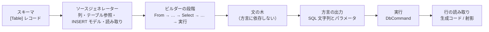
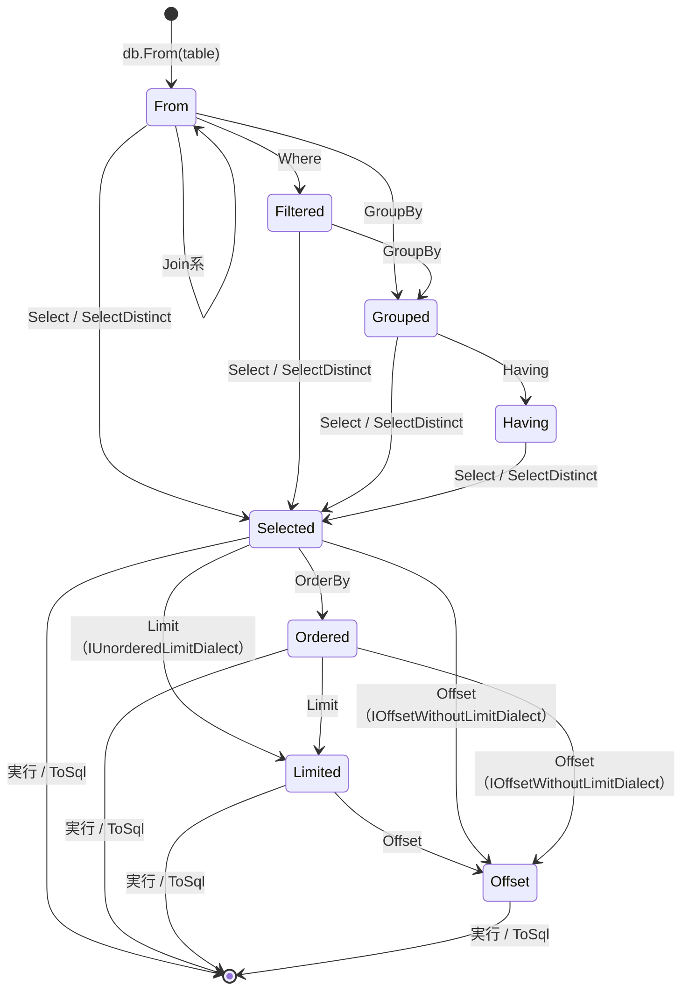

# AuraORM 設計書

本書は AuraORM の設計の正本である。契約・公開 API・生成される SQL・型安全性の保証・不変条件・フェーズはここで決める。変更は `design` Issue と設計 PR を通す（`.cursor/rules/design-docs.mdc`）。退けた案とその理由は [design-decisions.md](./design-decisions.md)、作業の順序は [roadmap.md](./roadmap.md) にある。

各データベースについての主張には、確認した一次資料を付ける。資料の一覧は §19 にある。

## 0. コンセプト

### 0.1 三つの約束

AuraORM は .NET 向けの型付き SQL クエリビルダーである。オブジェクトとテーブルを対応づけて変更を追跡する ORM ではない。C# で SQL を書くための道具であり、次の三つを約束する。

1. **SQL の柔軟性を損なわない。** API は SQL の句に一つずつ対応する。対象のデータベースで正しい SQL のうち API で表せるものは、すべてコンパイルが通る。API で表せない部分は生 SQL の断片（§11）で書ける。その場合も値はパラメータとして渡り、型は保たれる。
2. **生成される SQL を予測できる。** ビルダーの呼び出し一つが SQL の句一つになる。ライブラリは、呼び出し側が書いていないクエリ、結合、サブクエリ、`DISTINCT`、`ORDER BY`、`LIMIT`、往復を足さない。同じビルダーの連鎖は、値や実行環境によらず同じ SQL 文字列になる。すべてのクエリは、接続なしで SQL とパラメータを返せる（`ToSql()`）。方言ごとの SQL は本書に書き、ゴールデンテストで固定する。
3. **不正なクエリだけを、徹底して型で防ぐ。** クエリにないテーブルの列、型の違う比較、順序の誤った句、`INSERT` の必須列の欠落、`WHERE` のない `UPDATE` / `DELETE`、集計と非集計の混在、そのデータベースにない機能は、コンパイルエラーになる。型で表せないものだけを実行前の検査に回し、その一覧を §14.3 に書く。

さらに、次の二つを前提とする。

- **NativeAOT とトリミングに対応する。** リフレクション、式ツリー、動的コード生成を使わない。行の読み取りなど型ごとのコードは、ソースジェネレーターがコンパイル時に作る。
- **軽量である。** ランタイムのライブラリは .NET の基本ライブラリと `System.Data.Common` だけに依存する。ADO.NET プロバイダーは利用者が選ぶ。

### 0.2 想定する書き手

書き手は人間と AI エージェントの両方である。エージェントは、それらしく見えるが誤ったクエリを書き、実行時まで気づかないことがある。AuraORM は、そうした誤りをコンパイルエラーとして示す。エラーには固定の ID があり、メッセージは直し方を示す（§15）。エラーにならないクエリは、`ToSql()` で人間が読んで確かめられる。

### 0.3 他のライブラリとの位置づけ

| ライブラリ | SQL の書き方 | AuraORM との違い |
| --- | --- | --- |
| EF Core | LINQ をプロバイダーが SQL に翻訳する。変更追跡、ナビゲーション、遅延読み込みがある | AuraORM は翻訳しない。呼び出しと SQL の句が一対一に対応する。変更追跡はない |
| Dapper | SQL を文字列で書き、結果を型に対応づける | AuraORM は列と型をコンパイル時に検査する。生 SQL を使う場合も、値は補間からパラメータになる |
| Drizzle ORM（TypeScript） | スキーマを TypeScript で定義し、SQL に近いビルダーで書く | 考え方の手本である。AuraORM は C# の型でこれを実現し、集計の正しさや方言の機能差まで型で扱う |
| jOOQ（Java）、Kysely（TypeScript） | 型付きの SQL ビルダー | 方向は同じ。AuraORM は列をラムダの引数からしか取れないようにし、FROM にないテーブルの参照を構造的に防ぐ |

## 1. 要件

### 1.1 機能要件

| ID | 要件 |
| --- | --- |
| R1 | C# のレコード（またはクラス）と属性でテーブルを定義できる。ソースジェネレーターが、型付きの列、テーブル参照、INSERT のモデル、行の読み取りを生成する |
| R2 | SELECT: FROM、全種類の JOIN、WHERE、GROUP BY、HAVING、集計、射影、DISTINCT、ORDER BY、LIMIT / OFFSET、UNION / INTERSECT / EXCEPT、サブクエリ（IN、EXISTS、スカラー）、派生テーブル、CTE |
| R3 | INSERT（複数行）、UPDATE、DELETE と、方言が持つ場合の RETURNING |
| R4 | UPSERT（SQLite / PostgreSQL の `ON CONFLICT`、MySQL / MariaDB の `ON DUPLICATE KEY UPDATE`） |
| R5 | 型付きの生 SQL 断片と、生 SQL のクエリ・コマンド。補間の値はパラメータになる |
| R6 | 実行: 結果の一覧、ストリーミング、単一行、影響行数。トランザクション。キャンセル |
| R7 | 値コンバーター（利用者の型と、データベースが扱う型の変換） |
| R8 | DDL: CREATE / DROP TABLE と CREATE / DROP INDEX |
| R9 | すべてのクエリが、接続なしで SQL とパラメータを返せる |
| R10 | 対象の四つのデータベースすべてで、上のすべてが同じ API で使える。方言にない機能はコンパイルエラーになる |

### 1.2 非機能要件

| ID | 要件 |
| --- | --- |
| N1 | `net8.0` 以降で動く。NativeAOT で発行したアプリで、トリミングと AOT の警告がゼロのまま使える |
| N2 | ランタイムのライブラリはパッケージに依存しない。ソースジェネレーターは同じパッケージに入る |
| N3 | ジェネレーターが利用者のプロジェクトに出力するコードは、C# 12（`net8.0` の既定）でコンパイルできる |
| N4 | 行の読み取りは、結果そのもの（行のオブジェクト、文字列、配列）のほかにメモリを確保しない。値をボックス化しない |
| N5 | 生成される SQL は、カルチャ、時刻、タイムゾーン、バインドする値に依存しない |
| N6 | 生 SQL 断片以外で、呼び出し側の値が SQL の文字列に入ることはない。識別子は常にクォートする |

### 1.3 対象のデータベース

v0.1 の公開時にサポート期間中のメジャーバージョンを対象とする。最小バージョンは、本書が使う構文をすべて持つものにした。サポート期間は 2026-10-23 に確かめた（§19）。

| 方言 | 最小バージョン | 主な理由 |
| --- | --- | --- |
| SQLite | 3.39 | RIGHT / FULL JOIN と `IS [NOT] DISTINCT FROM`（3.39.0）、RETURNING（3.35.0） |
| PostgreSQL | 15 | 14 のサポートは 2026-11-12 に終わる |
| MySQL | 8.4 | 8.0 系のサポートは 2026 年 4 月に終わった。INTERSECT / EXCEPT（8.0.31）、行の別名を使う `ON DUPLICATE KEY UPDATE`（8.0.19） |
| MariaDB | 10.11 | 10.6 のコミュニティサポートは 2026-07-06 に終わった。10.11 は 2028-02-16 まで |
| SQL Server | 2019 | `IS [NOT] DISTINCT FROM` は 2022 からなので、2019 では §4.2 の展開を使う |

MariaDB は MySQL とは別の方言の型にする（§2.4）。RETURNING と UPSERT の構文が違うからである。

### 1.4 範囲外

- **変更追跡、ナビゲーションプロパティ、遅延読み込み、Unit of Work。** クエリが予測できなくなる。
- **リレーショナルクエリ**（Drizzle の `db.query.users.findMany({ with: ... })` に当たるもの）。一つの呼び出しが、入れ子の集約や複数の文に展開され、約束 2 に反する。
- **LINQ プロバイダー（`IQueryable<T>`）。** 式ツリーを翻訳する方式であり、約束 2 と NativeAOT の前提に反する。
- **同期 API。** 実行はすべて非同期で行う（`docs/design-decisions.md`）。
- **利用者が方言を追加すること。** 方言は閉じた集合とする（§2.4）。

ほかに後のフェーズに回すものは §18 にある。

## 2. 全体の構成

### 2.1 パッケージとプロジェクト

パッケージは `AuraORM` の一つだけにする。

| プロジェクト | 中身 | 対象 |
| --- | --- | --- |
| `src/AuraORM` | ランタイム。式、ビルダー、方言ごとの SQL の出力、実行、行の読み取り | `net8.0`、`IsAotCompatible` |
| `src/AuraORM.Generators` | ソースジェネレーターとアナライザー。パッケージの `analyzers/dotnet/cs` に入る | `netstandard2.0` |

ジェネレーターが参照する `Microsoft.CodeAnalysis.CSharp` は 4.8 とする。これは .NET 8 SDK の最初のリリースに入っているコンパイラーの版であり、.NET 8 SDK のどの版でもジェネレーターを読み込める。

### 2.2 層



- ビルダーは、方言に依存しない文の木を作る。木を SQL にするのは方言の出力だけである。
- 方言の違いはすべて出力の層にあり、その規則は本書の各節に方言ごとに書く。
- ラムダは文を組み立てるときに一度だけ呼ばれ、式のオブジェクトを返す。ラムダを式ツリーとして解析することはしない。

### 2.3 名前空間と公開面

- 公開する型は名前空間 `AuraORM` に置く。利用者は `using AuraORM;` と `using static AuraORM.Sql;` で全機能を使える。
- 公開面は次に限る: `Database<TDialect>` と `Transaction<TDialect>`、方言の型と機能のインターフェース、ビルダーの段階の型、式の型（`IExpr<T, TLevel>`、`Column<T>`、`Condition<TLevel>`、`IProjection<T, TLevel>`）、関数（`Sql`）、属性、`SqlStatement`、例外。
- 文の木、SQL の出力、パラメータの設定は `internal` にする。

### 2.4 方言

方言は型で表す。`Database<TDialect>` から作ったクエリは、すべて型引数に方言を持つ。

| 型 | データベース |
| --- | --- |
| `SqliteDialect` | SQLite |
| `PostgreSqlDialect` | PostgreSQL |
| `MySqlDialect` | MySQL |
| `MariaDbDialect` | MariaDB |
| `SqlServerDialect` | SQL Server |

方言の型は、持つ機能をインターフェースで宣言する。方言に依存する API は、型引数がそのインターフェースを満たすときだけ呼べる拡張メソッドにする。満たさない方言で呼ぶとコンパイルエラー（CS0311、または CS1061）になる。

| インターフェース | 意味 | SQLite | PostgreSQL | MySQL | MariaDB | SQL Server |
| --- | --- | --- | --- | --- | --- | --- |
| `IFullJoinDialect` | FULL OUTER JOIN | ✓ | ✓ | | | ✓ |
| `IInsertReturningDialect` | INSERT の結果を返す | ✓ | ✓ | | ✓ | ✓ |
| `IUpdateReturningDialect` | UPDATE の結果を返す | ✓ | ✓ | | | ✓ |
| `IDeleteReturningDialect` | DELETE の結果を返す | ✓ | ✓ | | ✓ | ✓ |
| `IUnorderedLimitDialect` | ORDER BY のない LIMIT | ✓ | ✓ | ✓ | ✓ | |
| `IOffsetWithoutLimitDialect` | LIMIT のない OFFSET | | ✓ | | | ✓ |
| `IOnConflictDialect` | `ON CONFLICT` による UPSERT | ✓ | ✓ | | | |
| `IOnDuplicateKeyDialect` | `ON DUPLICATE KEY UPDATE` による UPSERT | | | ✓ | ✓ | |
| `ICreateTableIfNotExistsDialect` | `CREATE TABLE IF NOT EXISTS` | ✓ | ✓ | ✓ | ✓ | |
| `ICreateIndexIfNotExistsDialect` | `CREATE INDEX IF NOT EXISTS` | ✓ | ✓ | | ✓ | |

方言は閉じた集合であり、利用者は追加できない。方言の出力は `internal` であり、型から出力への対応は `typeof` の比較で決まる（リフレクションを使わない）。

## 3. スキーマの定義

### 3.1 テーブルの宣言

テーブルは、`[Table]` を付けた `partial` なレコードかクラスで宣言する。この型が行の型になる。

```csharp
[Table("users")]
public sealed partial record User(
    [PrimaryKey, AutoIncrement] long Id,
    [MaxLength(100)] string Name,
    int? Age,
    [Default(SqlDefault.CurrentTimestamp)] DateTime CreatedAt);
```

- 位置指定のレコードでは、主コンストラクターの引数が列になる。それに加えて、`get` と `init`（または `set`）を持つ公開のインスタンスプロパティが列になる。テーブルはクラス（レコードクラス）であり、構造体はテーブルにできない（AURA0101）。
- 列の順序は宣言の順序である。この順序が `SELECT` の列の順序と DDL の列の順序になる。
- 列にしないプロパティには `[NotColumn]` を付ける。
- 列の NULL 可否は C# の型で決まる。`int?` と `string?` は NULL を許し、`int` と `string` は許さない。参照型の NULL 可否を読むため、テーブルの型は null 許容参照型が有効な文脈で宣言する（無効ならエラー AURA0102）。

属性:

| 属性 | 対象 | 意味 |
| --- | --- | --- |
| `[Table(name)]` | 型 | テーブル名。`Schema` でスキーマ名を、`Naming` で列名の規則を指定できる |
| `[Column(name)]` | 列 | 列名を指定する |
| `[PrimaryKey]` | 列 | 主キー。複数の列に付けると複合主キーになり、順序は宣言順 |
| `[AutoIncrement]` | 列 | データベースが値を振る整数の列。テーブルに一つだけで、主キーでなければならない |
| `[MaxLength(n)]` | 列 | 文字列とバイト列の最大長（DDL の型に使う） |
| `[Precision(p, s)]` | 列 | `decimal` の精度と位取り（DDL の型に使う） |
| `[Default(...)]` | 列 | データベースの既定値。`SqlDefault` の値か、定数。INSERT で省略できるようになる。コンストラクターは `object` を取る一つだけである（`SqlDefault` を取る多重定義があると、リテラルの `0` が列挙型に変換され `CurrentTimestamp` になるため） |
| `[DefaultSql(sql)]` | 列 | 既定値を生 SQL で書く。DDL にそのまま出る。INSERT で省略できるようになる |
| `[Unique]` | 列 | 単一列の一意制約 |
| `[Index(name)]` | 型（複数可） | インデックス。列は `Columns` に `nameof` で並べ、`Unique` で一意にできる |
| `[References(typeof(T), nameof(T.Member))]` | 列 | 外部キー。参照先が `[Table]` の型で、その列の型が一致することをジェネレーターが検査する |
| `[Converter(typeof(C))]` | 列 | 値コンバーター（§3.6） |
| `[NotColumn]` | プロパティ | 列にしない |

### 3.2 名前

- テーブル名は `[Table]` の引数がそのまま使われる。
- 列名の既定は、プロパティ（または引数）の名前そのままである。`CreatedAt` の列名は `CreatedAt` になる。
- `[Column("created_at")]` があればそれを使う。
- `[Table("users", Naming = ColumnNaming.SnakeCase)]` のとき、`[Column]` のない列の名前をスネークケースに変える。変換の規則は次のとおりで、ジェネレーターがコンパイル時に適用する。結果は生成コードの中に文字列として残る。
  1. 小文字または数字の直後の大文字の前に `_` を入れる（`CreatedAt` → `Created_At`）。
  2. 大文字が続き、その後に小文字が来るとき、最後の大文字の前に `_` を入れる（`HTTPCode` → `HTTP_Code`）。
  3. すべてを小文字にする（`created_at`、`http_code`）。
- 名前は SQL の中で常にクォートする（§5.12）。大文字と小文字は保たれる。

### 3.3 CLR の型と SQL の型

列に使える CLR の型と、DDL（§13）で使う方言ごとの SQL の型は次のとおり。nullable な値型（`int?` など）は、もとの型と同じ SQL の型で NULL を許す。

| CLR の型 | SQLite | PostgreSQL | MySQL / MariaDB | SQL Server |
| --- | --- | --- | --- | --- |
| `bool` | `INTEGER` | `boolean` | `BOOLEAN` | `bit` |
| `byte` | `INTEGER` | `smallint` | `TINYINT UNSIGNED` | `tinyint` |
| `short` | `INTEGER` | `smallint` | `SMALLINT` | `smallint` |
| `int` | `INTEGER` | `integer` | `INT` | `int` |
| `long` | `INTEGER` | `bigint` | `BIGINT` | `bigint` |
| `float` | `REAL` | `real` | `FLOAT` | `real` |
| `double` | `REAL` | `double precision` | `DOUBLE` | `float` |
| `decimal` | `TEXT` | `numeric(p,s)` | `DECIMAL(p,s)` | `decimal(p,s)` |
| `string` | `TEXT` | `text` / `varchar(n)` | `LONGTEXT` / `VARCHAR(n)` | `nvarchar(max)` / `nvarchar(n)` |
| `byte[]` | `BLOB` | `bytea` | `LONGBLOB` / `VARBINARY(n)` | `varbinary(max)` / `varbinary(n)` |
| `Guid` | `BLOB` | `uuid` | `CHAR(36)` | `uniqueidentifier` |
| `DateTime` | `TEXT` | `timestamp` | `DATETIME(6)` | `datetime2` |
| `DateTimeOffset` | `TEXT` | `timestamp with time zone` | `DATETIME(6)` | `datetimeoffset` |
| `DateOnly` | `TEXT` | `date` | `DATE` | `date` |
| `TimeOnly` | `TEXT` | `time` | `TIME(6)` | `time` |
| 列挙型 | 基になる整数型と同じ | 同左 | 同左 | 同左 |

- `string` と `byte[]` は `[MaxLength(n)]` があれば長さ付きの型、なければ長さのない型になる。
- `decimal` は `[Precision(p, s)]` がなければ `(18, 2)` とする。SQLite の `TEXT` は値を正確に保つが、SQL の中での大小比較と算術は数値として行われない。
- 主キー、一意制約、インデックス、外部キーに使う `string` と `byte[]` の列は `[MaxLength]` が必須である（エラー AURA0110）。MySQL と SQL Server では、長さのない型にインデックスを張れないためである。
- 値をパラメータにするときと、結果から読むときの変換は、ADO.NET プロバイダーに任せる。AuraORM は CLR の値をそのままパラメータの `Value` に入れ、型付きの取得メソッド（`GetInt64` など）か `GetFieldValue<T>` で読む。方言とプロバイダーの組み合わせごとの既知の差は §12.6 に書く。
- 表にない型はコンバーター（§3.6）で表にある型に変換する。どちらもなければエラー AURA0103 になる。

### 3.4 生成されるコード

`User` に対して、ジェネレーターは同じ `partial` 型の中に次を生成する。

| メンバー | 型 | 役割 |
| --- | --- | --- |
| `User.Table` | `Table<User, User.Columns, User.NullableColumns, User.Insert>` | テーブル参照。`db.From(User.Table)` のように使う |
| `User.Columns` | クラス | 列の集合。ラムダの引数になる。`IProjection<User, PerRow>` でもあり、`Select(u => u)` で行全体を表す |
| `User.NullableColumns` | クラス | 外部結合で NULL になりうる側の列の集合。各列は NULL を許す型になる。`IProjection<User?, PerRow>` |
| `User.Insert` | クラス | INSERT のモデル（§6） |
| `IQueryResult<User>` の実装 | 静的メンバー | 生のクエリ（§11.3）で、列名から行を読む。列名の一覧は `__AuraColumnNames` という private の静的フィールドに持つ |

- `User.Columns` の各プロパティは `Column<T>` 型で、`T` は列の CLR の型（`long`、`string`、`int?`）である。`[AutoIncrement]` の列は `ReadOnlyColumn<T>` で、UPDATE の代入先にできない（§7）。
- `User.NullableColumns` の各プロパティは `IExpr<T?, PerRow>` 型である。`long` の列は `long?`、`string` の列は `string?` になる。列ではないので、代入先にはできない。
- `User.Columns` と `User.NullableColumns` は、ライブラリだけが作れる。生成されるファクトリは、ライブラリの `internal` なコンストラクターを持つ `TableAlias` を受け取るので、利用者のコードからは作れない。列を得る方法は、ビルダーが渡すラムダの引数だけである。
- 生成コードは C# 12 でコンパイルでき、型名はすべて `global::` で修飾する。
- 利用者の型に、生成するメンバーと同じ名前のメンバーがあればエラー AURA0104 になる。

### 3.5 結果の型

テーブルではない型を、射影と生 SQL のクエリの結果にするときは `[QueryResult]` を付ける。

```csharp
[QueryResult]
public sealed partial record UserOrderTotal(string Name, decimal? Total);
```

ジェネレーターは次を生成する。

- `UserOrderTotal.RowProjection` と `UserOrderTotal.GroupProjection`: `required` な `init` プロパティを持つクラス。各プロパティの型は、前者が `IProjection<T, PerRow>`、後者が `IProjection<T, PerGroup>` で、`T` は対応するメンバーの型である（§4.5）。`Select` で `new UserOrderTotal.GroupProjection { Name = k.Item1, Total = Sum(o.Amount) }` のように使う。メンバーを書き忘れると CS9035、型や評価の段階が違うと CS0029 になる。
- `UserOrderTotal.Columns`: この型を派生テーブルと CTE（§5.11）の行として使うときの列の集合。
- `IQueryResult<UserOrderTotal>` の実装: 生のクエリ（§11.3）で、列名から値を読むコード。列名はメンバー名（`[Column]` があればその名前）である。

### 3.6 値コンバーター

利用者の型（強く型付けされた ID など）を列にするには、コンバーターを書いて `[Converter]` で指定する。

```csharp
public readonly record struct UserId(long Value);

public sealed class UserIdConverter : IValueConverter<UserId, long>
{
    public static long ToProvider(UserId value) => value.Value;
    public static UserId FromProvider(long value) => new(value);
}
```

- `IValueConverter<TModel, TProvider>` は静的抽象メンバーを持つインターフェースで、`TProvider` は §3.3 の表にある型である。
- コンバーターはパラメータを作るときと結果を読むときに呼ばれる。SQL の文字列は変わらない。
- 列の型が `TModel` か `TModel?` でなければエラー AURA0105 になる。

### 3.7 ジェネレーターの検査

テーブルと結果の型の誤りは、ジェネレーターがコンパイル時に報告する。ID の一覧は §15 にある。主なものは次のとおり。

- 型が `partial` でない、または入れ子の型の外側が `partial` でない。
- 列の型が使えない。
- 列名が重複している。
- `[AutoIncrement]` が二つ以上ある、整数でない、または主キーでない。
- `[References]` の参照先が `[Table]` の型でない、メンバーが列でない、型が一致しない。
- `[Index]` の列名が列でない。
- 行の型に、行を作るためのコンストラクター（位置指定のレコードのコンストラクター、またはアクセスできる引数なしのコンストラクター）がない。

## 4. 式

### 4.1 型

| 型 | 意味 |
| --- | --- |
| `IProjection<out T, TLevel>` | `SELECT` の列の並びと、その結果を `T` として読むコード。式、行全体、タプル、結果の型の射影がこれになる |
| `IExpr<out T, TLevel>` | 値を持つ SQL の式。`T` は結果として読むときの CLR の型。`IProjection<T, TLevel>` を継承する |
| `Column<T>` | テーブルの列。`IExpr<T, PerRow>` を実装し、UPDATE の代入先になれる |
| `ReadOnlyColumn<T>` | 代入先になれない列（`[AutoIncrement]`）。`IExpr<T, PerRow>` を実装する |
| `Condition<TLevel>` | 真偽を返す述語。`WHERE`、`ON`、`HAVING`、`CASE WHEN` に使う。値ではないので射影にはならない |

- `T` は NULL 可否を含む。NULL を許す `int` の列は `IExpr<int?, PerRow>`、NULL を許す `string` の列は `IExpr<string?, PerRow>` である。
- `IExpr` と `IProjection` は `T` について共変のインターフェースである。クラスにすると、`string?` の列と `string` の列を比べたときに、利用者のコードで null 許容の警告（CS8620）が出る。共変のインターフェースなら、`IExpr<string, …>` を `IExpr<string?, …>` として渡しても警告は出ない（試作で、クラスでは 8 件、インターフェースでは 0 件だった）。
- この二つのインターフェースは `internal` のメンバーを持つので、ライブラリの外では実装できない。式を作れるのは `Sql` の関数と、ジェネレーターが作る列だけである。
- `TLevel` は評価の段階で、`PerRow`（行ごと）か `PerGroup`（グループごと）である（§4.5）。
- 述語と値を分けるのは、SQL Server が述語を値として扱えず、`bit` の列をそのまま述語にもできないからである。真偽値の列を条件にするときは `Eq(u.IsActive, true)` と書く。この形はすべての方言で同じ SQL（`"IsActive" = @p0`）になる。

### 4.2 関数

関数はすべて静的クラス `Sql` のメソッドである。`using static AuraORM.Sql;` で、Drizzle と同じように `Eq(u.Age, 20)` と書ける。ここに載せる関数は、五つの方言すべてで使える。方言固有の関数は v0.1 には入れず、生 SQL 断片（§11）で書く（§18 の DF1）。

値の引数（`T` 型）はパラメータになる。式の引数（`IExpr<T, TLevel>`）は SQL として展開される。二つの引数を取る関数は、両方の `TLevel` が同じでなければならない。

**比較**

| 関数 | SQL | 型の規則 |
| --- | --- | --- |
| `Eq(a, b)` | `a = b` | `a` と `b` の `T` が同じ。片方だけが nullable な値型でもよい（`IExpr<long?>` と `IExpr<long>`）。`b` は値でもよい |
| `Ne(a, b)` | `a <> b` | 同上 |
| `Gt` / `Ge` / `Lt` / `Le` | `>` / `>=` / `<` / `<=` | 同上 |
| `Between(a, lo, hi)` | `a BETWEEN lo AND hi` | 同上 |
| `In(a, values)` | `a IN (@p0, @p1, …)` | `values` は `IReadOnlyList<T>`。空なら `1 = 0` |
| `NotIn(a, values)` | `a NOT IN (@p0, …)` | 空なら `1 = 1` |
| `In(a, subquery)` / `NotIn(a, subquery)` | `a IN (SELECT …)` | サブクエリの射影が一つの式で、その `T` が `a` と同じ（片方だけ nullable でもよい） |
| `Like(a, pattern)` / `NotLike` | `a LIKE @p0` | `a` は `string` か `string?` |

`In` の要素の数は文の形の一部であり、要素の数が違えば SQL の文字列も違う。これは N5 の例外である。`LIKE` が大文字と小文字を区別するかは、データベースの照合順序で決まる。AuraORM は `LIKE` をそのまま出す。

**NULL**

| 関数 | SQLite | PostgreSQL | MySQL / MariaDB | SQL Server |
| --- | --- | --- | --- | --- |
| `IsNull(a)` | `a IS NULL` | 同左 | 同左 | 同左 |
| `IsNotNull(a)` | `a IS NOT NULL` | 同左 | 同左 | 同左 |
| `IsNotDistinctFrom(a, b)` | `a IS b` | `a IS NOT DISTINCT FROM b` | `a <=> b` | `(a = b OR (a IS NULL AND b IS NULL))` |
| `IsDistinctFrom(a, b)` | `a IS NOT b` | `a IS DISTINCT FROM b` | `NOT (a <=> b)` | `NOT (a = b OR (a IS NULL AND b IS NULL))` |
| `Coalesce(a, b)` | `COALESCE(a, b)` | 同左 | 同左 | 同左 |
| `NullIf(a, b)` | `NULLIF(a, b)` | 同左 | 同左 | 同左 |

SQL Server 2019 には `IS [NOT] DISTINCT FROM` がないので展開する。展開では `a` と `b` が二度ずつ現れる。値の引数は、現れるたびに別のパラメータになる。`Coalesce` は二つの引数を取り、三つ以上は入れ子にする。`b` が NULL を許さない値型なら、結果は NULL を許さない型になる。`NullIf` の結果は NULL を許す型で、`a` は値型か `string` に限る（C# の制約で、ほかの参照型を NULL を許す型として表せないため）。

**論理**

| 関数 | SQL |
| --- | --- |
| `And(c1, c2, …)` | `(c1 AND c2 AND …)`。引数は二つ以上 |
| `Or(c1, c2, …)` | `(c1 OR c2 OR …)`。引数は二つ以上 |
| `Not(c)` | `NOT (c)` |
| `Exists(subquery)` | `EXISTS (SELECT …)` |

**算術**（数値型。`System.Numerics.INumber<T>` を満たす `T` と、その nullable）

| 関数 | SQL |
| --- | --- |
| `Add` / `Sub` / `Mul` | `(a + b)` / `(a - b)` / `(a * b)` |
| `Div(a, b)` | `(a / b)`。整数の型では、MySQL / MariaDB だけ `(a DIV b)`（MySQL の `/` は整数どうしでも小数を返すため） |
| `Mod(a, b)` | `(a % b)` |
| `Negate(a)` | `(-a)` |

整数の除算の結果の型は整数である。オーバーフローとゼロ除算の扱いはデータベースに従う。

**文字列**

| 関数 | SQLite | PostgreSQL | MySQL / MariaDB | SQL Server |
| --- | --- | --- | --- | --- |
| `Concat(a, b, …)` | `(a \|\| b \|\| …)` | `(a \|\| b \|\| …)` | `CONCAT(a, b, …)` | `(a + b + …)` |
| `Lower(a)` / `Upper(a)` | `LOWER(a)` / `UPPER(a)` | 同左 | 同左 | 同左 |
| `Length(a)` | `LENGTH(a)` | `CHAR_LENGTH(a)` | `CHAR_LENGTH(a)` | `LEN(a)` |
| `Trim(a)` | `TRIM(a)` | 同左 | 同左 | `TRIM(a)` |
| `Substring(a, start, length)` | `SUBSTRING(a, start, length)` | 同左 | 同左 | 同左 |

どの方言でも、`Concat` は引数のどれかが NULL なら NULL を返す。SQL Server の `LEN` は末尾の空白を数えない。ほかの方言の結果と違うことがある点を XML ドキュメントにも書く。

**型と条件分岐**

| 関数 | SQL |
| --- | --- |
| `Cast(a, SqlType.Int64)` | `CAST(a AS 型)`。第二引数は §4.3 の型の印 |
| `Case(c, v).When(c, v).Else(v)` | `CASE WHEN c THEN v … ELSE v END`。`Else` は必須。NULL を既定にするときは `T` を NULL を許す型にして `Else(null)` と書く |
| `CurrentTimestamp()` | `CURRENT_TIMESTAMP`。結果は `DateTime` |
| `Value<T>(v)` | `@p0`。値を式として使う（射影の中の定数など） |

**集計**（結果は `PerGroup`。引数は `PerRow`）

| 関数 | SQLite | PostgreSQL | MySQL / MariaDB | SQL Server | 結果の型 |
| --- | --- | --- | --- | --- | --- |
| `Count()` | `COUNT(*)` | `COUNT(*)` | `COUNT(*)` | `COUNT_BIG(*)` | `long` |
| `Count(a)` | `COUNT(a)` | `COUNT(a)` | `COUNT(a)` | `COUNT_BIG(a)` | `long` |
| `CountDistinct(a)` | `COUNT(DISTINCT a)` | 同左 | 同左 | `COUNT_BIG(DISTINCT a)` | `long` |
| `Sum(a)`（整数） | `SUM(a)` | `CAST(SUM(a) AS bigint)` | `CAST(SUM(a) AS SIGNED)` | `SUM(CAST(a AS bigint))` | `long?` |
| `Sum(a)`（`decimal`、浮動小数点） | `SUM(a)` | 同左 | 同左 | 同左 | 引数の型の nullable |
| `Avg(a)`（整数、浮動小数点） | `AVG(a)` | `AVG(CAST(a AS double precision))` | `CAST(AVG(a) AS DOUBLE)` | `AVG(CAST(a AS float))` | `double?` |
| `Avg(a)`（`decimal`） | `AVG(a)` | 同左 | 同左 | 同左 | `decimal?` |
| `Min(a)` / `Max(a)` | `MIN(a)` / `MAX(a)` | 同左 | 同左 | 同左 | 引数の型の nullable |

整数の `Sum` と `Avg` に `CAST` を入れるのは、方言ごとに結果の SQL の型が違い（PostgreSQL の `SUM(bigint)` は `numeric`、MySQL の `SUM` は `DECIMAL`、SQL Server の `SUM(int)` は `int`）、そのままでは同じ CLR の型で読めず、SQL Server では `int` の範囲で桁あふれするからである。この `CAST` は関数の出力の一部として固定であり、値によって変わらない。SQLite の `decimal`（`TEXT`）の集計は浮動小数点で計算される。

### 4.3 `Cast` の型

| 型の印 | SQLite | PostgreSQL | MySQL / MariaDB | SQL Server |
| --- | --- | --- | --- | --- |
| `SqlType.Int64`（`long`） | `INTEGER` | `bigint` | `SIGNED` | `bigint` |
| `SqlType.Double`（`double`） | `REAL` | `double precision` | `DOUBLE` | `float` |
| `SqlType.Decimal`（`decimal`） | `TEXT` | `numeric` | `DECIMAL(65,30)` | `decimal(38,18)` |
| `SqlType.String`（`string`） | `TEXT` | `text` | `CHAR` | `nvarchar(max)` |
| `SqlType.DateTime`（`DateTime`） | `TEXT` | `timestamp` | `DATETIME(6)` | `datetime2` |
| `SqlType.DateOnly`（`DateOnly`） | `TEXT` | `date` | `DATE` | `date` |

これ以外の型への `Cast` は書けない（MySQL の `CAST` が受け付ける型が限られるため）。結果は常に NULL を許す型である。変換に失敗したときの結果（NULL かエラーか）が方言によって違い、引数の NULL 可否からは決まらないためである。

### 4.4 NULL の扱い

SQL の三値論理はそのまま残す。そのうえで、次の二つはアナライザーのエラーにする。

- **AURA0201**: 比較関数（`Eq`、`Ne`、`Gt` など）の値の引数に `null` リテラルを書いた。SQL の `= NULL` は常に真にならない。直し方として `IsNull` / `IsNotNull` を示す。
- **AURA0202**: 比較関数の値の引数の型が nullable（`int?` の変数、`string?` の変数）である。実行時に NULL なら行が一件も一致しない。直し方として、`IsNotDistinctFrom` を使うか、NULL でないことを確かめてから `.Value` や `!` で渡すことを示す。

`IN` の値の一覧に `null` が入っていても NULL の行には一致しないので、`In` の値の型が nullable なら同じく AURA0202 にする。

### 4.5 評価の段階: 行とグループ

集計を含むクエリでは、`SELECT`、`HAVING`、`ORDER BY` に、`GROUP BY` のキーか集計の結果しか書けない。SQLite はこの誤りを報告せず、グループの中の任意の行の値を返す。AuraORM はこれを型で防ぐ。

- テーブルの列と、列から作った式は `PerRow` である。
- 集計関数は `PerRow` の式を受け取り、`PerGroup` の式を返す。集計の中に集計は書けない。
- `GroupBy` のキーは、後の段階のラムダに `PerGroup` の式として渡る（§5.5）。
- 二つの引数を取る関数は、両方の段階が同じでなければならない。値の引数はどちらの段階にも合う。
- `Where` と `On` は `Condition<PerRow>`、`Having` は `Condition<PerGroup>` だけを受け取る。
- `Select` の射影は、すべての要素が同じ段階でなければならない。`GroupBy` のないクエリで `PerGroup` の射影を選ぶと、表全体を一つのグループとする集計（`SELECT COUNT(*) FROM …`）になる。

```csharp
// コンパイルできない: 集計と行の値の混在（CS0029）
db.From(Order.Table).Select(o => (o.Customer, Count()));

// コンパイルできない: GROUP BY のキーではない列（CS0029）
db.From(Order.Table).GroupBy(o => o.Customer).Select((k, o) => (o.Price, Count()));

// コンパイルできる
db.From(Order.Table).GroupBy(o => o.Customer).Select((k, o) => (k.Item1, Count(), Sum(o.Price)));
```

PostgreSQL は、主キーで GROUP BY したとき、同じテーブルのほかの列を選ぶことを許す（関数従属）。AuraORM ではその列もキーに加える。これは SQL より厳しい制限であり、理由は上に書いた誤りを型で防ぐためである。

## 5. SELECT

### 5.1 段階

ビルダーは段階ごとに別の型を持ち、各段階はその後に書ける句のメソッドだけを持つ。生成される SQL の句の順序は、ビルダーの呼び出しの順序によらず標準の順序である。



- `Where`、`GroupBy`、`Having`、`OrderBy`、`Limit`、`Offset` は、それぞれ一度だけ書ける。条件を足すときは `And(…)` にまとめる。
- `Join` は `Where` より前にだけ書ける。
- 一つのクエリのテーブル（`From` と `Join` の合計）は 8 つまで。これを超える結合は、派生テーブルか CTE で分ける。
- 段階の型は、方言と、各テーブルの列の集合の型（通常と NULL 化の二つ）を型引数に持つ。これらの型はライブラリの中でテーブルの数ごとに生成される（`tools/` のスクリプトが出力し、CI が出力の古さを検査する）。

### 5.2 FROM とテーブル参照

```csharp
db.From(User.Table)                       // FROM "users"
db.From(User.Table.As("u"))               // FROM "users" AS "u"
```

- 列は `"テーブル名"."列名"` と修飾して出す。`As` で別名を付けたテーブルの列は `"別名"."列名"` になる。
- 同じテーブルを二度使うとき（自己結合）は、二度目以降に `As` が必要である。別名のない重複は、文を作るときに `InvalidOperationException` になる（§14.3）。
- `[Table]` に `Schema` があれば、テーブル名を `"スキーマ"."テーブル"` と出す。

### 5.3 JOIN と NULL 化

| メソッド | SQL | 結合後のラムダの引数 |
| --- | --- | --- |
| `InnerJoin(t, on)` | `INNER JOIN t ON …` | 変わらない |
| `LeftJoin(t, on)` | `LEFT JOIN t ON …` | `t` の側が `NullableColumns` になる |
| `RightJoin(t, on)` | `RIGHT JOIN t ON …` | それまでのすべてのテーブルが `NullableColumns` になる |
| `FullJoin(t, on)` | `FULL JOIN t ON …` | すべてのテーブルが `NullableColumns` になる。`IFullJoinDialect` が必要 |
| `CrossJoin(t)` | `CROSS JOIN t` | 変わらない |

```csharp
var rows = await db.From(User.Table)
    .LeftJoin(Order.Table, (u, o) => Eq(o.UserId, u.Id))
    .Select((u, o) => (u.Name, o.Amount))
    .ToListAsync();   // List<(string, decimal?)>
```

- `on` のラムダには、結合するテーブルの通常の列が渡る（`ON` の中では、結合する行は存在するため）。
- `NullableColumns` を行全体として選ぶと（`Select((u, o) => (u, o))`）、結果は `Order?` になる。すべての主キー列が NULL なら `null` を返す。主キーのないテーブルでは、すべての列が NULL のとき `null` を返す。

### 5.4 WHERE

```csharp
.Where(u => And(Gt(u.Age, 20), Like(u.Name, "A%")))
// WHERE ("users"."Age" > @p0 AND "users"."Name" LIKE @p1)
```

### 5.5 GROUP BY と HAVING

```csharp
db.From(Order.Table)
  .GroupBy(o => (o.Customer, o.Status))
  .Having((k, o) => Gt(Count(), 2L))
  .Select((k, o) => (k.Item1, k.Item2, Sum(o.Amount)))
// SELECT "orders"."Customer", "orders"."Status", SUM("orders"."Amount") FROM "orders"
// GROUP BY "orders"."Customer", "orders"."Status" HAVING COUNT(*) > @p0
```

- `GroupBy` のラムダは、一つの式か、式のタプル（8 つまで）を返す。
- 後の段階のラムダは、最初の引数にキー（`k`）を、続いて各テーブルの列の集合を受け取る。キーの要素は `k.Item1` から順に `PerGroup` の式である。
- 列の集合は集計関数の引数にだけ使える（§4.5）。

### 5.6 射影

| 書き方 | 結果の型 |
| --- | --- |
| `Select(u => u)` | 行の型（`User`）。テーブルのすべての列を宣言順に選ぶ |
| `Select(u => u.Name)` | 式の `T`（`string`） |
| `Select((u, o) => (u.Name, o.Amount, …))` | タプル（8 要素まで）。要素は式か行全体 |
| `Select(u => new UserSummary.RowProjection { … })` | 結果の型（§3.5） |

- `SELECT *` は出さない。列は常に並べて出す。
- 射影の列には別名を付けない。結果は列の位置で読む。派生テーブルと CTE の射影（結果の型の射影）だけ、メンバー名を別名（`AS "Name"`）として出す。

### 5.7 DISTINCT

`SelectDistinct(...)` は `SELECT DISTINCT …` を出す。射影の書き方は `Select` と同じ。

### 5.8 ORDER BY

```csharp
.OrderBy(u => [Asc(u.Name), Desc(u.Id)])
// ORDER BY "users"."Name" ASC, "users"."Id" DESC
```

- `Asc` と `Desc` は常に明示し、出力にも常に `ASC` / `DESC` を書く。
- `NULLS FIRST` / `NULLS LAST` は方言によって構文がないので v0.1 には入れない（§18 の DF1）。
- `GroupBy` のあとでは、ラムダはキーと列の集合を受け取り、`PerGroup` の式だけを並べられる。

### 5.9 LIMIT と OFFSET

`Limit(n)` と `Offset(m)` の値はパラメータになる。

| 方言 | `Limit(n)` | `Limit(n).Offset(m)` | `Offset(m)` だけ |
| --- | --- | --- | --- |
| SQLite | `LIMIT @p0` | `LIMIT @p0 OFFSET @p1` | 書けない |
| PostgreSQL | `LIMIT $1` | `LIMIT $1 OFFSET $2` | `OFFSET $1` |
| MySQL / MariaDB | `LIMIT @p0` | `LIMIT @p0 OFFSET @p1` | 書けない |
| SQL Server | `OFFSET 0 ROWS FETCH NEXT @p0 ROWS ONLY`（`OrderBy` の後だけ） | `OFFSET @p1 ROWS FETCH NEXT @p0 ROWS ONLY`（同） | `OFFSET @p0 ROWS`（`OrderBy` の後だけ） |

- SQL Server の `OFFSET … FETCH` は `ORDER BY` が必要なので、`OrderBy` のない `Limit` は SQL Server では書けない（`IUnorderedLimitDialect` を持たない）。ライブラリが `ORDER BY` を補うことはしない。
- SQLite と MySQL の `OFFSET` は `LIMIT` が必要なので、`Limit` のない `Offset` は書けない（`IOffsetWithoutLimitDialect` を持たない）。
- SQL Server の `Limit(n).Offset(m)` で、パラメータの番号が句の並び（`OFFSET` が先）ではなく呼び出しの順になるのは、パラメータの番号が式を組み立てた順に振られるからである（§5.12）。

### 5.10 集合演算

```csharp
var q = db.From(User.Table).Select(u => u.Name)
    .Union(db.From(Admin.Table).Select(a => a.Name));
// SELECT "users"."Name" FROM "users" UNION SELECT "admins"."Name" FROM "admins"
```

- `Union`、`UnionAll`、`Intersect`、`Except` は、`Selected` の段階（`OrderBy` の前）どうしで、結果の型と方言が同じものだけを結べる。
- 被演算子をかっこで囲まない（SQLite が受け付けないため）。そのため、被演算子に `ORDER BY` と `LIMIT` は書けない（型でそうなっている）。
- 集合演算の結果は実行するか、派生テーブル（§5.11）として外側のクエリで並べ替える。

### 5.11 サブクエリ、派生テーブル、CTE

- `In(a, subquery)`、`Exists(subquery)`、`Scalar(subquery)` は、サブクエリをかっこで囲んで展開する。`Scalar` の結果は、射影の `T` を NULL を許す型にした `PerRow` の式である（行がなければ NULL）。
- 外側のクエリのラムダの引数を内側のラムダで使えば、相関サブクエリになる。
- 派生テーブル: 結果の型の射影を持つクエリに `As("名前")` を付けると、テーブル参照になる。`db.From(sub.As("t"))` は `FROM (SELECT … ) AS "t"` を出し、ラムダには `UserOrderTotal.Columns` が渡る。
- CTE: `var t = db.Cte("t", sub);` で名前付きのテーブル参照を作り、`db.With(t).From(t)` と書く。`WITH "t" AS (SELECT …) SELECT … FROM "t"` を出す。再帰 CTE は §18 の別行にする。

### 5.12 SQL の書式

すべての文に共通する規則。

- キーワードは大文字。要素の区切りは `, `。句の間は半角空白一つ。改行と末尾の `;` は出さない。
- 識別子は常にクォートする。SQLite と PostgreSQL は `"x"`（中の `"` は `""`）、MySQL と MariaDB は `` `x` ``（中の `` ` `` は ``` `` ```）、SQL Server は `[x]`（中の `]` は `]]`）。
- パラメータの名前は、PostgreSQL が `$1`、`$2`、…（名前のないパラメータ）、ほかの方言は `@p0`、`@p1`、… である。番号は、文の木を組み立てた順に振る。同じ値でも現れるたびに別のパラメータになる。
- 複合の式（`And`、`Or`、算術、`Concat`）は常にかっこで囲む。比較とそれ以外の関数呼び出しは囲まない。
- 本書の例では、読みやすさのために SQL を改行して示すことがある。実際の出力は一行である。

## 6. INSERT

### 6.1 モデル

`User.Insert` は、`[AutoIncrement]` を除く列をプロパティに持つ。

- NULL を許さず、既定値（`[Default]` / `[DefaultSql]`）もない列は `required` になる。書き忘れると CS9035 になる。
- それ以外の列は省略できる。プロパティは値を設定したかどうかを覚えていて、設定しなかった列は `INSERT` の列の並びに出さない（データベースの既定値が使われる）。
- `[AutoIncrement]` の列はモデルにないので、値を指定できない。

### 6.2 文

```csharp
await db.Insert(User.Table)
    .Values(new User.Insert { Name = "Alice", Age = 30 })
    .ExecuteAsync();
// INSERT INTO "users" ("Name", "Age") VALUES (@p0, @p1)
```

- `Values` は一行（`User.Insert`）か、複数行（`IReadOnlyList<User.Insert>`）を受け取る。複数行は `VALUES (…), (…)` になる。
- 列の並びは、設定された列を宣言の順に並べたものである。複数行では、すべての行で設定された列が同じでなければならない（違えば `ArgumentException`、§14.3）。
- 設定された列が一つもないとき、SQLite、PostgreSQL、SQL Server は `INSERT INTO "t" DEFAULT VALUES`、MySQL と MariaDB は ``INSERT INTO `t` () VALUES ()`` を出す。
- パラメータの数が方言の上限（§12.4）を超えると、実行前に `ArgumentException` になる。ライブラリが文を分けることはしない。
- `ExecuteAsync` は影響を受けた行の数を返す。

## 7. UPDATE

```csharp
await db.Update(User.Table)
    .Set(u => [Set(u.Name, "Bob"), Set(u.Age, Add(u.Age, 1))])
    .Where(u => Eq(u.Id, 1L))
    .ExecuteAsync();
// UPDATE "users" SET "Name" = @p0, "Age" = ("users"."Age" + @p1) WHERE "users"."Id" = @p2
```

- `Set(column, value)` の `column` は `Column<T>` に限る。`ReadOnlyColumn<T>`、NULL 化した列、式には代入できない（CS1503）。値は `T` か `IExpr<T, PerRow>` である。
- `SET` の代入先の列名は修飾しない（PostgreSQL が受け付けないため）。それ以外の列の参照は §5.2 のとおり修飾する。
- 代入の一覧が空のとき、または同じ列に二度代入したときは、文を作るときに `ArgumentException` になる（§14.3）。
- `Set` の後は `Where(…)` か `AllRows()` のどちらかを書く。どちらもなければ `ExecuteAsync` が存在しない（CS1061）。`AllRows()` は SQL に何も足さない。

## 8. DELETE

```csharp
await db.Delete(User.Table).Where(u => Eq(u.Id, 1L)).ExecuteAsync();
// DELETE FROM "users" WHERE "users"."Id" = @p0
```

`Where(…)` か `AllRows()` がなければ `ExecuteAsync` が存在しないのは UPDATE と同じである。

## 9. RETURNING

INSERT、UPDATE、DELETE の後に `Returning(射影)` を書くと、影響を受けた行の値を返す。方言が対応しなければコンパイルエラーになる（§2.4）。

```csharp
List<long> ids = await db.Insert(User.Table)
    .Values(rows)
    .Returning(u => u.Id)
    .ToListAsync();
```

| 方言 | INSERT | UPDATE | DELETE |
| --- | --- | --- | --- |
| SQLite / PostgreSQL | 末尾に `RETURNING "Id"` | 末尾に `RETURNING "Id"` | 末尾に `RETURNING "Id"` |
| MariaDB | 末尾に `` RETURNING `Id` `` | 書けない | 末尾に `` RETURNING `Id` `` |
| MySQL | 書けない | 書けない | 書けない |
| SQL Server | 列の並びの後、`VALUES` の前に `OUTPUT INSERTED.[Id]` | `SET` の後、`WHERE` の前に `OUTPUT INSERTED.[Id]` | テーブル名の後、`WHERE` の前に `OUTPUT DELETED.[Id]` |

- `RETURNING` の列は修飾しない（SQL Server は `INSERTED.` / `DELETED.` を付ける）。
- MariaDB の `UPDATE … RETURNING` は 13.0 からで、最小バージョンの 10.11 にはないので書けない。
- SQL Server の `OUTPUT`（`INTO` なし）は、その操作のトリガーが有効なテーブルでは失敗する。AuraORM は `OUTPUT … INTO` に書き換えない。この制約は XML ドキュメントに書く。
- SQLite の `RETURNING` が返す行の順序は決まっていない。PostgreSQL の `RETURNING` の順序も、AuraORM は保証しない。
- `RETURNING` の射影に集計は書けない（型で `PerRow` に限る）。
- MySQL で挿入した行の ID が必要なときは、同じ接続で `LAST_INSERT_ID()` を生 SQL で問い合わせる。ライブラリが自動でこの問い合わせを足すことはしない。

## 10. UPSERT

方言ごとの構文をそのまま API にする。共通の API で包むと、方言によって意味が変わる（MySQL はどの一意キーの衝突にも反応する）からである。

**SQLite と PostgreSQL**（`IOnConflictDialect`）

```csharp
await db.Insert(User.Table)
    .Values(row)
    .OnConflict(u => u.Email)
    .DoUpdate((u, excluded) => [Set(u.Name, excluded.Name)])
    .ExecuteAsync();
// INSERT INTO "users" ("Email", "Name") VALUES (@p0, @p1)
// ON CONFLICT ("Email") DO UPDATE SET "Name" = "excluded"."Name"
```

- `OnConflict` は衝突の対象の列（一つの式かタプル）を受け取る。`DoNothing()` は `DO NOTHING` を出す。
- `DoUpdate` のラムダは、既存の行の列（`u`）と、挿入しようとした行の列（`excluded`）を受け取る。`DoUpdate` の後に `Where` を書くと `DO UPDATE SET … WHERE …` になる。

**MySQL と MariaDB**（`IOnDuplicateKeyDialect`）

```csharp
await db.Insert(User.Table)
    .Values(row)
    .OnDuplicateKeyUpdate((u, inserted) => [Set(u.Name, inserted.Name)])
    .ExecuteAsync();
// MySQL:   INSERT INTO `users` (`Email`, `Name`) VALUES (@p0, @p1) AS `new` ON DUPLICATE KEY UPDATE `Name` = `new`.`Name`
// MariaDB: INSERT INTO `users` (`Email`, `Name`) VALUES (@p0, @p1) ON DUPLICATE KEY UPDATE `Name` = VALUES(`Name`)
```

SQL Server の `MERGE` は §18 の別行にする。

`OnConflict` の `DoUpdate` は、PostgreSQL では衝突の対象が必須なので、対象を受け取る形だけを用意する。MySQL の行の別名（`AS new`）は 8.0.19 からで、MariaDB の資料には載っていないため、MariaDB には `VALUES(列)` を出す。

## 11. 生 SQL

### 11.1 断片

API で書けない式は、補間文字列で書く。

```csharp
.Where(u => Raw($"{u.Name} COLLATE NOCASE = {name}"))
// WHERE "users"."Name" COLLATE NOCASE = @p0

.Select(u => Raw<int>($"instr({u.Name}, {"a"})"))
```

| 関数 | 結果 |
| --- | --- |
| `Raw(sql)` | `Condition<PerRow>` |
| `Raw<T>(sql)` | `IExpr<T, PerRow>` |
| `RawAggregate<T>(sql)` / `RawHaving(sql)` | `IExpr<T, PerGroup>` / `Condition<PerGroup>` |

引数は `SqlInterpolatedStringHandler`（補間文字列ハンドラー）で受け取る。

- 文字列の部分（リテラル）は、そのまま SQL になる。
- 補間の穴に式（`IExpr`、`Condition`、列）を書くと、その SQL が展開される。テーブル参照（`User.Table`）を書くと、クォートしたテーブル名（スキーマがあれば `"スキーマ"."テーブル"`）になる。
- それ以外の値は、パラメータになる。値の型は §3.3 の表の型でなければならない（違えばアナライザーのエラー AURA0301）。
- 書式指定（`{x:N2}`）と幅の指定（`{x,5}`）は書けない。ハンドラーにそれを受け取る `AppendFormatted` がないので、コンパイラーが CS1739 を出す。
- 補間でない `string` は受け取らない。実行時に組み立てた文字列を SQL に入れるには、`Unsafe(string)` を穴に書く。名前のとおり、その文字列は検査されずに SQL に入る。
- 実行時に決まる識別子は `Identifier(string)` を穴に書く。方言のクォートで囲み、中の引用符を二重にする。

### 11.2 結果の型と評価の段階

`Raw<T>` の `T` は宣言どおりに読まれる。SQL の中身を AuraORM は解析しないので、型と段階の正しさは書いた人が保証する。生 SQL 断片は、型安全性の保証（§14）の外にある。

### 11.3 生のクエリとコマンド

```csharp
List<UserOrderTotal> rows = await db.QueryAsync<UserOrderTotal>(
    $"SELECT u.Name, SUM(o.Amount) AS Total FROM users u JOIN orders o ON o.UserId = u.Id GROUP BY u.Name");

long count = await db.QueryScalarAsync<long>($"SELECT COUNT(*) FROM users WHERE Age > {minAge}");
int affected = await db.ExecuteAsync($"UPDATE users SET Name = {name} WHERE Id = {id}");
```

- `QueryAsync<T>` の `T` は `[Table]` か `[QueryResult]` の型で、ジェネレーターが列名から読むコードを作る。列名と型のメンバー名は、大文字と小文字を区別せずに対応づける。対応は結果の読み取りを始めるときに一度だけ決め、メンバーに対応する列がなければ `InvalidOperationException` になる（§14.3）。
- 結果の型を用意しないときは、タプルを受け取る `QueryAsync<T1, T2, …>` を使う。列は位置で読む。
- `QueryScalarAsync<T>` は最初の行の最初の列を読む。行がなければ `InvalidOperationException` になる。`QueryScalarOrDefaultAsync<T>` は行がなければ `default` を返す。
- 値の埋め込みの規則は §11.1 と同じである。

## 12. 実行

### 12.1 データベース

```csharp
await using var dataSource = NpgsqlDataSource.Create(connectionString);
var db = new Database<PostgreSqlDialect>(dataSource);

var connection = new SqliteConnection("Data Source=app.db");
var db2 = new Database<SqliteDialect>(connection);
```

- `Database<TDialect>` は `DbDataSource` か `DbConnection` を受け取る。どちらも利用者のものであり、`Database` は破棄しない。
- `DbDataSource` を受け取ったときは、コマンドごとに接続を借りて返す。この場合の `Database` はスレッドセーフである。
- `DbConnection` を受け取ったときは、その接続を使う。接続が閉じていれば、コマンドの間だけ開いて閉じる。開いていれば開いたままにする。ADO.NET の接続はスレッドセーフではないので、この場合の `Database` も同時に使えない。
- `DatabaseOptions` で、コマンドのタイムアウトの既定値を指定できる。

### 12.2 結果を返す実行

`Selected` 以降の段階と、`Returning` の後で使える。

| メソッド | 結果 | 行の数が合わないとき |
| --- | --- | --- |
| `ToListAsync()` | `List<T>` | |
| `AsAsyncEnumerable()` | `IAsyncEnumerable<T>`。一行ずつ読む | |
| `FirstAsync()` | 最初の行 | 0 行なら `InvalidOperationException` |
| `FirstOrDefaultAsync()` | 最初の行か `default` | |
| `SingleAsync()` | ただ一つの行 | 0 行か 2 行以上なら `InvalidOperationException` |
| `SingleOrDefaultAsync()` | ただ一つの行か `default` | 2 行以上なら `InvalidOperationException` |

- `First…` と `Single…` は SQL に `LIMIT` を足さない。`First…` は最初の行を読んだらリーダーを閉じ、`Single…` は二行目があるかを確かめる。行を減らしたいときは `Limit` を書く。
- `AsAsyncEnumerable()` は、列挙している間だけ接続とリーダーを持つ。列挙を途中でやめれば閉じる。
- すべての実行メソッドは、最後の引数に `CancellationToken` を取る。

### 12.3 `ToSql`

すべての文は `ToSql()` で `SqlStatement` を返す。接続は使わない。

```csharp
SqlStatement s = db.From(User.Table).Where(u => Gt(u.Age, 20)).Select(u => u.Name).ToSql();
// s.Text: SELECT "users"."Name" FROM "users" WHERE "users"."Age" > @p0
// s.Parameters: [ (@p0, 20) ]
```

`SqlStatement` は SQL の文字列と、パラメータの名前と値の一覧を持つ。実行するときに使う SQL と同じものである。

### 12.4 パラメータ

- パラメータは `DbCommand.CreateParameter()` で作り、名前（PostgreSQL では名前なし）と `Value` だけを設定する。`DbType` は設定しない。型の推定はプロバイダーに任せる。
- NULL は `DBNull.Value` として渡す。
- 一つの文のパラメータの数の上限は、SQLite 32766（3.32.0 以降の既定）、PostgreSQL 65535、MySQL と MariaDB 65535、SQL Server 2100 である。超えると実行の前に `ArgumentException` になる。SQLite の上限は接続ごとに下げられるが、AuraORM は既定値で検査する。

### 12.5 トランザクション

```csharp
await using (var tx = await db.BeginTransactionAsync())
{
    await tx.Insert(User.Table).Values(row).ExecuteAsync();
    await tx.Update(User.Table).Set(…).Where(…).ExecuteAsync();
    await tx.CommitAsync();
}

await db.InTransactionAsync(async tx => { … });   // 例外がなければコミット、あればロールバック
```

- `Transaction<TDialect>` は `Database<TDialect>` と同じクエリのメソッドを持つ。トランザクションの中の文は、すべてそのトランザクションで実行される。
- `CommitAsync` を呼ばずに破棄すると、ロールバックする。
- `Transaction` に `BeginTransactionAsync` はない（入れ子のトランザクションはセーブポイントの別行 §18 で扱う）。
- 分離レベルは `BeginTransactionAsync(IsolationLevel)` で指定できる。
- 本体の例外の後のロールバックも失敗したときは、本体の例外を先にした `AggregateException` を投げる。

### 12.6 プロバイダーとの組み合わせ

テストと CI で確かめる組み合わせは次のとおり（版は `Directory.Packages.props`、データベースの版は `tools/databases.json`）。AuraORM はこれらのパッケージに依存しない。

| 方言 | プロバイダー | 補足 |
| --- | --- | --- |
| SQLite | Microsoft.Data.Sqlite | `DateOnly` / `TimeOnly` は `TEXT` で保存される |
| PostgreSQL | Npgsql | パラメータは `$1` 形式で、Npgsql の SQL の書き換えを使わない。`DateTime` の `Kind` と `timestamp` / `timestamptz` の対応は Npgsql の規則に従う |
| MySQL / MariaDB | MySqlConnector | `DateOnly` / `TimeOnly` は 2.0.0 から |
| SQL Server | Microsoft.Data.SqlClient | `DateOnly` / `TimeOnly` は 5.1 から。NativeAOT の対応はプロバイダーが公式には保証していない |

## 13. DDL

```csharp
await db.CreateTable(User.Table).ExecuteAsync();
await db.CreateTable(User.Table).IfNotExists().ExecuteAsync();   // ICreateTableIfNotExistsDialect
await db.DropTable(User.Table).IfExists().ExecuteAsync();
await db.CreateIndexes(User.Table).ExecuteAsync();              // [Index] / [Unique] の索引
```

`CREATE TABLE` は、列を宣言の順に、§3.3 の型で出す。続いて主キー、一意制約、外部キーを表の制約として出す。

```sql
-- PostgreSQL
CREATE TABLE "users" (
  "Id" bigint GENERATED BY DEFAULT AS IDENTITY NOT NULL,
  "Name" varchar(100) NOT NULL,
  "Age" integer,
  "CreatedAt" timestamp NOT NULL DEFAULT CURRENT_TIMESTAMP,
  PRIMARY KEY ("Id")
)
```

`[AutoIncrement]` の出し方:

| 方言 | 列の定義 |
| --- | --- |
| SQLite | `"Id" INTEGER PRIMARY KEY AUTOINCREMENT`（主キーを表の制約にせず、列に付ける。SQLite で rowid の別名になるのは、型がちょうど `INTEGER` の列だけである） |
| PostgreSQL | `GENERATED BY DEFAULT AS IDENTITY` |
| MySQL / MariaDB | `AUTO_INCREMENT` |
| SQL Server | `IDENTITY(1,1)` |

- SQLite の `AUTOINCREMENT` は、削除された値を再利用しない。ほかの方言の自動採番と同じ振る舞いにそろえるために付ける。
- PostgreSQL は `GENERATED ALWAYS` ではなく `BY DEFAULT` にする。`ALWAYS` は値を指定した INSERT に `OVERRIDING SYSTEM VALUE` を要求する。
- SQL Server の IDENTITY 列は更新できない。`[AutoIncrement]` の列を `ReadOnlyColumn<T>` にする理由である。
- `IfNotExists` は SQL Server にない（`CREATE TABLE IF NOT EXISTS` の構文がない）。`DropTable(…).IfExists()` はすべての方言で書ける。`CreateIndexes(…).IfNotExists()` は SQLite、PostgreSQL、MariaDB だけで書ける。
- 差分のマイグレーションは §18 の別行にする。

## 14. 型安全性の保証

### 14.1 コンパイルできないもの

| 誤り | 防ぎ方 | エラー |
| --- | --- | --- |
| クエリにないテーブルの列を使う | 列はラムダの引数からしか得られない（§3.4） | 書けない |
| 型の違う値どうしを比べる | 関数の型引数 | CS1503 / CS0453 / CS0411 |
| `null` と比べる、nullable の値と比べる | アナライザー | AURA0201 / AURA0202 |
| 句の順序の誤り、同じ句を二度書く | 段階の型（§5.1） | CS1061 |
| 集計と行の値の混在、GROUP BY のキーでない列 | 評価の段階（§4.5） | CS0029 / CS1662 / CS0411 |
| `WHERE` に集計、`HAVING` に行の値 | 評価の段階 | CS1662 / CS0029 |
| 外部結合の NULL になりうる側を NULL を許さない型で読む | `NullableColumns`（§5.3） | CS0029 |
| `INSERT` で必須の列がない | `required`（§6.1） | CS9035 |
| `[AutoIncrement]` の列に値を入れる、更新する | モデルにない／`ReadOnlyColumn<T>` | CS0117 / CS1503 |
| `WHERE` のない `UPDATE` / `DELETE` | `Where` か `AllRows` の後にだけ `ExecuteAsync` がある | CS1061 |
| 方言にない機能（§2.4 の表） | 方言のインターフェースの制約 | CS0311 / CS1061 |
| SQL Server で `ORDER BY` のない `Limit` | 同上 | CS0311 |
| 文字列の SQL を断片に入れる | 補間文字列ハンドラーだけを受け取る | CS1503 |
| 生 SQL の穴に書式指定か幅の指定を書く | ハンドラーにその `AppendFormatted` がない | CS1739 |
| 生 SQL の穴に扱えない型の値を入れる | アナライザー | AURA0301 |
| 文字列の関数（`Like`、`Concat` など）に文字列でない値を渡す | 型引数の制約（`IEnumerable<char>?`） | CS0313 / CS0315 |
| スキーマの定義の誤り | ジェネレーター | AURA01xx |

### 14.2 保証の外にあるもの

- 生 SQL 断片（§11）の中身。
- データベースのスキーマが、C# の定義と一致していること。AuraORM は実行時にスキーマを調べない。
- データベースの照合順序、タイムゾーン、数値の精度による結果の違い。

### 14.3 実行前の検査

型で表せないものは、文を組み立てるとき（`ToSql()` と実行の前）に検査し、データベースに送る前に例外を投げる。

| 検査 | 例外 |
| --- | --- |
| 同じテーブルを別名なしで二度使った（§5.2） | `InvalidOperationException` |
| 文の外のクエリの列を使った（ラムダの外に列を持ち出した） | `InvalidOperationException` |
| 複数行の INSERT で、行ごとに設定した列が違う（§6.2） | `ArgumentException` |
| UPDATE の代入の一覧が空、同じ列に二度代入した（§7） | `ArgumentException` |
| パラメータの数が方言の上限を超えた（§12.4） | `ArgumentException` |
| 生のクエリで、結果の型のメンバーに対応する列がない（§11.3） | `InvalidOperationException` |
| `Limit` / `Offset` に負の値を渡した | `ArgumentOutOfRangeException` |

## 15. 診断 ID

| ID | 出す場所 | 内容 |
| --- | --- | --- |
| AURA0101 | ジェネレーター | `[Table]` / `[QueryResult]` の型、またはそれを囲む型が `partial` でない |
| AURA0102 | ジェネレーター | null 許容参照型が無効な文脈でテーブルを宣言した |
| AURA0103 | ジェネレーター | 列の型が使えない（§3.3 の表にもコンバーターにもない） |
| AURA0104 | ジェネレーター | 生成するメンバーと同じ名前のメンバーがある |
| AURA0105 | ジェネレーター | コンバーターの型が列の型と合わない（行 V1） |
| AURA0106 | ジェネレーター | 列名が重複している |
| AURA0107 | ジェネレーター | `[AutoIncrement]` が二つ以上、整数でない、または主キーでない |
| AURA0108 | ジェネレーター | `[References]` の参照先が不正、または型が一致しない |
| AURA0109 | ジェネレーター | `[Index]` の列名が列でない |
| AURA0110 | ジェネレーター | 索引や制約に使う `string` / `byte[]` の列に `[MaxLength]` がない |
| AURA0111 | ジェネレーター | 行の型に、位置指定のレコードのコンストラクターも、アクセスできる引数なしのコンストラクターもない |
| AURA0201 | アナライザー | 比較の値に `null` リテラルを書いた |
| AURA0202 | アナライザー | 比較の値の型が nullable である |
| AURA0301 | アナライザー | 生 SQL の穴の値の型が使えない |

メッセージは英語の一文で、何が誤りかと、代わりに何を書くかを示す（`.agents/skills/english-writing/SKILL.md`）。診断はすべてエラーである。

## 16. 性能と NativeAOT

### 16.1 目標

- 行の読み取りは、結果そのもののほかにメモリを確保しない（N4）。CI のテストで、行数を変えたときの確保量の差が結果の分だけであることを確かめる。
- 行の読み取りの時間は、同じリーダーを手で読むコード（型付きの取得メソッドを位置で呼ぶ）に対して 5% 以内とする。測り方は `.cursor/rules/bench.mdc` に従い、行 P1 で BenchmarkDotNet で測る。
- SQL の組み立てと出力の時間と確保量は、行 P1 で Dapper（SQL の文字列をそのまま使う）、EF Core（コンパイル済みのクエリとそうでないもの）と比べて記録する。数値の目標は行 P1 の測定のあとに設計 PR で決める。

### 16.2 実装の方針

- SQL はプールしたバッファに書き、`string` の連結や補間で組み立てない。
- 行を読むコードは、列の位置で型付きの取得メソッドを呼ぶ。生のクエリの列名の対応づけは、リーダーごとに一度だけ行う。
- 型ごとのデータは `static class Cache<T>` に持つ。`Dictionary<Type, …>` を実行時に引かない。
- 方言は型引数なので、JIT と NativeAOT は方言ごとに出力を特殊化できる。

### 16.3 NativeAOT

- ランタイムのライブラリは `IsAotCompatible` で、トリミングと AOT の警告はビルドのエラーになる。
- CI は、SQLite を使うサンプル（`samples/`）を NativeAOT で発行して実行する。警告が一つでもあれば失敗する。
- ほかの方言の NativeAOT の対応はプロバイダーに依存する（§12.6）。

## 17. テストの層

| 層 | 中身 | データベース |
| --- | --- | --- |
| SQL のゴールデン | ビルダーの連鎖と、方言ごとの SQL の文字列とパラメータ。期待値は本書から手で書く | なし |
| コンパイル | 断片をジェネレーター付きでコンパイルし、成功するか、エラーの ID を確かめる。§14.1 の各行に一つ以上 | なし |
| ジェネレーター | 入力に対する生成コードと診断 | なし |
| 結合 | 同じクエリを各データベースで実行し、結果を確かめる | SQLite はプロセス内。PostgreSQL、MySQL、MariaDB、SQL Server は CI のサービスコンテナ（ローカルは WSL コンテナ） |
| NativeAOT | サンプルを発行して実行する | SQLite |

- 結合テストは、各データベースの最小バージョン（§1.3）と最新版の両方で CI が回す。
- §14.3 の各検査には、例外を確かめるテストがある。

## 18. フェーズ

v0.1 に入れるものと、その順序は [roadmap.md](./roadmap.md) にある。v0.1 の後に回すものは次の行で、ロードマップに ID を持つ。

| ID | 内容 |
| --- | --- |
| W1 | ウィンドウ関数（`OVER (PARTITION BY … ORDER BY …)`） |
| U1 | `UPDATE … FROM` / JOIN を伴う UPDATE と DELETE |
| U2 | SQL Server の `MERGE` |
| L1 | 行ロック（`FOR UPDATE` など） |
| T2 | セーブポイント（入れ子のトランザクション） |
| C2 | 再帰 CTE |
| P2 | 組み立て済みの文の再利用（SQL の文字列のキャッシュ、準備済みのコマンド） |
| J1 | JSON と配列の演算子 |
| DF1 | 方言固有の関数と並べ替えの指定（`ILIKE`、`NULLS FIRST` など）を、方言の制約付きで型安全にする |
| MG1 | 差分のマイグレーション |
| O1 | Oracle |
| OB1 | 観測（`ActivitySource` による文の記録） |

## 19. 資料

本書の各データベースについての主張は、2026-10-23 に次の資料で確かめた。

- SQLite: [RETURNING](https://www.sqlite.org/lang_returning.html)、[SELECT（LIMIT / OFFSET、複合 SELECT）](https://www.sqlite.org/lang_select.html)、[3.39.0 のリリースノート（RIGHT / FULL JOIN、IS DISTINCT FROM）](https://www.sqlite.org/releaselog/3_39_0.html)、[式](https://www.sqlite.org/lang_expr.html)、[UPSERT](https://www.sqlite.org/lang_upsert.html)、[上限](https://www.sqlite.org/limits.html)、[データ型](https://www.sqlite.org/datatype3.html)、[CREATE TABLE](https://www.sqlite.org/lang_createtable.html)、[AUTOINCREMENT](https://www.sqlite.org/autoinc.html)、[CREATE INDEX](https://www.sqlite.org/lang_createindex.html)、[WITH](https://www.sqlite.org/lang_with.html)
- PostgreSQL: [SELECT](https://www.postgresql.org/docs/current/sql-select.html)、[INSERT](https://www.postgresql.org/docs/current/sql-insert.html)、[比較関数](https://www.postgresql.org/docs/current/functions-comparison.html)、[字句の構造](https://www.postgresql.org/docs/current/sql-syntax-lexical.html)、[CREATE TABLE](https://www.postgresql.org/docs/current/sql-createtable.html)、[プロトコルのメッセージ形式](https://www.postgresql.org/docs/current/protocol-message-formats.html)、[バージョンのサポート方針](https://www.postgresql.org/support/versioning/)
- MySQL: [SELECT](https://dev.mysql.com/doc/refman/8.0/en/select.html)、[JOIN](https://dev.mysql.com/doc/refman/8.0/en/join.html)、[集合演算](https://dev.mysql.com/doc/refman/8.0/en/set-operations.html)、[INSERT … ON DUPLICATE KEY UPDATE](https://dev.mysql.com/doc/refman/8.0/en/insert-on-duplicate.html)、[比較演算子](https://dev.mysql.com/doc/refman/8.0/en/comparison-operators.html)、[識別子](https://dev.mysql.com/doc/refman/8.0/en/identifiers.html)、[文字列関数](https://dev.mysql.com/doc/refman/8.0/en/string-functions.html)、[CREATE INDEX](https://dev.mysql.com/doc/refman/8.0/en/create-index.html)、[プレースホルダーの上限（バグ 101630）](https://bugs.mysql.com/bug.php?id=101630)。8.0 のサポート終了は [Percona の記事](https://www.percona.com/blog/mysql-8-0-end-of-life-date/) による（二次資料）
- MariaDB: [UPDATE（RETURNING は 13.0 から）](https://mariadb.com/docs/server/reference/sql-statements/data-manipulation/changing-deleting-data/update)、[10.5.0（INSERT … RETURNING）](https://mariadb.com/docs/release-notes/community-server/old-releases/10.5/10.5.0)、[ON DUPLICATE KEY UPDATE](https://mariadb.com/docs/server/reference/sql-statements/data-manipulation/inserting-loading-data/insert-on-duplicate-key-update)、[CREATE INDEX](https://mariadb.com/docs/server/reference/sql-statements/data-definition/create/create-index)、[保守の方針](https://mariadb.org/about/#maintenance-policy)
- SQL Server: [OUTPUT 句](https://learn.microsoft.com/en-us/sql/t-sql/queries/output-clause-transact-sql)、[UPDATE](https://learn.microsoft.com/en-us/sql/t-sql/queries/update-transact-sql)、[ORDER BY（OFFSET / FETCH）](https://learn.microsoft.com/en-us/sql/t-sql/queries/select-order-by-clause-transact-sql)、[IS DISTINCT FROM](https://learn.microsoft.com/en-us/sql/t-sql/queries/is-distinct-from-transact-sql)、[識別子](https://learn.microsoft.com/en-us/sql/relational-databases/databases/database-identifiers)、[CONCAT](https://learn.microsoft.com/en-us/sql/t-sql/functions/concat-transact-sql)、[CONCAT_NULL_YIELDS_NULL](https://learn.microsoft.com/en-us/sql/t-sql/statements/set-concat-null-yields-null-transact-sql)、[比較演算子（真偽値）](https://learn.microsoft.com/en-us/sql/t-sql/language-elements/comparison-operators-transact-sql)、[検索条件](https://learn.microsoft.com/en-us/sql/t-sql/queries/search-condition-transact-sql)、[最大容量（パラメータ 2100）](https://learn.microsoft.com/en-us/sql/sql-server/maximum-capacity-specifications-for-sql-server)、[CREATE TABLE](https://learn.microsoft.com/en-us/sql/t-sql/statements/create-table-transact-sql)、[DROP TABLE](https://learn.microsoft.com/en-us/sql/t-sql/statements/drop-table-transact-sql)、[CREATE INDEX](https://learn.microsoft.com/en-us/sql/t-sql/statements/create-index-transact-sql)、[集合演算子](https://learn.microsoft.com/en-us/sql/t-sql/language-elements/set-operators-except-and-intersect-transact-sql)、[WITH](https://learn.microsoft.com/en-us/sql/t-sql/queries/with-common-table-expression-transact-sql)
- プロバイダー: [Microsoft.Data.Sqlite のパラメータ](https://learn.microsoft.com/en-us/dotnet/standard/data/sqlite/parameters)、[同・型](https://learn.microsoft.com/en-us/dotnet/standard/data/sqlite/types)、[Npgsql の基本的な使い方（位置パラメータ）](https://www.npgsql.org/doc/basic-usage.html)、[Npgsql 8.0（NativeAOT）](https://www.npgsql.org/doc/release-notes/8.0.html)、[Npgsql の日付と時刻](https://www.npgsql.org/doc/types/datetime.html)、[MySqlConnector の版の履歴](https://mysqlconnector.net/overview/version-history/)、[SqlClient の CHANGELOG](https://raw.githubusercontent.com/dotnet/SqlClient/main/CHANGELOG.md)

集計の結果の SQL の型（§4.2 の `Sum` と `Avg` の `CAST` の理由）は、この資料の確認に含めていない。行 Q3 の結合テストで、各方言の結果を確かめてから実装する。
